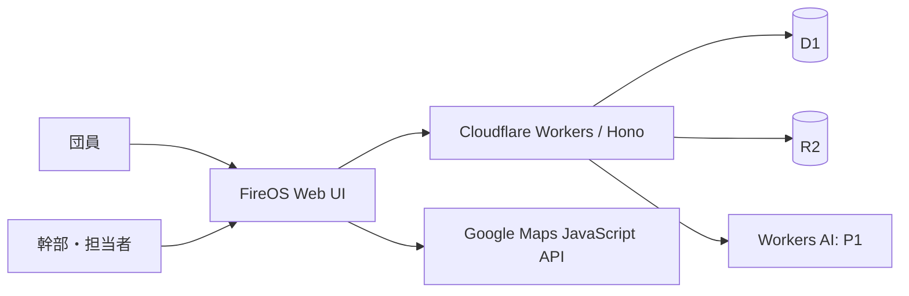

# 00 プロジェクト概要（ドラフト）

| 項目 | 内容 |
|---|---|
| プロジェクト名 | FireOS（仮称） |
| 対象 | 地元消防団の1分団（30名未満） |
| 利用頻度の想定 | 月1〜2回の定例活動＋適宜閲覧・点検・出動履歴記録 |
| 主目的 | 日常活動・団員・出動記録・消防水利・車両・資機材・文書の統合管理 |
| 副目的 | AI/LLM/GIS/Cloudflareの開発力を示すポートフォリオ |
| 状態 | 企画・設計段階、未承認 |

## 1. 解決する問題

- 予定・出欠・活動記録・点検票・車両台帳・消防水利情報が分散しがちである。
- 管理業務と現場の点検記録がつながっていない。
- 自由記述の報告から確認が必要な事項を抽出・振り分ける負荷が高い。
- 出動・訓練・点検の過去履歴を後から追いにくい。

※ これらは仮説。開発対象の分団でヒアリングし、実際の問題か検証する。

## 2. 提供価値

1. **一元管理**: 分団の活動・設備・人員の記録を同じシステム上で追跡できる。
2. **地図から業務を実行**: 消火栓、防火水槽、格納箱の位置、写真、点検履歴、異常対応を結び付ける。
3. **AIによる業務補助**: 報告内容をJevで分類し、LLMが文書下書きを生成する。ただし確定操作には確認を設ける。
4. **低コスト運用**: Cloudflareのマネージドサービスを優先し、個人開発・小規模運用に適合させる。

## 3. 基本方針

- モバイルファースト、PCでも操作可能なWebアプリとする。
- 初期導入は1分団。複数分団対応のための過剰な複雑化は避ける。
- P0（MVP）に「総合管理の基本動線」「Google Mapsの消防水利GIS」「点検・異常報告」「出動イベント記録」を含む。
- P1にJev・LLM、通知、リアルタイム、PWAを段階的に追加する。
- 本番・ステージング・公開デモを分離し、公開デモには架空情報のみを使う。

## 4. ステークホルダーと利用者

| 利用者 | 想定責務 |
|---|---|
| 一般団員 | 出欠回答、予定・水利閲覧、自分の活動確認、点検・異常報告 |
| 点検・活動担当者 | 担当業務の登録、一次確認、対応状況の更新 |
| 分団幹部 | 運営統括、必要な承認、活動実績・出動記録の確認 |
| システム管理者 | 招待、利用停止、権限付与、監査・運用管理 |
| 自治体・関係機関（調整先） | 実運用や管理データ利用の可否・条件の確認先 |

## 5. 成功指標案（事前目標、実績ではない）

- P0の3基本業務フロー（予定→出欠→実績、施設→点検→対応、イベント→参集記録）が完走できる。
- 権限外のデータ閲覧・更新がAPI側で拒否される。
- マーカーと施設一覧・点検履歴に矛盾がない。
- 代表端末で主要画面の操作を利用者が完了できる。
- P1導入前後の報告書作成所要時間とAI分類精度を測定できる。

## 6. やらないこと

- 消防本部の指令システムの代替、119番通報の受付、AIによる指揮命令。
- 実際の消防水利の使用可否をAI判定で自動確定すること。
- 団員の常時位置追跡。
- 許諾のない実団員・実出動・非公開設備データの公開。

## 7. 全体の接続

出動機能は初期段階では **記録・訓練用途** を中心とし、既存の正式な連絡手段を維持する。
