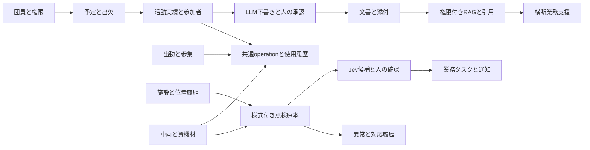

# 01 要件定義書

版：v0.3 / 2026-10-13 / 設計ドラフト・未承認・未実装。正式リリース判定は13、意思決定は14を正本とする。

**設計書の改訂は完了。消防団への実運用の提案・了承は、完成後に確認する。現段階の文書作成/架空データ検証を止める条件にはしない。アプリの実装・試験・正式運用承認とは区別する。**

## 1. 目的・リリース方針

FireOSは消防団の団員・組織・活動・出動・水利GIS・車両・資機材・点検・文書・連絡を共通データ基盤で統合し、Jev分類・LLM下書き・権限付き検索・承認を業務に組み込む。初期利用は単一分団30名未満、定例月1〜2回。スマートフォン優先、PC/タブレット対応。実利用と技術ポートフォリオを両立する。

**正式採用された機能・非機能要件の全件実装・統合・受入・運用承認が初回正式リリース条件。開発フェーズは実装順序のみを表し、後段機能の未完成を許さない。** AI、通知、リアルタイム、オフラインを実装後へ延期してリリースする方針は採らない。技術検証、架空データプレビュー、管理された試験は可能だが正式リリースではない。

v0.2の機能44件＋非機能10件をID・本文・元受入条件ごと保全した。機能41件＋非機能10件を正式リリース必須として扱う。将来構想とID付き対象の両方に書かれたMAP-10/AI-06/AI-07は採用確認待ち（D01）であり、削除も自動承認もしない。本改訂指示がRAG・横断支援を求めることを踏まえ採用を推奨し、実装可能な設計/試験を用意する。**D01未決のまま正式リリース不可。採用決定時は3件とも初回必須に編入し、延期による通過を認めない。**

旧優先度は履歴資料として12に保存し、現行の対象区分には使用しない。IDなしの音声、複数分団運用、公式指令連携、ルート最適化、計画書/連絡文の独立生成機能は参考候補として14で採用範囲を確認し、自動で必須へ昇格しない。

## 2. 境界と確定技術

Cloudflare Workers、React/TypeScript/Vite、Hono、Drizzle、D1、R2、Google Maps JavaScript API、Workers AI、Jev、生成LLM、PWAは今回の指示による採用方針。Better Auth、Queues、Durable Objects、RAGの索引方式・モデルは実装前検証を伴う設計提案（02/06/14）。技術の採用方針と、業務運用/モデル精度の承認を混同しない。

正式指令/119受付/現場指揮の代替、AIによる出動命令・設備使用可否の自動確定、無断の実情報公開、常時GPS追跡、Googleコンテンツの規約外保存は対象外。実災害時の許容用途はD08で確認し、確認不能を理由に必要機能を削除せず用途分離/代替案を判断する。

## 3. 機能要件（現行版）

下表はv0.2原文を出発点とした現行要件で、実装・検証に応じて改訂できる。過去の原文は12の履歴台帳に保存する。更新はREADMEの「docsの更新方針」に従い、具体化した契約03〜11、受入試験08、全件追跡12、実装タスク16も整合させる。PHは順序、必須/採用確認待ちは対象区分。元条件の曖昧さをもって新しい保護条件を免除しない。

### 認証・組織・団員

| ID | 対象 | 開発フェーズ | 要件（現行） | 受入条件（現行） |
|---|---|---|---|---|
| AUTH-01 | 初回必須 | PH1 | 招待制でアカウントを作成し、認証できる | 未ログインでは内部情報を閲覧できない |
| AUTH-02 | 初回必須 | PH1 | 一般団員／担当者／幹部／管理者のロールを管理する | 権限がないAPI更新はサーバー側で拒否される |
| AUTH-03 | 初回必須 | PH1 | 団員の氏名、所属、役職、連絡先等を必要最小限で管理する | 管理者が作成・変更・無効化できる |
| AUTH-04 | 初回必須 | PH1 | 退団・休団等に伴う利用停止を行える | 無効化後に再ログインできない |
| AUTH-05 | 初回必須 | PH1 | 認証強化（多要素認証等）を検討・導入する | 導入方式と復旧手順を文書化する |

### 予定・活動・出欠

| ID | 対象 | 開発フェーズ | 要件（現行） | 受入条件（現行） |
|---|---|---|---|---|
| ACT-01 | 初回必須 | PH3 | 訓練、点検、夜警、行事などの予定を登録・編集する | 件名、日時、場所、担当、状態を保存できる |
| ACT-02 | 初回必須 | PH3 | 団員が参加・不参加・未定を回答できる | 管理者が回答状況を一覧表示できる |
| ACT-03 | 初回必須 | PH3 | 実施後に活動内容、参加者、活動時間を記録する | 予定と実績が関連付いて保存される |
| ACT-04 | 初回必須 | PH3 | 活動履歴を日付、種別、参加者で検索できる | 条件に一致する記録を一覧表示できる |
| ACT-05 | 初回必須 | PH4 | 未回答者への連絡文下書き・確認依頼を支援する | 本人の確認なしに一斉送信しない |
| ACT-06 | 初回必須 | PH4 | 活動実績の集計・帳票出力を行う | 期間別の件数・参加状況を確認できる |

### 消防水利GIS

| ID | 対象 | 開発フェーズ | 要件（現行） | 受入条件（現行） |
|---|---|---|---|---|
| MAP-01 | 初回必須 | PH2 | Google Mapsを地図基盤として表示する | 権限のある利用者が地図を開ける |
| MAP-02 | 初回必須 | PH2 | 各施設を種別別マーカーで表示する | 消火栓／防火水槽／格納箱を識別できる |
| MAP-03 | 初回必須 | PH2 | 地図クリック・緯度経度入力等で施設を登録・修正する | 座標・種別・管理番号を保存できる |
| MAP-04 | 初回必須 | PH2 | 施設一覧、種別、管理番号、点検状態で検索・絞り込みする | 表示結果とマーカーが連動する |
| MAP-05 | 初回必須 | PH2 | マーカーから施設詳細・写真・点検履歴を開く | 対象施設の記録を参照できる |
| MAP-06 | 初回必須 | PH2 | 点検結果・異常報告を施設に紐付ける | 施設詳細に履歴が時系列表示される |
| MAP-07 | 初回必須 | PH2 | 施設の状態を未確認／確認待ち／確認済み等で管理する | 未確認情報が正式な使用可否として表示されない |
| MAP-08 | 初回必須 | PH2 | 施設マスタをCSVで取り込み・書き出す | 必須列検証と重複・誤座標の確認ができる |
| MAP-09 | 初回必須 | PH2 | Googleマップアプリへの経路案内リンクを提供する | 追加Routes APIなしで外部アプリを起動できる |
| MAP-10 | 採用確認待ち D01 | PH5 | 地域単位の点検巡回計画を支援する | 人が確定する計画案として出力される |

### 車両・資機材・点検

| ID | 対象 | 開発フェーズ | 要件（現行） | 受入条件（現行） |
|---|---|---|---|---|
| AST-01 | 初回必須 | PH2 | 車両および資機材の台帳を管理する | 管理番号、名称、保管場所、状態を登録できる |
| AST-02 | 初回必須 | PH2 | 点検記録を対象物に紐付けて保存する | 実施者、日時、結果、写真、コメントが残る |
| AST-03 | 初回必須 | PH2 | 異常・不足・修繕対応を確認待ち／対応中／完了で管理する | 対応履歴と担当者を追跡できる |
| AST-04 | 初回必須 | PH4 | 次回点検予定日と期限超過を検出する | 期限判定は日付ルールで正確に行う |
| AST-05 | 初回必須 | PH3 | 活動・出動で使用した車両・資機材を関連付ける | 使用履歴から元の活動を参照できる |

### 出動・参集

| ID | 対象 | 開発フェーズ | 要件（現行） | 受入条件（現行） |
|---|---|---|---|---|
| DSP-01 | 初回必須 | PH3 | 出動イベント（実績・訓練・模擬）を区別して登録できる | 種別、発生日時、概要、登録者を保存できる |
| DSP-02 | 初回必須 | PH3 | 団員の参集／参加／欠席／未確認等を記録できる | 権限に応じて一覧で把握できる |
| DSP-03 | 初回必須 | PH3 | 出動と使用車両・活動記録を関連付ける | イベント詳細から履歴をたどれる |
| DSP-04 | 初回必須 | PH6 | 参集状況等をリアルタイムに同期する | 複数端末間で更新が反映されることを試験する |
| DSP-05 | 初回必須 | PH6 | 接続断後の入力保留・同期を扱う | 再送重複・更新競合を検知できる |

### 連絡

| ID | 対象 | 開発フェーズ | 要件（現行） | 受入条件（現行） |
|---|---|---|---|---|
| COM-01 | 初回必須 | PH3 | お知らせを作成・閲覧できる | 作成者、公開先、公開日時を記録する |
| COM-02 | 初回必須 | PH4 | 確認依頼・既読・通知を扱う | 対象者と履歴を確認できる |

### 文書・添付

| ID | 対象 | 開発フェーズ | 要件（現行） | 受入条件（現行） |
|---|---|---|---|---|
| DOC-01 | 初回必須 | PH2 | 活動・施設・資機材に写真や文書を添付する | 許可された利用者だけが閲覧できる |
| DOC-02 | 初回必須 | PH4 | 報告書を編集・承認・出力する | AI生成文を人間が修正・承認できる |

### ダッシュボード

| ID | 対象 | 開発フェーズ | 要件（現行） | 受入条件（現行） |
|---|---|---|---|---|
| DASH-01 | 初回必須 | PH3 | 次回予定、未回答数、確認待ち異常、点検状況を表示する | 各数値から該当一覧に遷移できる |
| DASH-02 | 初回必須 | PH4 | 月次・年度別活動集計を表示する | 集計条件と元データを参照できる |

### AI・LLM

| ID | 対象 | 開発フェーズ | 要件（現行） | 受入条件（現行） |
|---|---|---|---|---|
| AI-01 | 初回必須 | PH4 | 点検・異常報告の自由記述をJevで定義済みカテゴリに分類する | 分類結果、モデル版、確認状態を記録できる |
| AI-02 | 初回必須 | PH4 | 報告内容に追加確認が必要かを判定候補として提示する | AI結果だけで設備状態を確定変更しない |
| AI-03 | 初回必須 | PH4 | 活動メモから報告書の下書きを生成する | 不足情報を捏造せず未記載として表示する |
| AI-04 | 初回必須 | PH4 | AIが提案した確認・連絡タスクを担当者が承認できる | 提案→確認→登録の状態遷移がある |
| AI-05 | 初回必須 | PH4 | AIの精度・応答時間・料金を評価できる | 日本語の評価データと評価結果を保存する |
| AI-06 | 採用確認待ち D01 | PH5 | 承認済み資料を出典付きで検索するRAGを提供する | 回答に参照元・確認日時を示す |
| AI-07 | 採用確認待ち D01 | PH5 | 複数領域を横断するAIアシスタントを提供する | 読み取り／書き込み権限を別々に検証する |

## 4. データ・業務の補足要件

- 団員の氏名/所属/役職/連絡先/公開範囲はD02/D03に従い最小化。退団後はログインだけでなく旧セッション/業務アクセスを失効する。
- 予定日時、回答対象者、出欠回答、実開始終了・内容、実参加者、個人時間を別保存する。時刻未入力を予定やAIで補完しない。
- 出動・活動は同一operationsを参照し、使用車両/資機材・参加者へ接続。実績集計はoperation単位とし二重計上を防ぐ。
- 施設は消火栓/防火水槽/格納箱が必須。詰所/車庫/その他への拡張余地を保持する。必須項目は内部ID、種別、番号または識別名、緯度/経度、登録者、更新日時。番号の一意範囲はD19。
- 所在地/目印、写真、管理者、最終確認日、出典/確認状態、備考を扱う。消火栓の型式/口径、防火水槽の容量/構造/取水口、格納箱の収納物/数量/不足は実台帳照合で選ぶ（D06/D09/D15）。未確定項目を正式帳票と呼ばない。
- 座標はWGS84、自ら権限を持つデータをD1に保持。Googleタイル/画像は保存しない。座標改訂時は確認を失効し確認対象版を追跡する。
- 点検原本/様式版/明細、訂正原本、異常の起点点検、手動異常、対応イベント、写真を関連付ける。位置確認/点検結果/対応状態/設備使用可否を別概念にする。
- 帳票は活動実績・版・添付・人の承認と結ぶ。AI候補/確定分類/業務タスク/通知は版と承認操作を追跡し、未承認の正式変更/送信を禁止する。
- お知らせには対象と公開日時、通知には対象者・承認本文版・配送/既読を持つ。既読を参集/安否としない。
- GIS表示範囲/点検状態検索は全ページ取得の完了を表示する。地図障害時は施設の一覧/目印/履歴を利用可能にする。
- 原文の現地確認/台帳由来/未確認を出典と位置確認状態に分離。公開デモは実在の非公開地点・人物・写真を使用しない。

## 5. 非機能要件（原文保全）

| ID | 対象 | 分類 | 初期目標・方針（v0.2原文） | 元検証方法 |
|---|---|---|---|---|
| NFR-01 | 初回必須 | 対応端末 | スマートフォン優先。現行主要ブラウザーとPCに対応 | 実機・ブラウザーテスト |
| NFR-02 | 初回必須 | 使いやすさ | 主要な閲覧・報告を少数操作で完了できる | 団員を想定した操作試験 |
| NFR-03 | 初回必須 | 性能 | 通常APIの応答を概ね2秒以内（p95）に収めることを目標とする。外部地図・AIの応答は別測定 | ステージング環境で計測 |
| NFR-04 | 初回必須 | 可用性 | 実出動に唯一依存しない。Cloudflare・Google障害時の代替連絡手順を保持する | 障害時の運用確認 |
| NFR-05 | 初回必須 | データ整合性 | 点検・出欠・承認処理の重複登録や更新競合を防ぐ | 二重送信・競合テスト |
| NFR-06 | 初回必須 | 回復性 | バックアップ・復元方法を文書化し、実運用前に復元試験を行う | リストア試験 |
| NFR-07 | 初回必須 | 監査性 | 誰がいつ何を変更・承認したか追跡できる | ログの検査 |
| NFR-08 | 初回必須 | 運用費 | 無料枠を基本に月次利用量を監視し、上限超過の前兆を通知する | ダッシュボード・請求確認 |
| NFR-09 | 初回必須 | アクセシビリティ | 色だけに依存せず、地図マーカーにはラベル・一覧代替を設ける | キーボード・視認性テスト |
| NFR-10 | 初回必須 | AI品質 | 日本語の業務表現による評価セットを作り、採用可否を判定する | 再現率、適合率、誤分類例の分析 |

数値目標/代表端末/回線/件数は08の試験条件案で測定しD18で合意する。2秒p95は通常APIの目標で、外部AI/地図を含むSLAではない。NFR-08の無料枠方針は$0保証ではなく、費用上限/負担者はD11。閾値未決・未測定を合格としない。

## 6. 統合業務フロー

RAG/巡回/横断の採用区分はD01。正式採用時はこの統合から外さない。画面遷移・状態遷移・認可・DB/APIの正本を後続文書へ分ける。

## 7. 正式リリース・承認

正式判定は13の全ゲート。全正式採用要件の受入合格、重大問題解消、再送/競合/復元、AI品質、地図/通知/同期/PWAの統合、許諾/体制/費用、デモ分離、阻害未決ゼロを要求する。旧来の一部機能のみの完成判定を廃止する。設計ドラフト作成、PoC成功、テスト計画の存在はアプリ完成の証拠ではない。
