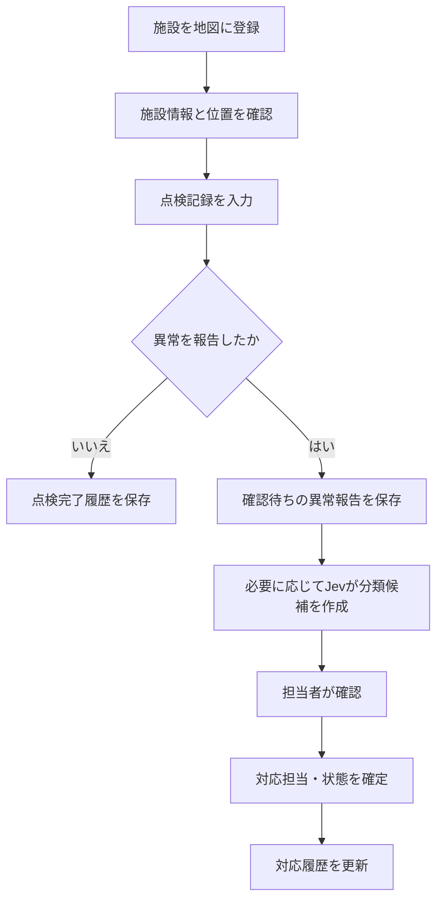
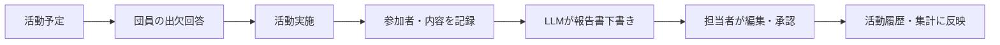
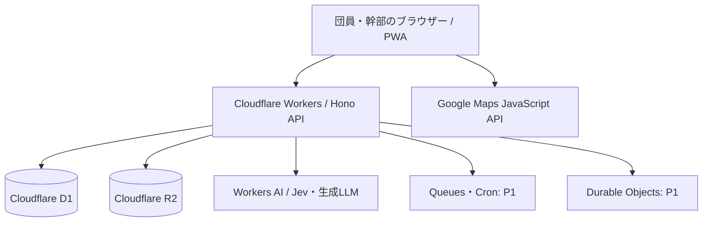

# FireOS 要件定義書

> 消防団向けAI搭載統合管理プラットフォーム  
> **版数:** v0.2（要件定義・検討用ドラフト）  
> **作成日:** 2026年10月13日  
> **想定対象:** 地元の1分団（団員30名未満、定例活動は月1〜2回程度）  
> **インフラ方針:** Cloudflare中心  
> **地図方針:** Google Maps Platform  
> **ステータス:** 未承認・未実装。運用規程、個人情報の取扱い、公式な出動連絡手段などは別途合意が必要。

## 1. 概要

### 1.1 プロダクトの目的

FireOSは、消防団の**日常活動・団員・予定・災害出動・消防水利・資機材・車両・点検・文書・連絡**を一元管理するWebアプリケーションである。情報を記録するだけではなく、業務を横断した情報参照とAIによる支援を実現し、分団運営の事務負担、情報の分散、点検漏れ、活動履歴の追跡困難を減らす。

本プロジェクトは、(1) 地元の消防団で使える実用性と、(2) Web・クラウド・地図・AIの実装力を示すポートフォリオとしての価値を両立することを目標とする。

### 1.2 基本方針

1. **総合管理が中核**：特定機能だけに特化せず、団員・活動・水利・資機材・出動を関連付ける。
2. **地図は業務画面**：消火栓・防火水槽・格納箱を地図に表示するだけでなく、点検や異常報告につなげる。
3. **AIは判断支援**：Jev等で自由記述を分類し、生成LLMで報告書などの下書きを作成する。確定処理はルール・権限・承認で制御する。
4. **小規模・低コスト運用**：団員30名未満、低頻度の定例活動を前提にサーバーレス技術を採用する。
5. **緊急用途は段階的に検証**：初期段階では実出動の唯一の指令・通信手段としない。
6. **ポートフォリオ公開は架空データ**：実団員情報、非公開の水利情報、出動記録、現場写真を公開しない。

### 1.3 想定利用者と利用状況

| 利用者 | 主な業務 |
|---|---|
| 一般団員 | 予定・連絡確認、出欠回答、活動実績閲覧、点検・異常報告、地図閲覧 |
| 班長・担当者 | 担当する活動の管理、点検・資機材の確認、報告内容の一次確認 |
| 分団長・幹部 | 予定・人員・活動・出動の統括、記録承認、運営状況の把握 |
| システム管理者 | アカウント、権限、マスター情報、監査ログ、システム設定 |

- 初期導入単位は**1分団**とする。複数分団・団本部への拡張は将来構想とし、当初から複雑なマルチテナント運用は要求しない。
- 主な利用端末はスマートフォン。管理・帳票作業はPCにも対応する。
- 定例活動は月1〜2回程度だが、地図や連絡の閲覧は活動日以外にも発生しうる。

## 2. 要件の優先度と範囲

| 区分 | 定義 |
|---|---|
| **P0 / MVP** | 初回公開・ポートフォリオの核。基本業務が一連の流れで成立する。 |
| **P1 / 拡張** | MVP後の実用性向上。AI活用の深化・通知・高度な出動共有。 |
| **P2 / 将来** | 現場検証・承認・追加コスト評価の後に検討。 |

### 2.1 P0（MVP）に含める

- ログイン、アカウント管理、ロール別のアクセス制御
- 団員・所属・役職の管理（必要最小限の個人情報）
- 活動予定の作成、出欠回答、活動実績の記録
- **Google Maps上の消火栓・防火水槽・格納箱の登録・検索・表示**
- 施設詳細、写真、点検・異常報告、確認・対応状態の管理
- 車両・資機材の台帳、基本的な点検履歴
- 出動イベントの記録、参集・参加状況の手動登録（**正式指令とは分離**）
- ダッシュボード、簡易集計、監査ログ
- 架空データによるデモ環境と基本テスト

### 2.2 P1（次段階）に含める

- **Jevによる点検・異常報告の分類支援**（評価基準を満たす場合に採用）
- LLMによる活動報告書・連絡文・計画書の下書き生成
- 施設のCSV入出力、履歴検索と管理画面の充実
- 点検期限の通知、確認依頼、未回答者への連絡支援
- 出動状況のリアルタイム共有（主に訓練・試験運用）
- PWA化、限定的なオフライン入力と再接続同期

### 2.3 P2（将来構想）

- 文書RAG（承認済み規程・マニュアルを出典付きで検索）
- 音声入力・音声文字起こし、AI横断アシスタント
- 巡回点検計画・地理空間分析・ルート最適化
- 複数分団対応、既存システムとの公式なデータ連携
- 公式出動通知連携など高信頼機能（関係機関の承認・検証が前提）

### 2.4 初期対象外

- 119番通報の受付、消防本部の指令システムの代替
- AIによる自動出動命令、現場指揮、安全性・使用可否の最終判断
- 未検証の位置情報による隊員の自動派遣・誘導
- 地図の無断スクレイピング、Google Mapsコンテンツの規約外の保存・再配布
- 団員の常時GPS追跡（要件・同意・運用規程がないため対象外）

## 3. 機能要件

### 3.1 認証・組織・団員管理

| ID | 優先 | 要件 | 主な受入条件 |
|---|---|---|---|
| AUTH-01 | P0 | 招待制でアカウントを作成し、認証できる | 未ログインでは内部情報を閲覧できない |
| AUTH-02 | P0 | 一般団員／担当者／幹部／管理者のロールを管理する | 権限がないAPI更新はサーバー側で拒否される |
| AUTH-03 | P0 | 団員の氏名、所属、役職、連絡先等を必要最小限で管理する | 管理者が作成・変更・無効化できる |
| AUTH-04 | P0 | 退団・休団等に伴う利用停止を行える | 無効化後に再ログインできない |
| AUTH-05 | P1 | 認証強化（多要素認証等）を検討・導入する | 導入方式と復旧手順を文書化する |

### 3.2 予定・活動・出欠管理

| ID | 優先 | 要件 | 主な受入条件 |
|---|---|---|---|
| ACT-01 | P0 | 訓練、点検、夜警、行事などの予定を登録・編集する | 件名、日時、場所、担当、状態を保存できる |
| ACT-02 | P0 | 団員が参加・不参加・未定を回答できる | 管理者が回答状況を一覧表示できる |
| ACT-03 | P0 | 実施後に活動内容、参加者、活動時間を記録する | 予定と実績が関連付いて保存される |
| ACT-04 | P0 | 活動履歴を日付、種別、参加者で検索できる | 条件に一致する記録を一覧表示できる |
| ACT-05 | P1 | 未回答者への連絡文下書き・確認依頼を支援する | 本人の確認なしに一斉送信しない |
| ACT-06 | P1 | 活動実績の集計・帳票出力を行う | 期間別の件数・参加状況を確認できる |

### 3.3 消防水利・格納箱GIS（重点機能）

管理対象は、**消火栓、防火水槽、ホース等の格納箱**を必須とする。将来、詰所・車庫等を追加できる分類設計とする。

| ID | 優先 | 要件 | 主な受入条件 |
|---|---|---|---|
| MAP-01 | P0 | Google Mapsを地図基盤として表示する | 権限のある利用者が地図を開ける |
| MAP-02 | P0 | 各施設を種別別マーカーで表示する | 消火栓／防火水槽／格納箱を識別できる |
| MAP-03 | P0 | 地図クリック・緯度経度入力等で施設を登録・修正する | 座標・種別・管理番号を保存できる |
| MAP-04 | P0 | 施設一覧、種別、管理番号、点検状態で検索・絞り込みする | 表示結果とマーカーが連動する |
| MAP-05 | P0 | マーカーから施設詳細・写真・点検履歴を開く | 対象施設の記録を参照できる |
| MAP-06 | P0 | 点検結果・異常報告を施設に紐付ける | 施設詳細に履歴が時系列表示される |
| MAP-07 | P0 | 施設の状態を未確認／確認待ち／確認済み等で管理する | 未確認情報が正式な使用可否として表示されない |
| MAP-08 | P1 | 施設マスタをCSVで取り込み・書き出す | 必須列検証と重複・誤座標の確認ができる |
| MAP-09 | P1 | Googleマップアプリへの経路案内リンクを提供する | 追加Routes APIなしで外部アプリを起動できる |
| MAP-10 | P2 | 地域単位の点検巡回計画を支援する | 人が確定する計画案として出力される |

**施設情報（初期必須／任意）**

- 共通必須：施設ID、施設種別、管理番号または識別名、緯度、経度、登録者、更新日時
- 共通推奨：所在地・目印、写真、管理者、最終確認日、位置情報の出典・確認状態、備考
- 消火栓の任意項目：型式、口径、開閉状態の点検記録
- 防火水槽の任意項目：容量、構造、取水口、蓋等の点検記録
- 格納箱の任意項目：収納資機材、数量、破損・不足情報
- 正式な施設台帳項目は、当該自治体・消防団の既存帳票に照合して確定する。

**位置情報のルール**

- 自分たちが登録・権限を得て利用できる施設座標をD1で管理する。Googleの地図画像や地図タイルそのものは保存しない。
- 初回登録・CSV取込時は現地確認済み／台帳由来／未確認等のデータ品質を明示する。
- 公開ポートフォリオでは、実在施設の非公開情報を使わず架空の地点を使用する。
- 地図と施設台帳を分離し、将来地図ライブラリを変更しても施設座標を引き継げる設計にする。

### 3.4 車両・資機材・点検管理

| ID | 優先 | 要件 | 主な受入条件 |
|---|---|---|---|
| AST-01 | P0 | 車両および資機材の台帳を管理する | 管理番号、名称、保管場所、状態を登録できる |
| AST-02 | P0 | 点検記録を対象物に紐付けて保存する | 実施者、日時、結果、写真、コメントが残る |
| AST-03 | P0 | 異常・不足・修繕対応を確認待ち／対応中／完了で管理する | 対応履歴と担当者を追跡できる |
| AST-04 | P1 | 次回点検予定日と期限超過を検出する | 期限判定は日付ルールで正確に行う |
| AST-05 | P1 | 活動・出動で使用した車両・資機材を関連付ける | 使用履歴から元の活動を参照できる |

### 3.5 出動・参集・活動状況（初期は記録・訓練用途）

| ID | 優先 | 要件 | 主な受入条件 |
|---|---|---|---|
| DSP-01 | P0 | 出動イベント（実績・訓練・模擬）を区別して登録できる | 種別、発生日時、概要、登録者を保存できる |
| DSP-02 | P0 | 団員の参集／参加／欠席／未確認等を記録できる | 権限に応じて一覧で把握できる |
| DSP-03 | P0 | 出動と使用車両・活動記録を関連付ける | イベント詳細から履歴をたどれる |
| DSP-04 | P1 | 参集状況等をリアルタイムに同期する | 複数端末間で更新が反映されることを試験する |
| DSP-05 | P1 | 接続断後の入力保留・同期を扱う | 再送重複・更新競合を検知できる |

**制約：** 当面は、正式な出動指令、緊急通報、現場指揮、安否確認の唯一の手段としない。実運用での活用範囲は消防団・自治体の責任者と決定する。

### 3.6 連絡・文書・ダッシュボード

| ID | 優先 | 要件 | 主な受入条件 |
|---|---|---|---|
| COM-01 | P0 | お知らせを作成・閲覧できる | 作成者、公開先、公開日時を記録する |
| COM-02 | P1 | 確認依頼・既読・通知を扱う | 対象者と履歴を確認できる |
| DOC-01 | P0 | 活動・施設・資機材に写真や文書を添付する | 許可された利用者だけが閲覧できる |
| DOC-02 | P1 | 報告書を編集・承認・出力する | AI生成文を人間が修正・承認できる |
| DASH-01 | P0 | 次回予定、未回答数、確認待ち異常、点検状況を表示する | 各数値から該当一覧に遷移できる |
| DASH-02 | P1 | 月次・年度別活動集計を表示する | 集計条件と元データを参照できる |

### 3.7 AI・Jev・LLM

| ID | 優先 | 要件 | 主な受入条件 |
|---|---|---|---|
| AI-01 | P1 | 点検・異常報告の自由記述をJevで定義済みカテゴリに分類する | 分類結果、モデル版、確認状態を記録できる |
| AI-02 | P1 | 報告内容に追加確認が必要かを判定候補として提示する | AI結果だけで設備状態を確定変更しない |
| AI-03 | P1 | 活動メモから報告書の下書きを生成する | 不足情報を捏造せず未記載として表示する |
| AI-04 | P1 | AIが提案した確認・連絡タスクを担当者が承認できる | 提案→確認→登録の状態遷移がある |
| AI-05 | P1 | AIの精度・応答時間・料金を評価できる | 日本語の評価データと評価結果を保存する |
| AI-06 | P2 | 承認済み資料を出典付きで検索するRAGを提供する | 回答に参照元・確認日時を示す |
| AI-07 | P2 | 複数領域を横断するAIアシスタントを提供する | 読み取り／書き込み権限を別々に検証する |

**AIの処理方針**

1. 点検報告等を保存し、業務ロジックで必須項目・形式を検証する。
2. Jevが定義済みの候補（例：設備異常、周辺障害物、不足、その他）に分類する。
3. 分類結果は**候補**として提示する。スコアや確率を「現実の異常の確率」と誤読させない。
4. 不確かな入力、低信頼な分類、重要な判断は必ず人間による確認へ回す。
5. 更新・通知・確定は、権限チェック、入力検証、担当者の明示的な承認後に実施する。
6. 生成LLMは文章作成・説明に用い、点検期限や権限判定のような決定論的処理は担当させない。

**Jev採用の判定ゲート：** Cloudflareのモデルカタログに`typesafe/jev`が掲載されている。ただし、実運用での採用は日本語の消防団用語を含む評価セットで精度・誤分類・コスト・データ取扱いを確認してから決定する。必要に応じてルールベースや別モデルへ切り替えられる抽象化を設ける。

## 4. 主な業務フロー

### 4.1 施設の登録・点検・異常対応

### 4.2 予定から活動実績・報告書まで

### 4.3 出動イベントの記録

- イベントの登録時には「模擬」「訓練」「実出動記録」を明確に区別する。
- 団員の状況を手動で記録し、出動イベントと活動・車両・資機材を関連付ける。
- 緊急時の実連絡系統は消防団の既存運用を優先する。

## 5. 画面要件・ナビゲーション

| 画面 | 主要表示・操作 | 優先 |
|---|---|---|
| ログイン | 招待ユーザー認証、ログアウト | P0 |
| ホーム | 次回活動、出欠、点検・異常の確認事項 | P0 |
| 消防水利マップ | 消火栓・防火水槽・格納箱マーカー、検索、絞り込み | P0 |
| 施設詳細 | 管理番号、座標、写真、点検履歴、異常報告 | P0 |
| 予定・活動 | カレンダー／一覧、出欠、実績入力 | P0 |
| 出動履歴 | 出動イベント、参加・参集、関連記録 | P0 |
| 車両・資機材 | 台帳、点検、故障・不足 | P0 |
| 団員・組織 | 団員一覧、所属、役職、権限 | P0 |
| お知らせ・文書 | 連絡の閲覧、資料添付、報告書 | P0/P1 |
| AI作業支援 | 分類候補、報告書下書き、承認待ち | P1 |
| 管理者設定 | 招待、マスター管理、ログ、利用状況 | P0 |

UIはモバイルファーストとする。地図では、マーカーを選択→施設詳細→「点検する／異常を報告する」の3操作で主要フローに入れることを目指す。

## 6. 推奨技術スタック（設計方針）

| 領域 | 技術 | 決定状態 |
|---|---|---|
| クラウド基盤 | Cloudflare Workers | **確定** |
| 地図 | Google Maps JavaScript API | **確定** |
| Webフロントエンド | React + TypeScript + Vite | 推奨 |
| UI | Tailwind CSS + shadcn/ui | 推奨 |
| 地図React統合 | `@vis.gl/react-google-maps` | 推奨 |
| API | Hono | 推奨 |
| ORM・スキーマ | Drizzle ORM + Zod | 推奨 |
| RDB | Cloudflare D1（SQLite） | 推奨 |
| 写真・文書 | Cloudflare R2 | 推奨 |
| 認証 | Better Auth（Workers/D1との互換性を実装検証） | 候補 |
| AI推論 | Workers AI / AI Gateway | 推奨 |
| 判定モデル | TypeSafe AI Jev `typesafe/jev` | **評価導入候補** |
| 生成LLM | Workers AI上の選定モデル等 | 未確定 |
| 定期ジョブ | Cron Triggers | P1で採用 |
| バックグラウンド | Queues | 必要時に採用 |
| リアルタイム同期 | Durable Objects | P1で要否判定 |
| PWA | Vite PWA Plugin等 | P1で要否判定 |
| CI/CD | GitHub Actions + Wrangler | 推奨 |
| 監視 | Cloudflare Logs / Analytics等 | 推奨 |

### 6.1 全体構成

- WebとAPIをCloudflare上に集約する。初期は**モノリスに近い単一Workersアプリ**を優先し、運用負荷を抑える。
- 地理情報はD1に緯度・経度として格納する。基本的な範囲検索・一覧表示から始める。
- D1はPostGISの代替ではない。高度な空間演算が必要になった場合のみ外部PostgreSQL + PostGIS等を別途評価する。
- AIモデルはサーバー側からのみ呼び出す。秘密鍵・AI認証情報をクライアントに置かない。

### 6.2 Google Maps利用条件・コスト対策

- Webでの地図表示は**Dynamic Maps**を想定する。
- **2026年10月時点のGoogle公式料金表**ではDynamic Mapsの無料利用枠は**月10,000ロード**、次の料金帯は**1,000ロード当たり7米ドル**である。月の無料枠に収まればこのSKUの表示料金は0ドルだが、利用量は団員数・活動回数だけでは決まらない。
- Maps JavaScript APIを正式運用するには、Google Cloudの請求先設定、APIキー、キー制限が必要である。
- APIキーはHTTPリファラーと利用APIを制限する。予算アラートと利用上限の監視を設定する。**予算アラートのみでは自動課金停止にならない。**
- Places、Geocoding、Routes、Street View等の別SKUは初期では原則使用しない。追加時に料金表を再評価する。
- マップは必要な画面でのみ読み込み、施設データは自前DBの座標として管理する。
- Googleの提供コンテンツの保存・キャッシュ・表示は利用規約に従う。Google地図タイルをオフライン保存する設計は採用しない。
- PWAのオフライン機能は当面「自前の入力データ」の一時保存に限定し、Google地図のオフライン利用を約束しない。

## 7. データ要件

### 7.1 論理エンティティ

| エンティティ | 主な項目・用途 |
|---|---|
| `users` | 認証ユーザー、状態 |
| `members` | 団員プロフィール、役職、所属、公開範囲 |
| `roles` / `member_roles` | ロールと権限 |
| `activities` | 予定・活動実績、種別、日時、場所、状態 |
| `activity_attendance` | 活動への出欠・実参加 |
| `incidents` | 出動イベント、模擬／訓練／実績区分 |
| `incident_participants` | 参集・参加の状態と時刻 |
| `facilities` | 消火栓／防火水槽／格納箱など、位置・管理情報 |
| `facility_inspections` | 施設点検結果、実施者、実施日 |
| `issues` | 異常・不足・修繕依頼、担当、進捗 |
| `vehicles` | 消防車両の台帳 |
| `equipment` | 資機材台帳、保管場所、数量等 |
| `asset_inspections` | 車両・資機材の点検結果 |
| `attachments` | 写真・文書のメタデータとR2キー |
| `announcements` | お知らせ、対象者、公開状態 |
| `ai_evaluations` | AI分類候補、モデル版、レビュー結果 |
| `audit_logs` | 閲覧・変更・承認等の監査履歴（重要操作中心） |

**データ設計規約（初期案）**

- 内部主キーはUUID等で一意に管理し、表示用管理番号と分離する。
- 作成日時、更新日時、操作者、状態を必要に応じて保存する。
- 緯度・経度は測地系・入力方法を統一し、範囲・形式の検証を行う。
- 出動・施設・活動・資機材を関連付ける中間テーブルは必要に応じて追加する。
- 削除可能性、個人情報の保持期間、監査ログ保存期間は団の運用規程に合わせて決定する。

### 7.2 データの正確性と権限

- 施設情報の変更、点検結果の確定、団員の個人情報変更は操作権限を確認する。
- 「報告内容」「AIによる分類候補」「管理者が確認した事実」は異なる状態として保持する。
- 不明値をAIで埋めない。情報に出典・登録者・最終確認日を付与できるようにする。
- 実データ移行前に、データ保有者、利用目的、関係機関からの許諾・指示を確認する。

## 8. 権限・セキュリティ・プライバシー

### 8.1 概略権限マトリクス（案）

| 操作 | 一般団員 | 担当者 | 幹部 | 管理者 |
|---|---|---|---|---|
| 予定・地図の閲覧 | ○ | ○ | ○ | ○ |
| 自分の出欠回答 | ○ | ○ | ○ | ○ |
| 施設点検・異常の報告 | ○ | ○ | ○ | ○ |
| 施設・資機材台帳の確定変更 | × | △（担当範囲） | ○ | ○ |
| 予定・出動イベントの作成 | × | △（担当範囲） | ○ | ○ |
| 重要記録の承認 | × | △（担当範囲） | ○ | ○ |
| 団員・権限の管理 | × | × | △（合意範囲） | ○ |
| 監査ログ・システム設定 | × | × | △（閲覧のみ） | ○ |

※ ○＝原則可、△＝条件付き、×＝不可。実際の権限は分団の役割分担に応じて確定する。**画面表示と独立してAPI側で必ず強制する。**

### 8.2 必須のセキュリティ要件

- 全通信をHTTPSで暗号化し、セッション保護・CSRF対策・入力検証・レート制限を実装する。
- API認可はサーバー側で実施する。ユーザーIDやロールの自己申告値を信用しない。
- R2の添付ファイルは原則非公開とし、認証・認可済みの利用者にだけ期間限定で配信する。
- 地図の施設情報、団員連絡先、写真、出動履歴は公開URLや匿名APIから参照できないようにする。
- 個人情報を含む本文をAIへ送る場合は利用目的、提供先、保存・学習利用条件、アクセスログを確認し、必要最小限・マスキングを原則とする。
- AIログに個人情報や正確な位置情報を無条件で残さない。監査に必要な情報と入力本文の保存を分離する。
- 本番・検証・公開デモ環境を分離し、実データをGitHubリポジトリへコミットしない。
- 重要操作（権限変更、台帳確定、報告承認等）は監査可能な形で記録する。

## 9. 非機能要件

| ID | 分類 | 初期目標・方針 | 検証方法 |
|---|---|---|---|
| NFR-01 | 対応端末 | スマートフォン優先。現行主要ブラウザーとPCに対応 | 実機・ブラウザーテスト |
| NFR-02 | 使いやすさ | 主要な閲覧・報告を少数操作で完了できる | 団員を想定した操作試験 |
| NFR-03 | 性能 | 通常APIの応答を概ね2秒以内（p95）に収めることを目標とする。外部地図・AIの応答は別測定 | ステージング環境で計測 |
| NFR-04 | 可用性 | 実出動に唯一依存しない。Cloudflare・Google障害時の代替連絡手順を保持する | 障害時の運用確認 |
| NFR-05 | データ整合性 | 点検・出欠・承認処理の重複登録や更新競合を防ぐ | 二重送信・競合テスト |
| NFR-06 | 回復性 | バックアップ・復元方法を文書化し、実運用前に復元試験を行う | リストア試験 |
| NFR-07 | 監査性 | 誰がいつ何を変更・承認したか追跡できる | ログの検査 |
| NFR-08 | 運用費 | 無料枠を基本に月次利用量を監視し、上限超過の前兆を通知する | ダッシュボード・請求確認 |
| NFR-09 | アクセシビリティ | 色だけに依存せず、地図マーカーにはラベル・一覧代替を設ける | キーボード・視認性テスト |
| NFR-10 | AI品質 | 日本語の業務表現による評価セットを作り、採用可否を判定する | 再現率、適合率、誤分類例の分析 |

※ 数値性能はSLAの保証ではなく初期目標値であり、対象端末・回線等の試験条件を定義して最終決定する。

## 10. ポートフォリオ要件

- 架空の分団・団員・消火栓・防火水槽・格納箱・点検・出動イベントを用意する。
- 利用者権限が異なる複数のテストアカウントを用意し、アクセス制御をデモできるようにする。
- 「予定登録 → 出欠 → 活動実績」「施設登録 → 点検 → 異常対応」「出動イベント → 参集記録」の3フローをデモ可能にする。
- 画面、ER図、API構成、AI処理、Cloudflareへのデプロイ構成、CI/CDをREADMEで説明する。
- Jev導入後は日本語のテストデータによる分類の評価結果と失敗例、AI承認フローを示す。
- 実運用版のアカウント・URL・データと公開デモを分離する。

## 11. MVP受入基準（完了判定）

MVPの完了は、以下の項目を**すべて**満たすことを条件とする。

- [ ] 招待ユーザーがログインでき、ロール別のAPI認可が動作する。
- [ ] 管理者が団員、活動予定、車両・資機材の基本情報を登録できる。
- [ ] 団員が出欠を回答でき、活動後に実績と参加者を記録できる。
- [ ] Google Maps上に消火栓・防火水槽・格納箱が別種のマーカーで表示される。
- [ ] 地図上で施設を選択し、基本情報と写真・点検履歴を確認できる。
- [ ] 権限のある利用者が施設を登録・修正し、点検・異常を報告できる。
- [ ] 未確認・AI推定・確認済みの状態が混同されない。
- [ ] 出動・訓練イベントを区別して登録し、参加状況を記録できる。
- [ ] 他人の個人情報や非公開添付を権限外のユーザーが取得できない。
- [ ] 重要な更新操作が監査ログで確認できる。
- [ ] 本番とは分離した架空データのポートフォリオ用デモが動く。
- [ ] Google Maps APIキーの制限、請求通知、基本的なバックアップ・復元方法を設定・記録する。

P1のAI機能はMVP完了を妨げない。Jevの精度検証が十分でない場合、分類機能は無効化した状態でリリースできる。

## 12. 開発フェーズと主な成果物

| フェーズ | 内容 | 成果物 |
|---|---|---|
| 0. 要件具体化 | 既存帳票・データ入手可否・権限・利用範囲の確認 | 要件定義確定版、画面一覧、データ項目一覧 |
| 1. 基盤・認証 | Workers/Hono/React、D1、認証、団員・予定 | 動くアプリ基盤、CI/CD |
| 2. GIS・点検 | Google Maps、施設マスタ、写真、点検・異常対応 | 消防水利GIS、点検ワークフロー |
| 3. 総合管理 | 活動実績、車両・資機材、出動イベント、集計 | MVP統合版、権限・監査テスト |
| 4. AI評価・導入 | Jev分類、生成LLM、承認フロー、評価 | AI機能付き拡張版、評価レポート |
| 5. 運用強化 | 通知、リアルタイム、PWA、バックアップ運用 | 限定試験運用版、運用手順書 |

## 13. リスクと対処

| リスク | 対処方針 |
|---|---|
| Google Mapsの有料利用・APIキー不正使用 | キー制限、請求・クォータ監視、別SKUの利用制限 |
| 位置情報の誤り・鮮度低下 | 出典、現地確認状態、最終確認日、更新責任者を明示 |
| AI誤分類・根拠のない生成 | 候補扱い、人間の承認、分類評価、モデル切替え可能な構造 |
| 出動時の通信断・サービス障害 | アプリを唯一の指令・通信手段とせず既存連絡手段を維持 |
| 団員情報・非公開施設情報の漏えい | 認証認可、添付非公開、ログ点検、デモ分離 |
| Cloudflare D1の高度GIS処理の制約 | 初期は緯度経度と基本検索。必要時にPostGISを検討 |
| 開発範囲が広がりすぎる | P0/P1/P2で機能を分割し、GIS＋総合管理の業務フローを先に完成 |
| 実団体に導入できない | 関係機関への事前説明、模擬データによるデモ、段階的な試験運用 |

## 14. 未確定事項・要確認事項

1. **正式な利用主体・承認者**：個人の試作か、分団の公式な業務利用まで目指すか。自治体・消防本部との調整が必要か。
2. **既存帳票・台帳**：活動報告様式、点検票、団員情報、施設台帳の具体的な項目・入力権限。
3. **施設データの入手方法**：地元の消防水利・格納箱の位置情報を誰が保持し、利用許諾を得られるか。
4. **団員情報の管理範囲**：住所、電話番号、緊急連絡先等を保存する必要性と閲覧範囲。
5. **ロールと承認者**：班長・分団長・担当者の責任分界と操作権限。
6. **出動機能の実運用範囲**：実出動は履歴管理のみにするか、参集共有まで許容するか。
7. **AIに送信できるデータ**：利用目的・第三者提供・国外処理・ログ保持などの確認。
8. **帳票・履歴の保持年限**：自治体・分団の規程、退団時の扱い、削除の可否。
9. **災害時オフライン対応**：どのデータを端末に保持してよいか、端末紛失時にどう保護するか。
10. **費用負担者**：Cloudflare、Google Cloud、ドメイン、AI APIの課金先。

## 15. 参考資料（公式・一次情報）

料金・API仕様・利用規約は変更されるため、**2026年10月13日時点の確認情報**として扱い、実装・本番導入前に再確認する。

- Google Maps Platform 料金表（Dynamic Mapsの無料枠・単価）：https://developers.google.com/maps/billing-and-pricing/pricing
- Maps JavaScript API 使用量・請求：https://developers.google.com/maps/documentation/javascript/usage-and-billing
- Maps JavaScript API キー設定：https://developers.google.com/maps/documentation/javascript/get-api-key
- Google Maps JavaScript API 利用ポリシー：https://developers.google.com/maps/documentation/javascript/policies
- Google Maps Advanced Markers：https://developers.google.com/maps/documentation/javascript/advanced-markers/add-marker
- Cloudflare Workers 料金：https://developers.cloudflare.com/workers/platform/pricing/
- Cloudflare D1 制限・FAQ：https://developers.cloudflare.com/d1/reference/faq/
- Cloudflare R2 料金：https://developers.cloudflare.com/r2/pricing/
- Cloudflare Workers AI モデルカタログ（Jev）：https://developers.cloudflare.com/ai/models/typesafe/jev/
- Cloudflare Workers AI 導入：https://developers.cloudflare.com/workers-ai/get-started/workers-wrangler/

---

**文書の位置付け：** 本書は会話から合意できた方針をもとにした要件定義の初稿である。優先度、データ項目、受入条件には実装を前進させるための提案が含まれ、正式な要件確定や所属団体の承認を意味しない。
