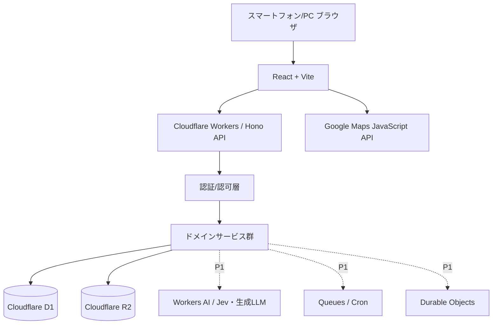
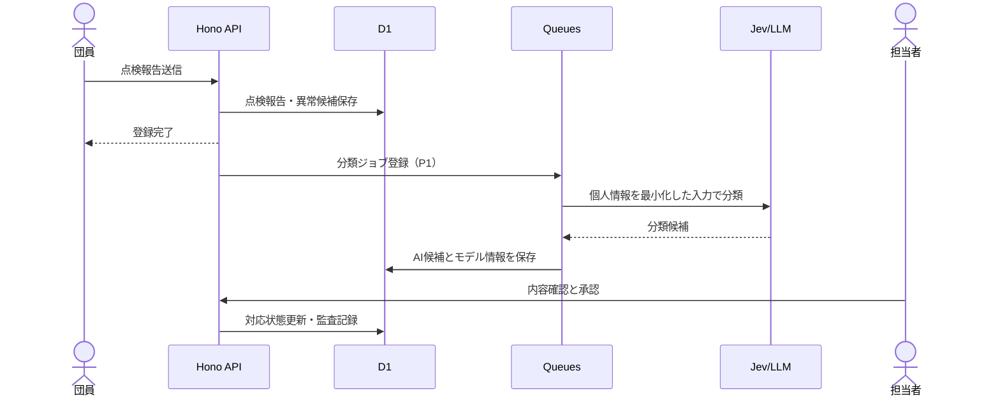

# 02 基本設計書（ドラフト）

## 1. アーキテクチャ方針

初期はフロントエンドとAPIを同じCloudflare基盤に配置する、**単一アプリケーション（モジュラーモノリス）** とする。運用・保守の負担を抑えながら、画面・DB・AIの責務はコード上で分離する。

## 2. 技術構成（案）

| レイヤー | 技術 | 状態・用途 |
|---|---|---|
| クラウド | Cloudflare Workers | 会話上の基本方針として確定 |
| フロント | React / TypeScript / Vite | 推奨。管理画面とGIS |
| UI | Tailwind CSS / shadcn/ui | 推奨。レスポンシブ対応 |
| 地図 | Google Maps JavaScript API | 会話上の採用方針として確定 |
| 地図統合 | @vis.gl/react-google-maps | 推奨 |
| API | Hono / TypeScript / Zod | 推奨。ルーティング・検証 |
| DB | Cloudflare D1 / Drizzle ORM | 推奨。業務データ・施設座標 |
| Object storage | Cloudflare R2 | 推奨。写真・PDF等は非公開 |
| 認証 | Better Auth | 候補。Workers/D1で実証後に確定 |
| AI（P1） | Workers AI / Jev / LLM | Jevは評価通過が導入条件 |
| 非同期（P1） | Queues / Cron Triggers | 通知や期限処理の必要に応じて |
| リアルタイム（P1） | Durable Objects | 出動記録の試験的同期に利用候補 |
| 配布 | Wrangler + GitHub Actions | 環境別のデプロイ・検証 |

## 3. 論理モジュール

| モジュール | 主な責務 | P |
|---|---|---|
| Identity | ログイン・招待・セッション・ロール | P0 |
| Members | 団員、所属、役職 | P0 |
| Activities | 予定、出欠、活動実績 | P0 |
| GIS Facilities | 施設座標、写真、種別・状態検索 | P0 |
| Inspections & Issues | 点検、異常、担当・対応履歴 | P0 |
| Assets | 車両・資機材、点検履歴 | P0 |
| Incidents | 模擬/訓練/実出動の記録、参集 | P0 |
| Documents | お知らせ、非公開添付、帳票下書き | P0/P1 |
| Dashboard | 未回答、次回予定、点検確認事項 | P0 |
| AI Workflow | Jev分類、LLM下書き、承認 | P1 |
| Operations | 監査、課金・エラー監視、復元 | P0 |

## 4. APIの処理原則

1. APIリクエストの認証状態・セッション有効性を確認する。
2. 団員・ロール・対象分団の閲覧/操作権限をサーバー側で評価する。
3. Zodなどで入力を検証する。IDや日時、位置座標を厳密に検証する。
4. サービス層が業務ルールを適用する（例：出欠を本人だけが更新できる）。
5. データ更新と関連監査ログを可能な範囲で同一の整合性単位で保存する。
6. AI提案は別の状態として保存し、正式データへの反映は人間の承認で行う。

## 5. 業務イベント間のつながり

- `activities` は出欠・実績を持ち、必要に応じて施設・車両・資機材の使用履歴に結び付く。
- `facilities` は点検履歴と異常対応、添付ファイルに結び付く。
- `incidents` は参集記録と使用車両、活動実績に結び付く。
- 共通の `audit_logs` は更新・承認・権限変更を追跡する。

## 6. Google Maps実装方針

- 背景地図のみGoogle Mapsを使用し、**施設座標・設備台帳・点検履歴はFireOSが権限を持つデータ**としてD1で保持する。
- 施設データはAPIからGeoJSON相当の独自形式で返し、マーカーを種別・確認状況で表示する。
- 地図と一覧を併置して検索・絞り込み結果を同期する。
- 道路経路計算などの別SKUはP0で使わない。必要ならGoogleマップアプリへの遷移リンクを利用する。
- オフライン地図の提供は約束せず、Google Mapsのコンテンツ保存は利用規約に従う。
- APIキーはHTTPリファラー・API制限をかけ、予算アラートと利用量監視を行う。

## 7. 非同期処理と通知（P1）

**補足**: 非同期AIが失敗しても元の点検報告は消えない。分類失敗時は「未分類・要確認」とし、バックグラウンド再試行には重複防止キーを設ける。

## 8. エラー・障害時

- 外部AIのタイムアウトは、業務記録の保存・閲覧を妨げない。
- Google Mapsが表示できないときは、施設一覧（管理番号・住所/目印・緯度経度）への導線を残す。
- 災害時の正式出動連絡は、アプリ障害があっても既存手段で実施する。
- PWA同期機能を実装する場合、二重送信・競合・端末紛失を想定した設計レビューを実施する。

## 9. 今後の技術検証課題

- Workers + Better Auth + D1のセッション管理および招待制認証
- D1上での施設の表示範囲検索の性能とインデックス設計
- Workers AIでのJev入力・出力形式および日本語分類精度
- R2非公開添付の署名付き取得方式と権限検査
- Google Mapsの使用量・無料枠・キー制限・マーカーの大量描画方式
