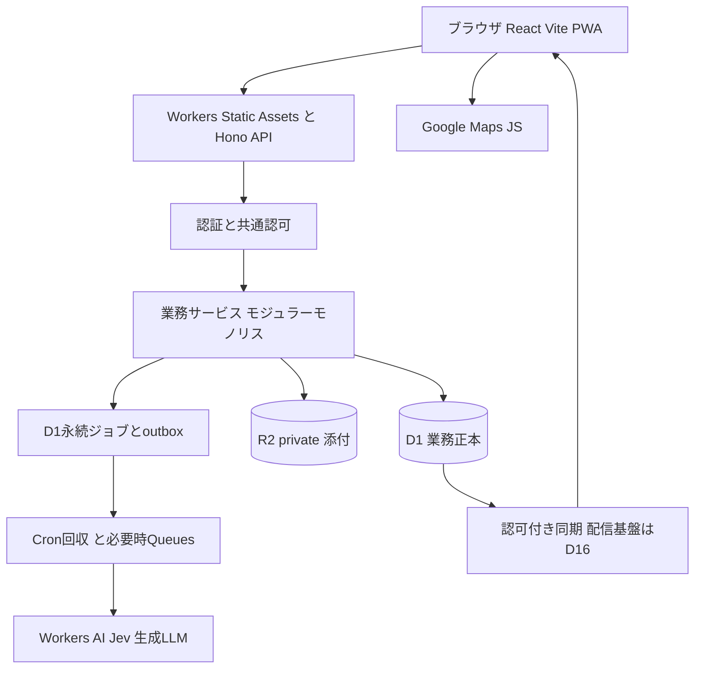

# 02 基本設計書

版：v0.3 / 2026-10-13 / 未承認。PH0（共通基盤）実装・検証済み、業務機能は未実装。配置/処理境界/原子性の正本。全採用要件は初回正式リリース対象、PHは実装順序。

## 1. 配置とモジュール



Identity/Members/Activities/Incidents/GIS/Inspections/Issues/Assets/Documents/Announcements/Notifications/Tasks/AI/RAG/Dashboard/Operationsを同じAPIアプリ内のモジュールとして分離。RAGの索引やDOは派生基盤、D1は業務正本。フロントのPWAは自前下書きの端末キャッシュであり業務正本ではない。複数分団用の独立サービスや汎用workflow engineへ分割しない。

React/TS/Vite、Hono、Drizzle、D1、R2、Google Maps、Workers AI/Jev/LLM/PWAは採用方針。Better AuthはD04、Queues/DO/検索基盤はD16の実証後に固定する。Honoはfetch、scheduled、queue等のWorker handlerを統合できる。[Hono Workers](https://hono.dev/docs/getting-started/cloudflare-workers)

## 2. 配信・環境

単一originで`/app/*`はSPA、`/api/v1/*`は業務JSON、`/api/auth/*`は認証handler。Workers Static AssetsのSPA fallbackはAPI/callbackを優先処理するroutingを明示し、APIへindex.htmlを返さない。public利用規約/Privacyページは認証不要、業務データはAPI認可。[Workers SPA routing](https://developers.cloudflare.com/workers/static-assets/routing/single-page-application/)

local/staging/demo/productionのWorker名、D1/R2/AI/queue/Google key/認証baseURL/Secretを別bindingにする。デモから本番bindingを参照不可にする。Wrangler compatibility_date/flags、依存package/lockfile、認証プラグインを固定し、nodejs_compat等を必要機能に合わせ検証。Node専用ネイティブ処理を無検証で持ち込まない。CPU（特にpassword hashing/画像検査）・メモリを実Workersで計測。

**PH0（T001）で固定した検証値（2026-10-13、実測で変更可）：** `compatibility_date=2026-08-15`＋`nodejs_compat`（wrangler 4.150.0／workerd 1.20260815系）。bindingは`DB`(D1)・`FILES`(R2)・`JOBS_QUEUE`(Queues)・`ASSETS`・`AI`・var`APP_ENV`で、4環境が別名のリソースを持つ（`wrangler.jsonc`の`env.*`は継承されないため各環境に全て記載）。**localにはAI bindingを置かない**（Workers AIは常にCloudflare本体へ接続し、アカウント認証なしでは`wrangler dev`/試験が起動しないため。AIを使うPH4以降はdemo/stagingで検証）。Cronは毎分(UTC)。`run_worker_first=["/api","/api/*"]`（末尾スラッシュなしの/apiもWorkerへ）に加え、Worker側でも`/api/*`をJSON 404で終わらせて二重に守る。D1/R2/Queueの`database_id`等は架空の仮値で、実値はデプロイ時に設定しSecretはファイルへ置かない。試験は`@cloudflare/vitest-plugin`（旧`vitest-pool-workers`は非推奨のため置換、vitest 4系に固定）でworkerd上のD1/Queuesを使う。

CIは設計契約→型/検証→DB/API結合→E2E→migration staging→受入証跡→運用承認→本番deployの順。破壊的列変更はexpand/移行/backfill/照合/contract。戻しはコードrollbackだけでなくDB復元/前方修復、R2保持を設計する。自動で本番テーブルを消して復旧しない。

## 3. リクエスト経路

認証→最新users/members/authz_version→10の行/項目認可→入力検証→11の遷移/版→04のFK/所属/添付ready→以下のD1 mutation→応答。AIを認可や期限判定に使わない。内部job/通知handlerも依頼者/承認者の現在権限と元版を再確認する。

## 4. D1 mutationの原子性（B設計案、実環境検証必須）

D1 batchは文が失敗すれば全体rollback。0行UPDATEはSQL成功であり、batch完了後に検出しても後続履歴を取消せない。Sessions APIは逐次整合性で、対話型トランザクションではない。[D1 Database API](https://developers.cloudflare.com/d1/worker-api/d1-database/)

次のガード方式を設計契約とする。下記は**設計SQL例で、製品コード/検証済migrationではない**。

```sql
-- requestのIdempotency-Keyとは別に毎試行サーバーでattempt_tokenを生成する。
UPDATE issues
SET status = :next, version = version + 1, last_mutation_token = :attempt
WHERE id = :id AND unit_id = :unit AND version = :expected
  AND status = :allowed_previous;
INSERT INTO mutation_assertions(attempt_token, seq, ok)
SELECT :attempt, 1, CASE WHEN EXISTS (
 SELECT 1 FROM issues WHERE id=:id AND unit_id=:unit
 AND version=:expected+1 AND last_mutation_token=:attempt
) THEN 1 ELSE 0 END;
-- ok CHECK(ok=1)なので0件更新時は制約違反。複数の検査(権限版/root/子)は seq=2,3.. で追加する(PKが(attempt_token,seq)のため)。以下は同じbatchに入れる。
-- issue_events、audit_logs、domain_events、jobs、idempotency_recordsの確定応答
DELETE FROM mutation_assertions WHERE attempt_token=:attempt;
```

`mutation_assertions`はok=1のCHECK。INSERT側で必ず一行評価し、CHECK自体にサブクエリを置かない。OR IGNORE/REPLACEを使わない。同じbatchで、認可版のassert→冪等レコードUNIQUEをstate=reservedで予約→前提条件(conditions、書込前の状態で評価)→業務書込→rootのassert、の順に置き、末尾でstate=completed＋応答を保存する。**応答JSONはbatchの中でSQL(`json_object`等のSELECT)が組み立てて保存する**（batchの途中でJS側へ値を戻せないため）。応答を返す最終SELECTは保存済みの`response_json`を読む。認可前提もusers.authz_version/割当版をassertする。複数root/参加者/現在版の条件も個別にassertし、rootだけ成功して子更新0件を許さない。SQL制約エラーは再読込で403/404/409と内部障害を区別し、DB障害を全て409へ偽装しない。版は一致するが状態が操作の宣言する「許可された前の状態」（roots[].allowedStates）に無ければ422 INVALID_TRANSITION、操作が宣言した一意制約（duplicateOn。「表.列」または「index:索引名」。表単位にしないのは、同じ表に分団内一意と全体一意が混在するため）のUNIQUE違反は409 DUPLICATE。全てのassertionは同じ文言で失敗するため、エラー文だけで分類しない（実装の誤りを利用者の誤りに見せない）。宣言外は500（PH0レビューで追加）。[SQLite CHECK](https://www.sqlite.org/lang_createtable.html)

| 操作 | 一つのD1 batchに含める必須書込 |
|---|---|
| 点検 | 冪等/認可guard、series/current pointer/原本/様式参照/明細、任意異常/起点、ready添付リンク、AI jobs、監査/outbox、応答 |
| 異常状態 | root版/遷移guard、状態/担当、issue_events、監査/outbox、応答 |
| 実績/訂正 | 活動/root/現在版guard、実績新revision、実参加、pointer、使用記録の同要求分、監査/outbox、応答 |
| 出動/使用リンク | 出動/活動/operation両版、使用行、参加変更、種別/参集履歴、監査/outbox |
| AI承認 | 元版/権限/提案pending guard、review_decision、確定分類/タスク/通知draft、監査/outbox、応答 |
| 招待消費/権限変更 | invitation/member/users状態guard、リンク/role/authz_version、監査。認証ライブラリ外部処理は07の補償/失効を使用 |

D1・R2・Queues・外部AI/配送は一つのtransactionではない。外部処理の成功後にD1応答が失敗することを前提に、固定operation ID、照合、再実行、孤児回収を設計する。D1内一意制約と冪等が外部課金の完全一回性まで保証するとはしない。

## 5. 永続ジョブ・通知・同期

原本とjobs/outboxを同時保存して202/201を返す。Cronがqueued/retry_wait/期限切れleaseを回収。Queueは配送アクセラレータ候補で、投入失敗後もD1 queuedを回収する。Queueのat-least-once配送で同一jobを再受信してもlease＋dedupe_keyで反映を一回にする。[Queues guarantees](https://developers.cloudflare.com/queues/reference/delivery-guarantees/)

試行設定案：外部timeout 30秒、最大3試行（初回＋再試行2回）、待ち1分/5分、lease 2分、上限後manual_review。値は技術測定で固定（D16）、業務期限を越えて無限再送しない。実行権トークンとlease期限をcommit時も確認し古いworkerの結果を拒否。AI元版更新/権限喪失はstale（終端。docs/11）へ。CronはUTC、期限判定はAsia/Tokyo。

**PH0（T006）の実装値：** Cronは毎分（`* * * * *`）。作業権の取得は`UPDATE ... RETURNING`の1文、結果確定は`status='running' AND lease_token=自分 AND lease_until>現在`の時だけ成功。待機は失敗回数に応じ60秒→300秒、3回目の失敗/3回目の作業権期限切れで`manual_review`。作業権が期限切れになったjobは`retry_wait`（待機付き）へ戻る。Queueのメッセージは`{jobId}`のみで、受信側はD1から実行可能なjobを取って処理する（再配送されても実行済みなら何も起きない）。例外・タイムアウトの本文は保存せず、`error_code`には`timeout`/`handler_error`/`lease_expired`/`unknown_kind`等の短いコードだけを残す。業務更新と同じD1 batchにjob登録を入れるときは`enqueueJobStatement()`を使う。独自のdedupe_keyは必ず`${unitId}|`で始める（満たさなければ例外。別unitとの衝突で登録が黙って抜けるのを防ぐ）。**元版/config版/権限の再検査と外部効果の一回性は各handlerの責務**（runnerはleaseで確定を一回にするだけで、タイムアウト後も処理自体は止められない）。Queue consumerは`max_batch_size=10, max_retries=2`、1回の起動で最大10件を処理。Cronは冪等レコードの期限切れ処理（応答本文を消してexpired。失敗してもジョブ回収は続ける）も行う。バイナリ(kind=binary、API-83)は共通層が本文を読まないため、**ハンドラが大きさ上限とContent-Typeを自分で検査する**（T015）。[Cron](https://developers.cloudflare.com/workers/configuration/cron-triggers/)

通知本文/対象は人が承認しsnapshot保存。配送成功、provider受付、端末表示、既読を区別。リアルタイムはD1 commit後のdomain_eventを認可して配信し、端末は単調な版/sequenceを適用。snapshotとunit連番の同一read batch＋認可filter付き再開cursorで接続間の更新も回収する（05 §8）。非可視イベントの番号飛びを通信欠落としない。保持期間外/認可版変化時はsnapshot APIへ戻る。同期の詳細は07。DO有無は機能有無でなく手段の決定である。

## 6. 障害時

Googleのみ失敗→施設一覧/座標/目印/履歴へ。API停止→既存連絡系統/正式紙台帳等の運用、復旧後の補完（D08/D17）。AI停止→原本保存と手動確認を継続、未処理jobを表示。通信断→ローカル下書き/未同期を明示し再認証後同期。機能障害下の縮退運用と、未完成機能のまま正式リリースすることは別である。
