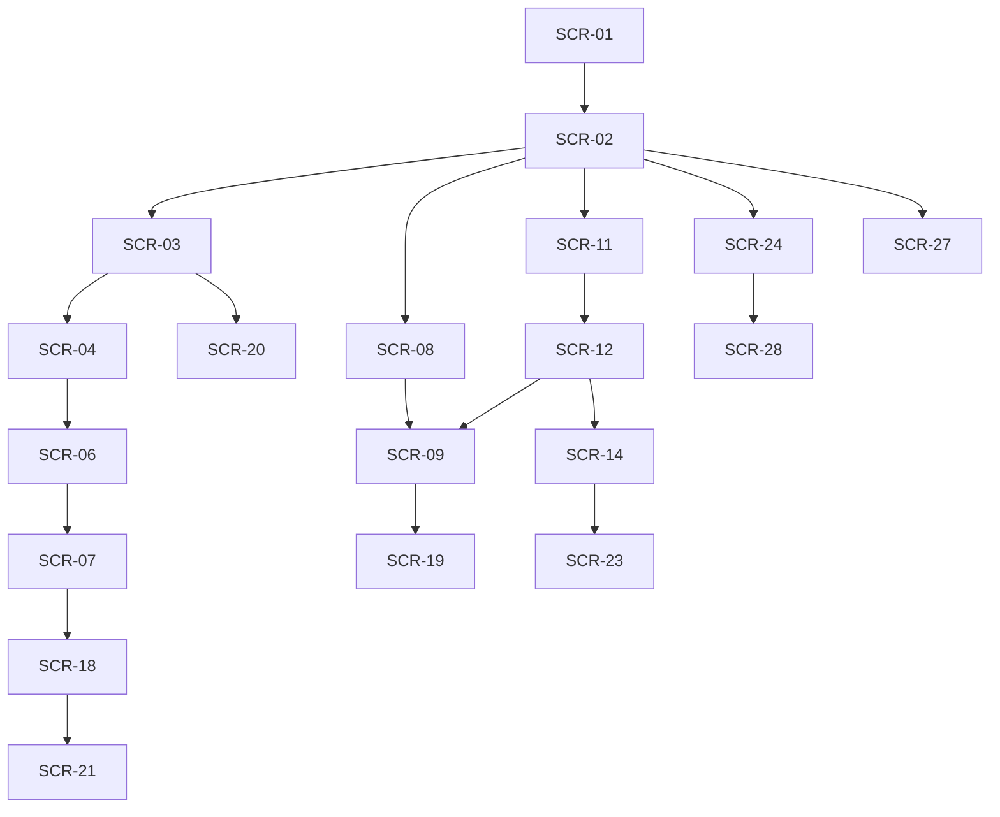

# 03 画面設計・遷移

版：v0.3 / 2026-10-16 / 未承認。シェルと共通UIはPH0、PH1〜PH3の画面（SCR-01〜17・20・22。点検様式はSCR-17のパネル）、PH4のSCR-21（T052）・SCR-18（T055）・SCR-19（T059）・SCR-26（T060）、PH5のSCR-24（T069）・SCR-28（T070）・SCR-25（T071）を実装済み（docs/evidence/ph5.md）。PH6のSCR-27はT077で実装（§1.1-22）。SCR-23は後続PH（資産点検入力と点検訂正UIはT033の残作業。docs/evidence/ph3.md）。画面/操作/表示状態の正本。SCR-01〜19を維持し20〜28を追加。全採用機能を一つのアプリに統合する。

## 1. 全画面共通

**画面構成・導線・見た目・文言の正は `prototype/`（FireOS Prototype / Desktop / Design System）。** docsはprototypeに合わせ、prototypeが示さない業務規則・権限・状態遷移・API・DBを補う。prototypeと食い違う記述はprototypeを優先してdocsを直す（2026-10-13改訂）。モバイルは**ホーム/マップ/予定・活動/AI/メニュー**の5タブ（AIは独立したタブ。ただし書込・送信は必ず人の確認を経る）。通知・文書・AI作業はホームと対象詳細へも接続する。PC/タブレットでは一覧/詳細併置。権限の非表示だけに依存せず10のAPI認可を使用する。

loading/empty/validation_error/network_error/forbidden/conflict/successを区別。通信断時はlocal_draft/pending_sync、202は処理中であり完了ではない。未確認報告・位置確認済・人確認分類・AI推定を別ラベル/日時/確認者で表示する。文字拡大、フォーカス移動、キーボード、スクリーンリーダー、色以外の形/文字を使用。操作量を08で測る。

### 1.1 prototype準拠のシェルと共通UI（正本: prototype/）

**デザイン原則（Design System）：** ①一点だけ光らせる＝1画面に主要アクション（暖色の塗り）は1つ。②色＋形＋文字で伝える＝施設種別・状態は色だけに頼らず形状とラベルを併記。③AIは紫、決めるのは人＝AI由来は常に紫で示し、確定・送信は必ず人の操作。④出動時は世界ごと変える＝出動モードは背景から切り替え、確定は長押し/2回タップ。

**トークン（暗色のみ）：** 背景#08101C・面#101A2B（パネル#0D1626、サイドバー#060C16）・文字#EDF1F7（補助#A9B3C4/#8792A5/#7D889B）・主色Ember#FF5A2E（淡#FF8A66）・OK#3AD08F・注意#FFC35C・異常#FF7A66・AI紫#B9A9FF・現在地青#4F9BFF・出動#FF3B2F（出動背景#0D0709）。フォントはZen Kaku Gothic New（和欧文）＋IBM Plex Mono（数値・管理番号・時刻・英字小見出し）、アイコンはMaterial Symbols Rounded（選択中はFILL 1）。本文の最小14px、補足の最小11px。角丸はpill=99px・カード20〜22px・入力16px・PCナビ12px。罫線はbox-shadowの1px inset（rgba(255,255,255,.07)）。主ボタン56px（pill、1画面1つ）、副ボタン52px、入力54px、下部ナビ84px、PCサイドバー248px・ヘッダー64px・本文余白28/32px・最大幅1440px。施設マーカー: 消火栓=赤#E8432A円、防火水槽=青#2F7FE0丸角四角、格納箱=橙#F08A24ひし形、詰所=緑#2FAE6A六角形。

**スマホ（FireOS Prototype）：** 下部ナビは**ホーム/マップ/予定・活動/AI/メニュー**（高さ84px、選択=アイコンpill橙18%、AIだけ紫18%）。常設ヘッダーは無く、ホームの最上段に「通信状態の札（左）・DEMO・通知（橙の点=未読）」、他の画面は等幅の小見出し（例: 2026 · OCT）＋26px太字の画面名。サブ画面は左上に44pxの丸い戻るボタン（点検登録は×）＋画面名＋右に状態ピル。サブ画面は親のタブを強調（施設→マップ、活動・活動記録→予定・活動）。点検登録は下部ナビなしの全画面フロー。ホームとログインのみ橙の放射状ぼかし。**メニュー**はプロフィールカード（頭文字・氏名・所属・役割ピル）＋2列タイル（団員名簿/車両・資機材/お知らせ/文書・規程/出動履歴/活動分析/設定・通知/使い方ガイド）＋ログアウト。prototypeに入口が無いdocs上の画面（点検管理/巡回計画/AIレビュー/同期の状況/管理）はメニューへ**追加**タイルとして置く（到達できない画面を作らないため）。

**PC（FireOS Desktop）：** 左サイドバー248px＝ロゴ（同心円マーク）＋FireOS＋DEMO／分団カード／**OVERVIEW**（ダッシュボード）・**OPERATIONS**（マップ・水利/予定・出欠/活動記録/点検管理/お知らせ）・**ORGANIZATION**（団員/車両・資機材/文書・規程/活動分析）／最下部に赤枠の**出動管理**と利用者ブロック（頭文字・氏名・班・役割ピル）。**ADMIN**グループ（タスク・通知/巡回計画/AIレビュー/同期の状況/管理）はprototypeに無いため追加。ヘッダー64px＝パンくず（分団/区分: 概要・運用・組織・分析・災害）＋画面名、検索欄（⌘K）、通信状態の札、通知、紫枠の「AIアシスタント」ボタン。本文だけがスクロール（100vh固定）。右側に重ねる要素: AIパネル360px・団員ドロワー440px・リマインドモーダル560px。切替幅はスマホ/PC=1024px（prototypeのPC最小幅1200pxより広くタブレットも扱う）。

**SCR番号の無いシェル画面：** `/app/menu`（メニュー、T005）、`/app/help`（使い方ガイド、内容はT086）。

**prototype画面 → SCR対応と主な仕様：**

| prototype | SCR | 主な仕様（prototypeの内容） |
|---|---|---|
| ログイン | 01 | 団員ID/パスワード/ログイン/生体認証でログイン、DEMO注記、「パスワードを忘れた場合は分団の管理者へ」 |
| ホーム/ダッシュボード | 02 | 次回予定ダイヤル（参加/未定/未回答の円）、出欠クイック回答、やること（横スクロールカード）、お知らせ（重要=赤札/連絡）、AIバー。PCはKPI4枚・要対応（AIが優先度順）・今後の予定・担当区域ミニマップ・月別活動件数 |
| マップ | 03 | 検索＋地図/一覧切替、種別チップ（件数）、現在地、選択シート（状態/最終点検/次回期限、点検する/詳細/経路）。PCは右420px施設一覧/詳細＋凡例 |
| 施設詳細 | 04 | 写真、種別/状態ピル、異常報告枠、管理番号/規格/最終点検/次回期限、点検履歴、固定CTA「この施設を点検する」 |
| 点検登録 | 06 | 3ステップ（チェック→写真・メモ→確認）、項目ごとに良好/異常あり、AI分類候補（JEV・緊急度・根拠・確度、最終判断は人）、「班長への確認タスクを作成」、オフライン時は端末保存→自動送信 |
| 予定・活動 | 08 | 週ストリップ7日＋月別グループ（日付/種別/時刻/題/出欠ピル）。PCは左300px＋詳細 |
| 活動詳細 | 09 | 種別/状態ピル、日時/場所/持ち物、あなたの出欠（参加/未定/不参加）、参加状況チップ、過去の活動は「AI報告書」（紫） |
| 活動記録 | 19 | 下書き→確認待ち→承認の3段階、不足欄のAI指摘、下書き保存/班長に確認を依頼。PCは左360px一覧＋承認 |
| AIアシスタント | 28 | 「団員権限で参照」、提案チップ、思考ステップ、準備状況ブリーフ、タスク下書き（確認して作成/破棄）、連絡文下書き（全体送信は班長以上、班長に送信を依頼） |
| 団員（PC） | 15 | 班/資格フィルタ付き一覧、団員ドロワー440px、未回答者へのリマインド（モーダル560px） |
| 出動モード | 11/12 | 赤テーマ。要請カード、状態ボード4、応答の長押し、進捗ステップ、「現場の指揮は団長・消防署の指示に従う」を常時表示、訓練想定=DEMO |
| 点検管理/車両・資機材/文書・規程/活動分析/お知らせ（PC） | 07/13/24/26/16 | prototypeでは予告ページ（実装は完成版で作成） |

**prototypeから意図して変えた点（理由つき）：**
1. 「同期済み 19:48」→「オンライン/オフライン」。同期はPH6で実装するまで実際に同期していないため、完了を示す表示は出さない。
2. 「PHASE 2/3」「P2/P3」のタグは表示しない。フェーズは作業順でリリース境界ではない（README）。
3. 分団名・氏名・班名は架空（架空市消防団 第一分団、架空 団員）。実在団体名を載せない。
4. 検索欄・分団切替・ログアウト・AIパネルは見た目を先に置き、機能が入るまで無効表示（押しても何も起きない状態を作らない）。サイドバーの件数バッジ（マップ=異常件数、活動記録=承認待ち）と通知の未読の点は、件数データの接続時（PH2〜4）に表示する。
5. アクセシビリティの追加：フォーカスリング（prototypeはoutline:none）、スキップリンク、h1、44px以上の押下領域。
6. マップのシート3列・PC詳細4項目（状態/最終点検/次回期限）と状態バッジ・凡例は、点検期限・異常状態のデータ接続まで代替表示（上のSCR-03段落④⑤。施設の点検期限はAPIが未実装のため後続で接続。資産の点検期限はT048で接続＝SCR-14）。
7. PH2画面（点検登録・施設詳細・異常・資産）の保存成功はトースト（docs/03 §1.1の共通規則を各画面へ適用）。CSV取込の確定成功のみ、結果（取込件数と行エラー）を同じ画面の成功Bannerで示す（遷移しないため）。異常の定型操作（確認する/対応開始/対応実施）は理由入力なしで実行（理由必須の操作だけダイアログ）。異常の「対応実施→対応中への戻し」は画面からは提供しない（docs/11の許可辺では可能。必要になった時に追加）。
8. CSV書き出しは取込画面から「現在の台帳を書き出す（CSV）」（検索条件UIが無いため全件。docs/05 API-55の FacilityQuery を使った絞り込み書き出しは後続で検討）。
9. 予定・活動（PH3 T039）の画面：①一覧の出欠ピル（「出欠 未回答/回答済み」）はAPI-05の応答に出欠が含まれないため開催状態のピル（下書き/予定/進行中/終了/中止）で代用し、回答状態は詳細画面で示す。②PC（Desktop prototype）の左300px一覧＋右詳細の併置は作らず、一覧→詳細（SCR-09）の遷移にする（検索条件をURLクエリにもち、ホームT047からのドリルダウン`?from=&to=&memberId=&actual=`を同じURLで受ける。一覧の凡例扱いだった「実参加の記録がある」チェックはAPI-05のactual検索として動く。日付入力はその日の0時／翌0時の半開区間へ変換）。③スマホ詳細の参加者チップ（色の点のみ）は「色＋文字」のため回答の語を併記した行にし、幹部は同じ行で回答日時の表示と代理回答（未回答/参加/未定で絞れる。prototype Desktopのタブと表に相当）をできるようにした。④予定の登録フォーム（SCR-10。prototypeは「次のラウンドで作成」扱い）と実績フォームは共通部品で構成（施設の登録・編集と同じ流儀）。実績の参加者は対象者ごとに「未確認/実参加/欠席」を選び、未確認は行を送らない。訂正は現行版の参加者全員を初期値に載せて全集合を送る（API-42は全置換）。⑤詳細の情報カードの「持ち物」行は契約に無い列のため出さない（日時/場所/担当/回答締切）。⑥開催状態の操作（公開/開催する/終了する/中止）を詳細に置く（prototypeは状態操作を持たない。docs/11の許可辺のみ。公開だけ理由不要で、公開済みの状態変更と中止は理由必須の確認）。⑦過去の活動の「AIで活動記録の下書きを作成」のCTAはT059（活動記録）で接続するため出さない。使用資産の導線はT044で実装済み（詳細からResourceUsageEditorで編集し、資産履歴から「元の出動記録に戻る/元の活動に戻る」で辿れる）。**報告書の導線はT059で接続済み**（実績のある活動に「報告書」セクションを出し、帳票が無いときは幹部に「報告書を作る」（`/app/reports?activity=`）を、有るときは紫の「AI報告書を開く」行を出す。prototype語彙「AI報告書」）。⑧予定編集は詳細からの別入口（`/app/activities/:id/edit`。screens.tsのaliases。SCR-10の`/app/activities/new`と同じフォーム。⑪お知らせの別入口と同じ方式）。
10. 出動（PH3 T044）の画面：①一覧・登録・詳細（SCR-11/22/12）はprototypeに出動モードのデモとメニューの「出動履歴」タイルしか無いため共通部品で構成（CSV取込と同じ扱い）。出動モードの赤テーマの語彙と注記（「現場の指揮は団長・消防署の指示に従ってください。本アプリは応答と記録の共有のための補助です。」docs/14 D08）を一覧・登録・詳細の全画面で常時表示し、**この記録は正式な指令ではない**ことを示す（SCR-22「出動指令文として自動送信しない」も同じ文面で明示）。②種別（模擬/訓練/実出動記録）は色＋文字の大きな選択で区別し、状態（記録中/出動中/終了/無効）は別ピル（docs/11 出動イベント。遷移は許可辺のみ、全変更で理由必須の確認ダイアログ。voidedは終端で操作を出さない=参集・使用履歴・リンクの編集も非表示）。③参集・帰還は「参集中/参集済/帰還記録/出動不可」の固定語彙（docs/11:34）で記録し、時刻は3つとも任意（空欄は既存値維持＝未知を捏造しない。帰還のみの事後記録で到着時刻は空のまま）。代理記録の入力も出すが、担当(scope)が無ければサーバーが403で返す（画面は案内を出す。T039と同じ流儀）。④活動詳細（SCR-09）からの相互導線は`/app/incidents?activity=`の一覧絞り込み（API-21にactivityIdの絞り込みが無いため全ページを読んでからクライアントで絞る。上限40ページで打ち切った場合はその旨を表示）。⑤資産詳細（SCR-14）から元の記録へは出動/活動詳細からの遷移に`?from=`を付け、資産側の「元の出動記録に戻る/元の活動に戻る」で戻る（operationIdから元記録を逆引きするAPIが無いため。/app配下の経路だけを受け付ける）。⑥API-07/API-70の応答に`operationVersion`を、API-07に`resourceUsages`を追加した（使用履歴の全集合PUT（API-57）とリンク（API-71）が出来事rootの版でガードするため、画面は読み取り時に現行版と行を取得できる必要がある。docs/05に記載しOpenAPIを再生成）。⑦登録フォーム（SCR-22）の「関連活動」は作成時リンク（API-22のactivityId。既に別出動へリンク済みの活動は409の案内）、詳細画面からも既存活動を検索してAPI-71でリンク（両root＋双方のoperation版を送り、競合は409の案内）。
11. お知らせ（PH3 T046）の画面：①API-24/25/72の応答`Announcement`に`createdByMemberId`（作成者。users→membersを解決）・`readAt`（**この要求の本人**による現行版の既読日時。未読null。旧版の既読は含めない＝改版で未確認に戻る）・`attachments`（リンク中の添付id/linkId/linkVersion/status/contentType。API-101の解除に画面が使う）を追加した（作成者・本人既読・添付の表示に必要。docs/05に記載しOpenAPIを再生成。単一件のGET契約は無いため画面はAPI-24の一覧をページ送りで探し、20ページで打ち切る）。②**publishedは対象者だけが一覧に現れる**（T045の設計のまま。変更しない）。対象外のPER-03保持者は、自分が作った公開済でも対象外なら一覧から開けない（単一件GETも無い）。作成者は対象に自分を入れる運用とし、管理視点の一覧取得（query パラメータ追加）は契約変更になるため作らない（必要になった時に追加）。③旧版の本文と閲覧履歴（だれがいつ既読）は取得契約が無いため表示しない（announcement_revisions/announcement_readsの読み取りAPIは無い）。対象者ごとの既読/未既読の管理表示（既読件数）も既存契約に無いため出さない（件数を黙って切り捨てない。本人の既読だけを表示。docs/11「既読を参加/配送完了と混同しない」）。④添付は作成フォームからは追加できない（API-25にattachmentDraftIdが無い）。保存後の詳細画面からAttachmentUploader（API-26。添付の検査jobがannouncementへ直リンクするようATTACHMENT_TARGET_TABLES/LINK_ENTITY_TABLESにannouncementを追加。既存のfacility等と同じ存在条件）で追加し、解除は理由必須のAPI-101（外した添付は対象者にも即座に見えなくなる。リンクの記録と理由は残る）。⑤公開はAPI-72（status: published。理由欄は契約に無いため確認のみ）で、必ず「公開先（N人）」と対象者名を示す確認ダイアログを挟む。終了（published→archived）も確認ダイアログ（archivedは終端）。⑥通知依頼の導線は無効表示（「通知機能（後のフェーズ）で接続」の案内。PH4の通知タスクで接続）。⑦一覧・詳細・作成/編集を単一SCR-16の別入口（`/app/announcements`、`/new`、`/:id`、`/:id/edit`。screens.tsのaliases）として登録した（docs/03 §2のSCR-16は作成/閲覧を含む1画面。SCR番号は28のまま増やさない）。
12. ホーム（PH3 T047）の画面：①指標の条件（docs/03/05に語彙が無い部分の決定。docs/05 API-28行に記載）：**次回予定**＝これからの予定（status=scheduled、開始>=現在。API-05のfrom包含の半開区間）の件数＋最接近の1件（安定順 planned_starts_at,id の先頭）、**本人未回答**＝自分が対象snapshotに含まれ出欠の回答（unanswered以外の行）が無い、これからの予定（T036の方式。API-05に`unanswered=true`を追加。docs/05 API-05行に記載しOpenAPIを再生成）、**確認待ち異常**＝`issues.status='reported'`（docs/03 SCR-07「未確認（確認待ち）」の語彙。確認中/対応中/対応実施/確認終了は含めない）、**点検期限・通知・自分のタスク**は未接続（点検期限=inspection_schedulesはT048、通知・タスク=API-67/68はPH4）で`connected=false`を返し、画面は「0件」ではなく「未接続」と出す（docs/16 T047「0件と未実装を混同しない」）。periodはDASH-02（PH4）用の予約で値を受けない（指定は400。黙って無視しない）。②**数値と一覧件数の一致はサーバー側で作る**: 活動の2指標は活動一覧（API-05）と同じ`activityConditions`（src/server/activities/query.ts）、異常はAPI-15と同じunit＋status条件で数え、hrefに同じfilterクエリを載せる。試験（tests/dashboard.test.ts）がhrefの一覧APIを最後のページまで読んで件数一致・別分団の件数非漏えい（hiddenDataContributed=false）を確認する。③ダイヤルの押下先は活動詳細ではなく**「これからの予定」の一覧**（DASH-01「各数値から該当一覧に遷移できる」と数値＝一覧件数を保つため。詳細は一覧の行から開く）。円グラフは回答内訳（参加=橙・未定=黄・未回答=灰。prototypeの色）。④出欠クイック回答（prototypeの「参加する/ほかの回答」ボタン）はホームからは保存せず、活動詳細（SCR-09）の本人出欠への「回答する/変更」ボタンにした（締切検査・取り下げ・代理の回答はSCR-09の実装に集約し、ホームの指標と回答状態の不整合を作らない）。⑤prototypeの「やること」カードは業務タスク（PH4）のため、同じ横スクロールカードの見た目で指標タイル（本人未回答/確認待ちの異常/点検期限/通知/自分のタスク）を置いた。⑥お知らせ欄は自分が対象の公開済みを新しい順に最大3件（readAtで未読/既読ピル。一覧はSCR-16へ）。prototypeの「重要/連絡」ラベルは契約に区分が無いため出さない。⑦PC（Desktop prototype）のKPI4枚のうち「水利点検の実施率」「あなたの承認待ち」「月別の活動件数」「担当区域マップ」はデータ未接続（点検実績=T048以降、承認=T059、集計=DASH-02、マップの状態表示=T048）のため出さず、接続済みの指標タイル・ダイヤル・お知らせで構成した。⑧スマホに画面名「ホーム」の見出し（h2）と挨拶を別行で残す（prototypeのホームには画面名が無いが、シェルの共通見出し・スクリーンリーダーの整合のため）。⑨最下部のAIバーはPH5（SCR-28）への入口として配置（押すと未実装の案内画面へ遷移する。押しても何も起きない状態を作らない）。
13. 資産（PH4 T048）の画面：①一覧（SCR-13）は`?due=overdue`をURLフィルタとして受け、点検期限が超過した現役資産だけに絞る（ホームの「点検期限」タイル＝API-28 inspectionDueからのドリルダウン。絞り込み中は「点検期限を超過した資産だけ表示中」チップ＋解除を出す。ActivitiesPage T039のURLフィルタと同じ流儀）。②詳細（SCR-14）の点検履歴カードに「次回点検期限」の行を追加（API-51のinspectionDue。超過は「期限超過」ピル、未設定は「未設定」。prototypeに専用指定が無いため共通部品・既存トークンで行表示）。③編集フォームの状態候補はdocs/11 §2の列挙（運用/在庫/修繕中/廃止）のみにした（T048でサーバーがAPI-48/50の未知値を400にするため。旧データで列挙外の値のまま変更しない場合は保存に影響しない）。
14. タスク・通知（PH4 T052）の画面：**prototypeにSCR-21専用の画面が無いため共通部品で構成**（CSV取込SCR-20と同じ扱い）し、語彙（未読/既読・下書き・取消・履歴）と行の見た目はprototypeホームのお知らせ欄・タスクカードに合わせた。①一覧（/app/tasks-notifications）は通知／タスクの2タブ（URLクエリ`?tab=`。スマホのメニュータイル「設定・通知」とPCサイドバーADMIN「タスク・通知」、ホーム最上段の通知・ホーム指標タイルの両方から入る）。**通知タブ**は自分宛の通知（API-67。行は本文・未読/既読ピル・配送状態ピル）＋「未読のみ」の絞り込み（`?unread=true`＝ホームの通知指標と同じ条件で、指標の件数と一覧の件数が一致する。API-28行）＋PER-12保持者（幹部・管理者）の「通知を作成」。**タスクタブ**は自分の担当タスク（API-102。`?status=done`で完了済み）で、行ごとに状態ピル（未着手/担当済み/着手中/完了/中止）・期限・履歴（details。API-102のevents）と操作（**着手/完了は確認なしで定型理由「着手しました/完了しました」を送る（API-87は理由必須のため。docs/03 SCR-07の流儀）、再開（done→in_progress）だけ理由必須の確認ダイアログ、担当変更はPER-04/10保持者に表示**（担当scopeの保持者は画面からは判定できないためサーバーが拒否する。お知らせのcanManageと同じ注記））。②**通知の作成は一方向の流れ**: 源の選択（未回答者抽出=これからの予定／お知らせ）→本文・対象の編集（対象は源からの提案。activityは画面が対象snapshot−回答ありで先に数える案内値で、作成時にサーバーが取り直す）→下書きを作成（API-63）→**承認前確認**（本文・対象者N人・channels。対象の変更は新しい下書きになる旨の注記）→**承認**（API-64 approve。送信確認ダイアログで本文・対象・人数を明示。202=配送jobの受付で完了ではないため「処理中」表示）または**取消**（API-64 cancel。取消済みは「あらためて作成」）→**配送結果**（API-65のrecipients。**受付済み/失敗/到達不明/取消/送信待ちと既読を別の行で表示**（docs/11「受付≠到達≠既読」。承認だけで到達したとは表示しない）。到達不明は「結果を確認」で対象者と対処（無条件再送しない・対象者に直接確認）を開く。承認・配送中と、終端でも既読が全員に達するまでは2.5秒ごとに読み直す）。**未送分の取消**（API-64 cancel_unsent。T052で拡張）は「未送分を取り消す（N人）」の確認ダイアログで対象を明示してから行い、送った分は戻らない旨を出す。③**対象者は自分宛通知の既読**（詳細で「内容を確認」の明示操作。API-100。409のときは最新版を読み直して1回だけやり直す。お知らせT046と同じ流儀）。詳細はAPI-65が呼び出し者で投影を変えるため、送信者には配送結果を、対象者には本文と既読操作を出し分ける。④**到達不明（unknown）の試験/デモ用の規約**: 実チャネル（Web Push/email）はD13未了承で未実装のため、「providerで宛先が解決できず送受の成否が不明になる」状態を実データで再現できない。そこで通知draft作成（API-63）に限り、**対象団員の班（squad）が「連絡先未登録」のとき宛先参照を内部試験値`unknown:<memberId>#inbox`にし**（member_private_profiles由来の実連絡先ではない。Secretは無い）、inapp provider（src/server/notifications/provider.ts）は`unknown:`接頭辞の宛先だけ結果unknownを返す。班が通常値なら通常の参照で本番のinapp（内部成立）挙動は変わらない（規約はdraft作成時の班値で固定される）。⑤点検期限（inspection_due）の源は**選択肢に出さない**: 検出行（inspection_due_detections）の一覧を読むAPIが無く、源のIDを画面が得られないため（到達できない操作を作らない。サーバー側のdraft作成はAPI-63で実装済み。検出行一覧のAPI追加時に選択肢へ加える）。⑥承認せずに離れた下書きは、送信者の一覧を読むAPIが無いため作成 flow に戻れない（未承認のまま配送されず対象者にも見えない。入力途中の離脱はLeaveConfirmで確認する。送信者一覧のAPI追加は後続で検討）。⑦ホーム（SCR-02）最上段の通知・指標タイル「通知」「自分のタスク」はT052で接続（connected=true。hrefはそれぞれ`/app/tasks-notifications?tab=notifications&unread=true`と`?tab=tasks`。docs/05 API-28行）。お知らせ詳細（SCR-16）と活動詳細（SCR-09）には「通知を作成」への導線（`?source=&id=`で源を事前選択）を出す。⑧**e2e（tests/e2e/notifications.spec.ts）では、承認後の配送jobの回収を開発用トリガ`GET /cdn-cgi/local/scheduled`で明示的に走らせる**: 本番は毎分のCron（handleScheduled→runDueJobs）が回収するが、ローカルのwrangler devはCronを自動発火しない（webServer起動時の警告どおり）。トリガは本番と同じCron経路を走らせるだけで、本番の挙動は変えない。⑨**通知の操作の失敗は必ず表示する**: 下書き作成・承認・取消・未送分取消・本人既読の結果は成功（saved/processing）だけでなく**失敗（409競合・422・権限・通信断）もMutationStatusの既存語彙でそのまま通す**（潰してidleにすると、ダイアログが開いたまま無反応になり成功と失敗の区別が付かない。docs/03 §1「conflictを区別」。失敗時はダイアログが開いたまま案内が出る。PH4レビューC 中2）。**「下書き」のチップは中立**（人が作る通知の状態を紫にしない。紫=AI由来だけ＝Design System原則③。AI候補の紫〔PROPOSAL_STATUS.pending〕は変えない。PH4レビューC 低2）。

15. AIレビュー（PH4 T055）の画面：**prototypeにSCR-18専用の画面が無いため共通部品で構成**（タスク・通知SCR-21と同じ扱い）し、候補欄の見た目と語彙（紫枠＋「AIによる分類候補」＋JEV印、AI由来は紫で確定は人の操作）はprototype点検登録の候補欄に合わせた。①一覧（`/app/ai/reviews`）は候補（API-30）の状態絞り込み（`?status=`）＋行（状態ピル〔承認待ち/承認済み/修正承認済み/却下/要再確認〕・源と元の版・代表分類・日時）。源（異常）ごとのレビューパネル（`?source=issue:<id>`）で分類を依頼（API-29）でき、処理中は受付応答のjob（202）をAPI-86で2.5秒ごとに読み直す（通知の配送結果と同じ流儀）。保留（manual_review/stale/時間切れ）は「保留（AIだけで決めない）」の語彙で理由（error_codeの日本語）を出し、成功を偽装しない（docs/03 §1「202は処理中であり完了ではない」）。②詳細（`/:id`。候補の単一件GET契約が無いため一覧を上限20ページで探す。お知らせT046と同じ流儀）は原文（issue源はAPI-15の本文）・元の版と現行版・AI候補（代表分類・確率の内訳・保留度＝Jevのnoul〔「正答の確率ではない」注記つき〕・複数異常フラグ）・モデル/実モデル版/質問版/tokens・**確定予定値**（承認後の確定分類と作られるタスク（題名/担当/期限）を「（予定）」として承認前に表示。未承認案は確定済み分類・正式タスクのようには見せない）・現権限（幹部・管理者と担当scopeの案内。判定そのものはサーバーが毎要求行う）を出す。③**stale（元の記録の更新）は表示時に候補のsource_versionと源の現行版を比較**して「元の記録が更新されています」を出し、承認・却下を無効化する（強制承認の抜け道は無い。**再生成はAPI-29を現行版で再依頼**し、旧候補はstale表示のまま残す＝docs/11「staleは再生成/再レビュー、旧決定書換なし」。ai_evaluations側のstale遷移は未実装のため、画面の比較＋承認時のサーバー検査409（T054）の二段構え）。④承認は「候補どおり承認」（approve）/「修正して承認」（approve_with_edit）を確認ダイアログ（確定予定値の明示付き）で行い、却下は理由必須。タスクは承認効果として作る（confirmedPayload.task。題名・担当・期限は人が変えられる。既定の担当は自分）。**承認要求に無い効果は作らない**（この源の種別は通知源の契約対象外のため、通知draftは画面から作らず注記を出す。連絡はタスク・通知で別途作る）。⑤点検源（facility/asset_inspection）は点検の現行版・原文の単一件読み取り契約が無いため、原文の表示と版の画面比較ができない（記録の参照（input_snapshot_ref/input_hash）表示と「承認時にサーバーが版を再検査する」案内で代替。点検からの依頼入口は点検履歴画面の接続後＝docs/evidence/ph3.mdの残作業で追加）。⑥点検登録（SCR-06）の紫枠は「保存後に異常の記録から依頼できる」案内に更新（保存前は源がまだ無いため依頼できない）、施設詳細（SCR-04）の異常報告の枠に「AI分類をレビュー」の導線を追加した（点検→異常→AIレビュー。docs/03 §3のIssue→Review辺）。⑦ローカル（wrangler dev）にはAI bindingが無いため、e2eの間だけ決定的なfake AIを使う試験専用の仕組み（`TEST_AI_FAKE=1`。playwright.config.tsのwebServerだけが付ける。src/server/ai/local-fake.ts。実AI bindingがあれば常に優先。demo/staging/productionの設定には置かない）を追加した。fake由来の候補は実モデル版が`fake-local@`で始まるため画面・記録で区別できる。⑧保留度の注記は**内部文書番号を画面文面に入れない**（「AIの保留の度合いです。正答の確率・確約ではありません」。PH4レビューC 低3）。

16. 報告書（PH4 T059）の画面：**prototypeにSCR-19専用の画面が無いため共通部品で構成**（タスク・通知SCR-21／AIレビューSCR-18と同じ扱い）し、版ピル・カード・状態語彙は活動詳細の実績版表示とAIレビューに合わせた。①一覧（`/app/reports`）は**実績のある活動**（API-05 actual=true。報告書の元）を行で出し、行で `?activity=` を選ぶと「この活動の報告書」パネルを一覧の上に出す（AIレビューの `?source=` と同じ流儀。**PCの一覧/詳細併置は作らず、一覧→詳細の遷移にする**（docs/03 §1.1-9②のT039と同じ前例。SCR-19行の「PCは…併置」からの意図した変更。理由は併置レイアウトを共通部品で持たないため）。帳票の一覧API（activityId→reports）が無いため、活動詳細API-07に**reports（rootとpointerだけのサマリ）を追加した**（契約変更3点セット。docs/05 API-07行。SCR-09の「報告書」導線もこれで解決する）。②生成依頼（API-32）の202は「AIが下書きを作成しています　受け付けました。完了するまで報告書は現れません（処理中であり完了ではありません）」と出し（docs/03 §1「202は処理中であり完了ではない」）、job（API-86）を2.5秒ごとに読み直す（AIレビューと同じ）。保留（manual_review/stale）は「保留（AIだけで決めない）」＋理由コードの日本語（fabricated_facts＝「実績に無い人数・時刻が含まれていたため」を含む）。**e2eのTEST_AI_FAKE環境では報告書生成は保留に落ちる**（fakeはJev専用。偽の下書きを作らない＝T057の設計）ため、保留後も「手動で作成」が通るように操作を並べて出す（生成が成功したふりをしない）。③手動作成（API-62）は本文を空欄で作れるように見せない（**完全な空欄の本文は契約で400**〔Body min(1)〕。画面の注記は「空白のみの本文で作ると未記載として記録されます」。missingFieldsの計算はサーバーが空白判定する＝docs/05 API-62）。様式はallowlistの**架空の検証設定（test-activity-v1）固定**（様式の一覧APIが無いため版を固定し、架空である旨とD20差し替え注記を出す）。④詳細（`/app/reports/:id/draft`）は版ピル（第N版。活動詳細の実績版選択と同じ流儀）→本文・不足欄（**「未記載の欄があります（…推測で補完しません）」**。docs/06 §4）・生成証跡（AI版はモデル/質問版/tokens〔API-58 DTOにpromptVersion/usageJsonを追加＝契約変更3点セット。docs/05 API-58行〕、手動版は「手動で作成」）・承認記録（承認日時。「この版の記録はもう変わりません」）を1枚に出す。⑤**「元の実績との比較」カード**（docs/03 SCR-19「人数/時刻は元実績と比較」）: 参加人数は元実績の実参加行から数えた数（**行が無ければ「未記載」。行があれば全員欠席の0名も「0名」と出し、「未記載」と混同しない**。PH4レビューC 低5で表示を分離。「未入力と0を分ける」前例〔docs/16 T026〕と同じ流儀）、実施時刻は開始/終了（欠落は「未記載」。補完しない）。API-58のsource_versions（版の保存値）と現行の元実績の版がずれていれば「元の実績が更新されています」を出し、**申請・承認の操作を無効化する**（AIレビューのstaleと同じ二段構え。最終防御はAPI-60の409＝T058）。⑥**版比較（ReportVersionDiff）**は選択版と直前版の**行単位の簡易diff（一致/追加/削除。LCSを自前で計算。ライブラリは追加しない）**＋直前版との記録欄の並列表示（状態/様式/モデル・質問版/不足欄）＋元実績の版（予定・実績の版と訂正番号）。本文が400行を超えると先頭ぶんだけ計算し「続きは省略」を明示する（黙って切り捨てない）。⑦操作語彙はprototype活動記録（「下書き→確認待ち→承認」「班長に確認を依頼」）。編集は常に**「新しい版として保存」**（API-59。旧版不変＝docs/11。訂正理由必須）、申請は定型理由で1クリック（draft→in_review。決定行は作らない）、承認は**確認ダイアログで対象版と元実績の版・未記載欄を明示**してから（API-60 approve。理由必須）、差戻しは理由必須の確認ダイアログ（changes_requested）。⑧出力（API-61）は**承認済み版があるときだけ**「PDFを出力/CSVを出力」を出す（承認前配布不可＝SCR-19の完了条件。未承認のときは「承認済みの版が無いため出力はまだできません」の案内）。ダウンロードはfetch→blob→a[download]（添付表示と同じ流儀）で、Content-Dispositionのfilename（`report-<id>-r<版>.<ext>`＝出力版の表示）をそのまま使う。⑨活動詳細（SCR-09）の「報告書」セクション（docs/03 §1.1-9⑦）から一覧へ入る。⑩e2eは `tests/e2e/reports.spec.ts` の `report_ui_shows_missing_fields_and_only_exports_approved_version`（生成依頼→保留→手動作成→不足欄→編集→版比較→申請→承認→PDF/CSV→再訂正で旧承認版不変まで。両プロジェクト）。⑪**手動作成フォームと編集フォーム（本文＋訂正の理由）には未保存離脱の確認（LeaveConfirm）を付ける**（docs/03 §1.1「入力途中の離脱確認」。値ベースのdirty判定: 手動作成は本文の空白以外の入力、編集は**フォームを開いた時点の本文からの変更または訂正理由の入力**で確認する。開いた時点で既存本文が入っていても、それは未保存ではない。e2eは `report_forms_warn_on_unsaved_leave_and_links_meet_touch_target`。PH4レビューC 中3）。⑫「活動詳細」「元の活動を開く」の紫pillリンクは**モバイル44px以上の押下領域**（`min-h-11 lg:min-h-9`。AIレビュー「異常を開く」と同じ流儀）、一覧パネルのトースト位置は**対応表の既定110に統一**（一覧だけ160だったのを110へ。SCR-19は予定・活動〔prototypeのschedule〕系だがサブ画面は対応表の既定に載る。PH4レビューC 中4/中5）。
17. 活動分析（PH4 T060）の画面：**prototypeにSCR-26専用の画面は無い**（スマホのメニュータイル「活動分析」とPCサイドバーORGANIZATION「活動分析」のみ。Desktopでは予告ページ）ため共通部品で構成（CSV取込SCR-20／報告書SCR-19と同じ扱い）。①**集計の単位と条件を画面にそのまま出す**（SCR-26「二重計上なし、条件/単位/未入力を明示」）: 出来事（operations単位。同operationの活動＋出動は1件）・延べ参加（出来事×団員。実参加の和集合で重複除去）・活動時間（実績の全体時間、既知分のみ）の3カードで、条件チップに適用した期間（from〜to、終端を含まない）・年度・種別・絞り込みを併記する（API-52の応答の写しで、画面側で加工して数値の根拠を変えない）。②**年度の注記**は「年度の区切り（4月始まり）は検証設定（D05案・未承認）です」を常時表示する（docs/14 D05。了承済みとは表示しない）。年度セレクタはURL `?fy=`、区分は`?view=monthly|year|members`、種別は`?kind=`でも受け、そのままAPI-52へ渡す。③**未入力の扱い**: 時間が未入力の出来事（実績に全体時間が無い活動・出動）は0時間と表示せず、合計カードと月次行は「未入力N件」、団員別の行は既知0なら「未入力」チップ、既知分があれば「X時間＋未入力N件」を出す（docs/14 D05案）。④**月次**は記録のある月だけの行（JST暦月。活動=予定開始・出動=発生日時で分類）で、行ごとに「同じ月の活動一覧（API-05 actual=true）／出動一覧（API-21）」へドリルダウンできる。**団員別**は実参加のあった団員の行（同unitだけ。PER-01）で、行を押すと同じ条件＋その団員の実参加（actual=true&memberId）の活動一覧へ。⑤**元データ（数値の根拠）**: API-52のsources（元活動/出動のidと操作Id）の行から元活動/出動の詳細（SCR-09/SCR-12）へ辿れ、「同じ条件の活動一覧／出動一覧」のリンク（filters）も出す。出動の一覧は無効(voided)の行も表示されるため「無効の行も表示されるが集計には含まない」注記を添える（docs/05 API-52行）。⑥e2eは `tests/e2e/analytics.spec.ts` の `analytics_shows_conditions_and_traces_sources`（注記・条件チップ・月次/年度/団員別の切替・元データからの詳細遷移・無効出動の非表示。両プロジェクト）。⑦**数値カードの等幅数字は26px**（Design System Numeric 13–26。ホームの指標タイルと同じ。PH4レビューC 低1）。団員別の注記と年度のまとめ文は**内部文書番号を画面文面に入れず**、年度まとめの活動時間の文は未入力が0件のときも文が破綻しない形に分けた（「活動時間は…合計（既知分のみ）です。」＋未入力件数の文。PH4レビューC 低3/低4）。「検証設定（D05案・未承認）」の常時注記自体は②の規定語彙なので保持する。

18. 文書・規程（PH5 T069）の画面：**prototypeにSCR-24専用の画面が無いため共通部品で構成**（点検管理SCR-07／CSV取込SCR-20／報告書SCR-19と同じ扱い。スマホのメニュータイル「文書・規程」とPCサイドバーORGANIZATION「文書・規程」のみ。Desktopでは予告ページ）。①一覧（`/app/documents`）は状態の絞り込み（すべて/下書き/承認済み。**撤回済みはサーバー側ACL前置で誰にも現れないため選択肢に置かない**）＋題名検索（API-90のq。`?q=&status=`をURLに持ち、戻る・再読込で消えない）＋行（状態ピル・**承認版の有無**・題・分類と日付）。**一覧の「版数」の列は一覧応答（API-90）に含まれないため出さず、有効な承認版の有無（currentVersionIdの有無）で代用**（版数の取得契約が出来るまで。docs/05 API-90）。②作成（`/app/documents/new`。SCR-24の別入口。screens.tsのaliases。お知らせSCR-16と同じ方式）は題名・分類・ACL（API-73。ACLは必須1件以上＝deny優先の投影に必要）。**ACLの行は団員だけ**（役割の一覧APIが無いため。roleIdは契約上任意）。permission値は可視性判定に使われない記録専用列のため「read」固定（docs/16 T062に記録）。③詳細（`/:id`）は情報カード（分類・**閲覧許可の改訂 第N版**〔policy_version〕・**「有効な承認版 第N版／まだ無い」と「最新の下書き版 第N版／無し」の別行**〔docs/11「承認版とdraftの別pointer」〕）＋版パネル＋ACLパネル＋撤回の順。④版パネルは版ごとに第N版・状態ピル（下書き/審査中/承認済み/差戻し/旧版）・pointerチップ（有効な承認版／最新の下書き）・**許諾根拠（licenseRef）**・原本のhash（content_hash。先頭16字＋全容はtitle属性）・承認者と日時・**原本を開く（API-27。取得のたびACLを再検査）**。版の作成（API-74。202=受付で完了ではない）は検査済み原本（AttachmentUploader。**1つの版に付けられる原本は1つで、複数追加したときは先頭を使う**旨の注記）＋許諾の出典（必須。無い版は作れない＝docs/05 API-74）。⑤**抽出状態・索引状態は、この画面で版を作成（API-74応答のdocument.extract job）・承認（API-75応答のdocument.index job）したときだけ追跡表示する**（jobの照会API-86は依頼者本人だけのため）。語彙は処理中／抽出済み（result_ref `ready:<chunk数>:<頁数>`。T064）／抽出不能（**error_codeの日本語**。document_ocr_required＝画像だけのPDFのため抽出できません 等）／索引 待ち（pending）／索引済み（indexed）／反映できませんでした（T066語彙）。追跡できないとき（他の人が作った版・ページの再読込後）は「—」と出し、jobの照会は依頼した本人だけができる旨の注記を添える（**成功に見せない**）。**承認と撤回の理由（content_version_events）も取得契約が無いため表示せず**、承認者・日時（API-91応答の列）の範囲だけを出す。⑥申請（request_review）は**定型理由で1クリック**（報告書T059の「班長に確認を依頼」と同じ流儀。決定行は作らない〔T063〕）、承認（approve）は**確認ダイアログで対象版・許諾根拠・原本hashを明示**してから（理由必須。最終決定は一版一回＝二重approveは409〔T063〕。承認済み版の記録は不変の旨も出す）、差戻し（changes_requested）は理由必須の確認ダイアログ（**changes_requestedは終端のため、訂正は新しい版で行う**旨を出す。docs/11）。⑦**ACLパネルの「現在の設定」はACL行を読むAPIが無いため、この端末で最後に送った内容（作成フォーム・変更フォームが覚えているもの）だけを表示**し、他の端末や他の人による変更は反映されない旨を注記する（偽装しない）。変更フォーム（API-99）は分類＋ACL行の**全置換**で、変更前に**確認ダイアログで差分（追加/解除）と「変更は全置換」「閲覧範囲が広がる変更（許可の追加・拒否の解除）も、この変更の操作自体が承認として記録される」**（緩和方向の注記。docs/16 T063の裁定）を出す。⑧撤回（API-92）は**理由必須の確認ダイアログ**で「撤回すると詳細も開けなくなり、一覧・原文・検索・引用のすべてから直ちに消える。元に戻せない」を出し、成功したら一覧へ戻す（撤回後の詳細は404＝T063。ページが残ると存在しない文書の操作枠を出すことになるため）。⑨管理操作（作成・版・承認・差戻し・撤回・ACL）の操作枠は幹部・管理者だけに出す（担当scopeの保持者は画面からは判定できないため、操作はサーバーが毎要求判定する。お知らせT046と同じ注記）。一般団員は閲覧のみ（可視文書だけが一覧・詳細に現れる＝サーバー側ACL前置）。**AI紫の語彙は使わない**（文書画面にAI由来の要素は無い。RAG検索窓はSCR-28=T070で置く）。⑩e2eは `tests/e2e/documents.spec.ts` の `withdrawn_document_disappears_from_search_and_citation`（架空原本〔T064のfixture PDF。中身は架空の訓練資料〕→許諾→抽出→申請/承認→検索〔**検証読みはAPI-76。SCR-28の画面はT070のため未実装**〕→ACL変更→撤回→旧引用リンク〔原文添付API-27〕が404。両プロジェクト）。

19. AIアシスタント（PH5 T070）の画面：**prototypeのAI画面（FireOS Prototype.dc.html）の語彙・見た目でSCR-28（/app/assistant）を実装**。入口は3つ: スマホ下ナビのAIタブ（紫18%〔既設〕）・PCヘッダーの紫枠「AIアシスタント」ボタン（既設。押すとSCR-28へ）・ホーム最下部のAIバー（T047の「AIアシスタント（後のフェーズで実装）」ラベルを「AIアシスタントに聞く（例: 訓練の準備状況）」に置き換え。prototypeは質問のサジェスト〔「訓練の準備状況を確認する？」〕だが確定したサジェスト語彙が無いため入口ラベル＋例示の形にした＝意図した変更）。①画面上部にprototype語彙「団員権限で参照」の注記を出す（読み取りは依頼者の現権限で境界＝PER-09。判定はサーバーが毎要求行い、権限が無い質問は403をそのまま案内に出す。画面では権限を判定しない）。②質問1件ごとにAPI-76（RAG。出典つき回答）とAPI-77（横断読取と書込提案）を並行で呼ぶ。**AI発言は命令・確定事実として表示しない**（デザイン原則③）: 回答は「AIによる回答（出典つき）」の紫ブロックで、出典（CitationPanelの「参照元」）を別カードに出す。回答欄に「AIの回答は命令・確定した事実ではありません。出典の原文で確認してください。」の注記を常時出す。③**CitationPanel**: 「参照元」ラベル＋出典行（文書題・第N版・頁・節・引用位置〔quotedSpanの文字位置。本文の復元は画面で行わず原文で確認する＝捏造しない。Citation DTOには版番号・題が無いためAPI-91の応答から引用元版〔documentVersionId→revisionNo・attachmentId〕を引く〕）＋**版の文書詳細 `/app/documents/:id?revision=N` へのリンク**（API-91のrevision指定を文書詳細が受けるようT069の画面を拡張＝「AIアシスタントの出典として 第N版 を開いています」の案内を出す）＋**「原本を開く」（API-27）**: docs/06 §5「引用原文取得でも現ACLを検査」のとおり開くたびにサーバーが現権限で再検査するため、表示時には開けた文書も撤回・権限変更の後は404になる。その場合は同じ枠内に「この出典の原文は開けません（404）…」の案内を出す（アプリ外に袋小路を作らない）。文書自体が404の引用行は「出典の文書は現在開けません」を出す。④**読取結果と書込候補は別カード**: 読取結果は種別・出典版・要約＋元記録リンク（活動=詳細・文書=?revision=N・異常=一覧。点検は詳細画面が無いため参照表示のみ＝成功に見せない）。書込候補は**提案ごとに1回の承認**（docs/11「1提案=1行」。API-31のconfirmedPayload.task/.notificationは各1件のため、同種別の候補が複数あるときは選んだ1件だけが confirmedPayload に入る旨を画面で示す）。⑤操作はprototype語彙の「確認して作成」／「破棄」／「再生成」: 確認して作成は**確認ダイアログで作られる値を明示**（タスクは題名・担当〔既定=自分〕・期限を確認・修正できる＝確定予定値〔T055と同じ考え方〕。人の修正や候補の選択があれば approve_with_edit。1提案=1決定のため承認・破棄は提案ごとに1回）、破棄は理由必須の却下（効果0）、再生成は同じ質問の再実行（旧候補の記録は残す＝docs/11「staleは再生成」。応答の再表示契約は無いため画面は応答をそのまま表示し、再生成は新しい応答として追記する）。⑥**通知の実送信は更にAPI-64の送信承認**: 承認（API-31）で作るのは下書きだけ（「送信は別の承認」の注記を候補カードと確認ダイアログの両方に出す。prototypeの「全体への送信は班長以上の権限が必要です」の更新版）。承認後は画面内に「作成した通知の下書き」（API-65の送信者投影。本文・対象・人数）を出し、**送信確認ダイアログ（本文・対象・人数を明示）→API-64**で初めて配送が始まる（T052の通知作成flow流儀。202=配送の受付で完了ではなく「承認済み・配送を準備しています」を出す）。⑦**abstained（根拠不足）は「確認できない（根拠が足りません）」＋手動検索への導線**（文書・規程の一覧・マップへのリンク。docs/06 §5.4）。AI無し環境・呼出し失敗（503）は「回答を取得できませんでした」＋同じ手動検索の導線（成功に見せない）。403は「権限が足りません」の案内。⑧記録を添える提案チップ（prototypeのサジェストチップの位置。これからの予定〔API-05 scheduled・現在以降〕と確認待ちの異常〔API-15 reported〕を API-77のcontextRefsとして添える。任意・既定は外す。質問語による文書検索はcontextRefsが無くても走る）。⑨確認日時・出典版の注記: 質問ごとに「この質問の回答は〈時刻〉に取得しました。回答は取得した時点の記録に基づきます。出典の原文は開くたびに、現在の閲覧権限で改めて確認されます（失効していれば開けません）」を出す（docs/06 §5「保存回答の再取得と引用原文取得でも現ACLを検査」の画面側注記）。⑩トースト位置はホーム/AIの160、主要ボタン・リンクは44px以上（max-lg:min-h-11。質問の送信ボタンは**モバイル44px・PC（lg）はprototypeどおり40px**＝`size-11 lg:size-10`〔巡回の上下移動と同じ流儀。PH5レビューC中2〕）、質問入力中の離脱はLeaveConfirm。**fake AIのトリガー語規約（T070・e2e用）**: TEST_AI_FAKE=1のfake提案は、質問が明示的に求めるとき（「タスク」／「通知」を含むとき）だけ読み取りデータから派生して出す（task提案=最初に引用した読取の「題そのもの」、通知draft提案=activity読取が在るときだけその「題そのもの」を本文にする。値は読取本文の部分列にしかならない＝捏造不能。トリガー語が無ければ提案は空。実AIの提案挙動はこの規約に縛られない）。⑪検索（FTS5 trigram）は語ごとに**AND**のため、複数語の質問は全語を含むchunkが無いと出典0件（abstained）になる（T066実装の検索条件。画面の使い方の注記はしていない＝挙動はdocs/06 §5.4どおり）。⑫e2eは `tests/e2e/assistant.spec.ts` の `assistant_proposal_requires_explicit_review_of_effects`（seed〔団員・車両・異常・予定〔API-39で公開〕・文書〔原本→版→申請→承認→索引〕はAPI経由。jobは開発用トリガで回収〕→出典の質問〔1語〕→参照元表示→タスク提案〔異常を添える〕→差分確認→承認〔承認前に `writesBeforeReview === 0` をAPI検証読みで断言〕→通知draft提案→承認→`sendsBeforeNotificationApproval === 0`〔送信承認の前に検証読み〕→送信確認ダイアログ→根拠なし質問はabstained表示→文書撤回後の引用リンクは404案内。両プロジェクト）。⑬**prototypeからの意図して変えた点（PH5レビューC低1/低2）**: ①prototypeのAIヘッダーには等幅小見出しが無いため、他画面の「2026 · …」格式の等幅小見出し（eyebrow）は置かない（ヘッダーは26pxの「AIアシスタント」＋「団員権限で参照」の注記だけ。prototypeどおり）。②prototypeの思考ステップ（アイコンつきの複数行リスト）は**1行の処理中表示**（「権限内の記録を読み、回答と候補を作成しています…」。12px・紫アイコンのpulse）に単純化した（処理中である旨は伝わる。段数表示は応答の実進行と対応しないため出さない）。

20. 巡回計画（PH5 T071）の画面：**prototypeにSCR-25専用の画面が無いため共通部品で構成**（文書SCR-24・活動分析SCR-26と同じ扱い。スマホのメニュータイル「巡回計画」とPCサイドバーADMIN「巡回計画」のみ。既設のプレースホルダーを置き換え）。①**常時注記**を2本出す: 「巡回計画は点検の補助のための計画です。計画を確定しても、出動・タスク・通知は自動では作られません。この計画は実災害の指令や設備の安全判断ではありません」（SCR-25の完了条件。確定の確認ダイアログにも同じ旨を出す）と「巡回計画の機能は正式採用の確認待ちの検証設定です」（docs/14 D01。了承済みとは表示しない。内部文書番号は画面文面に入れない。PH4レビューC 低3と同じ方針）。②案の作成（API-78）は巡回日・目的・対象施設（API-10の自分の分団の現役施設。位置未確認は「位置未確認」と併記）で、**順序の候補はサーバーが施設座標から最近傍順で提案する**（docs/16 T071の裁定。画面は提案順を受け取り、Google Routes等の経路自動最適化は使わない）。③順序編集は行の上下移動ボタン（押下領域44px。`size-11 lg:size-9`）。変更は確定まで保存されない旨を出す。各行に**施設詳細と同じdestination座標の外部リンク**（MAP-09と同じbuildMapsUrl。送る緯度経度を画面にも表示）を出す。④確定（API-79 decision=confirm）は**確認ダイアログで巡回日・順序・対象施設を明示**してから行う（「確定した計画はもう変わりません。変更するときは新しい案を作成します」の終端の注記つき。理由は契約必須のため定型文を送る。異常の定型操作〔T034〕と同じ流儀）。確定後は「確定済み」ピル＋終端の案内で、並べ替え操作は消える。⑤取消（cancel）は**理由必須の確認ダイアログ**（理由が空のときは実行できない。取り消した案は使えない旨も出す）。⑥**計画の一覧は「この画面で作成した計画」だけ**（計画の取得契約〔GET /patrol-plans〕が102 API台帳に無いため。docs/16 T071の裁定）。再読込で消える・他の人が作った計画は現れない旨を注記し、取得できるようには見せない（ACL行の「この端末で最後に送った内容」T069と同じ誠実表示の方針）。⑦操作の可否は画面で判定せずサーバーが毎要求判定する（PER-14。担当scopeの保持者にも操作枠を出す。お知らせT046と同じ注記方針）。⑧トースト位置はメニュー系の100、作成フォームと順序変更には未保存離脱の確認（LeaveConfirm）。⑨e2eは `tests/e2e/patrol-plans.spec.ts` の `patrol_ui_completes_draft_order_and_human_confirm_without_auto_dispatch`（案作成→順序変更→確定→確定済み表示＋注記→別案の取消。**確定の前後でタスク/出動/通知/点検の件数が増えないことをAPI検証読みで断言**〔API-102/21/67/44。autoDispatchCount=0相当〕。両プロジェクト）。
21. **PWAの更新案内（T074）**：新しい版のService Workerが待機に入ったら、**トースト帯の上**に小さな札（「FireOSの新しい版があります」＋「更新」ボタン）を出す。位置の根拠：札は全画面共通のfixed要素で、トーストは画面ごとに下端100/110/160px・PCは下端28px中央（z-120）で出るため、下端96pxに置くと「更新」ボタンがトーストに覆われる。全画面で重ならない位置として、最も高いトースト帯（ホーム/AIの160px）＋トースト高さの上＝**スマホ下端224px・PC下端84pxの中央**とする（z-60のまま＝トースト・メニュー系・dialogには覆われる側）。prototypeにPWAのchromeは無いための追加で、面は通信状態の札〔1.〕の半透明白（`bg-white/[.06]`）ではなく**`surface`（#101A2B）の実色＋白の細枠**（トークン`bg-surface`。PH6レビューround 1で初回実装の配色記述〔「札と同じ配色」〕が実物と違ったため訂正）。docs/07 §4どおり勝手には適用しない（「更新」を押しても再読込しない＝未保存の入力は消えない。新しいshellは次回の起動から効く）。

22. 同期の状況（PH6 T077）の画面：**prototypeにSCR-27専用の画面が無いため共通部品で構成**（文書SCR-24・巡回計画SCR-25と同じ扱い。スマホのメニュータイル「同期の状況」とPCサイドバーADMIN「同期の状況」。既設のプレースホルダーを置き換え）。①一覧（`/app/sync`）は**この端末・この利用者の下書きだけ**（DraftStoreのscope〔userId+unitId+deviceId〕で絞る。他ユーザーの下書きは復元しない＝SCR-27行の制約）で、読む前に必ず期限切れの掃除（`expireDueDrafts`。T075レビューからの持ち越し事項「listは内部で消さない」）をする。行は状態チップ（**未同期／送信中／応答不明／競合／拒否**。docs/11のsync操作語彙）＋内容の要約＋対象・写真・期限（T075のdraftExpiryLabel）＋**保留の理由**（memo.reason。写真の検査待ち・版の競合・権限・送信鍵の期限切れなど）を出し、操作は「もう一度送る」（手動再送）と「削除」（確認ダイアログ。**応答不明の行は「サーバーに届いたか分からない」旨を削除の前に必ず出す**）。**反映済みの行は端末に残さない**（docs/07「まだ送っていない業務入力」だけを置く）ため一覧には現れず、反映は直前の同期のまとめ（「反映 N件」＝**サーバーが適用を確認できた数だけ**）で伝える。保存完了の表示はしない（docs/16 T077「applied前に保存完了表示をしない」）。②**通信断入力の接続点はuseMutationの保存失敗**（status 0＝ネットワーク層の未知失敗。結果が確定した拒否は対象外）に置いた: allowlistの元操作のうち画面がある3つ（点検保存API-14・本人出欠API-08・参集API-23。点検訂正API-46は訂正フォームが未実装のため対象外。**参集は本人の記録に限り、代理〔D08 scope・params.memberId≠本人〕は下書きにしない**＝同期のallowlistがAPI-23を必ず同期主体自身の記録として再生するため、代理の参集を下書きに置くと再送時に別人の参集記録として黙って届いてしまう。PH6レビューround 1で接続）の保存が通信断等で結果不明になったとき、**失敗したリクエストと同じIdempotency-KeyをclientOperationIdとして**下書きを端末に置く（capture.ts。docs/05 §2「同じキー/本文の再送は元の応答」により、実はサーバーに届いていた場合も再送は一回だけ成立する）。点検/出欠/参集の各フォームをoffline対応に作り直すのはしない（T033のフォームはこのままで、通信断の保存だけが下書きになる。「SCR-27と点検/出欠/参集の各画面がofflineから回復できる」はこの接続点＋同期runner＋SCR-27で満たす）。下書きに置けないときも画面の失敗表示はそのまま（下書き化の成否で表示を変えない）。下書きのscopeは必ず認証済みme（API-01）から組み立てる（T075レビューからの持ち越し事項）。③**同期runner（sync-runner.ts）の順序制御**は「再認証→期限切れの掃除→写真の予約・転送・検査（API-26/83/84→job API-86）でready→元操作の同期（API-81。鍵=clientOperationId）→結果照会（API-82）」。**写真がreadyになるまで親の点検は送らない**（parentSentBeforeReady=false。検査で拒否された写真は親ごと「拒否」にして壊れた入力を送らない。検査済みのattachmentIdはmemoに覚えて二重に上げない。写真を載せた本文になるためpayloadHashは送る本文の形に更新する）。**応答不明は同じ鍵での再送が「照会」を兼ねる**（適用済みの鍵は保存済みの結果を返す＝sync_operationsの台帳解決。**新しい鍵を勝手に作らない**）。サーバーの同期操作IDが判っているときは送り直す前にAPI-82で照会する（404＝未適用の証明のときだけ送る。docs/16「結果不明は照会優先」）。**401はパスを中断して残りを再認証待ちにする**（順序制御の1歩目。権限はサーバーが毎要求判定する）。**競合（409 VERSION_CONFLICT）は下書きを「競合」で止めるだけ**で、版を読み直しての自動再送・自動上書きはしない（conflictAutomaticallyOverwritten=false。競合・拒否の行はrunnerの送信候補から外れる）。解消はConflictPanelで「この端末の入力」と「現在サーバーにある値」（API-07/70/12から取得。**点検の単件取得が無いため点検訂正は現値を取得できない旨を出す**＝成功に見せない）を並べ、人が**「現値の版で送り直す」（新しいclientOperationId＋現行baseVersion。確認ダイアログで旧操作の記録が残る旨も出す）か「破棄」**を選ぶ。④自動同期はMeGateの起動・online・タブ復帰で即時、逃したら30秒周期（startAutoSync。**IndexedDBが使えない環境では開かない**＝storeの縮退と同じ方針）。**「再接続から60秒以内に同期が始まる」契約**（docs/16 T077）はこの組合せで満たす。同期パスは単一化し（runSyncPass。未処理のrejectionを作らない）、ログアウト時はMeGateのcleanupで実行中のパスも中断する（中断は下書きを触らない。失権時の「応答不明」誤記録を防ぐ）。⑤e2eは `tests/e2e/offline-sync.spec.ts` の `offline_conflict_never_uses_last_write_wins`（通信断で点検/写真/本人出欠/参集の入力→別端末で同じ記録を更新→全セッション失権→再接続→再ログイン→同期の回復→競合の手動解消→ログアウト。両プロジェクト）。**通信断のシミュレーションはブラウザをオフラインにせず、元操作3つと同期APIのリクエストだけを遮断する**（context.setOfflineはSW制御下の完全読込を壊すことがあるため使わない＝offline-account-switch.specと同じ経験則。navigator.onLineはオンラインのままのためT047の通信状態の札はこの試験の対象外）。**応答不明は「サーバーへ転送（適用される）→応答を捨てる」（route.fetch→abort）で再現**し、同じ鍵での回復と業務効果が必ず1回（二重適用0）をAPIで断言する。**失権はAPI-38の全セッション失効**（管理者操作＝端末紛失時）を注入し、再接続の最初の同期が再認証で止まること・下書きが壊れず偽の完了表示を出さないことを確認する。写真先行は「ready前の親操作の試みが無いこと」（写真の検査確定を遮断している間の起動時同期の記録で確認）＋「親の同期POSTが写真の検査確定より後であること」の2つをリクエスト記録で断言する。変異試験: 写真先行ゲートの削除・競合の誤分類（409をappliedと偽る）のどちらでもこの試験は赤になる（scripts/mutate-e2e.shで確認済み）。**T083判断（ph6-review 要確認2の決着）**: 出動詳細の同期の札（IncidentPage。ドット＋「同期の状態」のテキスト）は**現設計を維持**する——ドットは通信状態（オンライン/オフライン）を、テキスト（SYNC_LABEL）は同期の状態（オンライン・同期中/やり直し/オフライン）を担い、NFR-09の色非依存はテキスト側が満たす（`role="status"`＋`aria-label="同期の状態"`。realtime.specがテキストの変化を既に断言）。ドットとテキストの役割を一致させる改修は行わない）。

23. 運用（費用と障害）パネル（PH7 T080）：**prototypeにSCR-17のoperationsパネルは無いため共通部品で構成**（点検様式・AI評価と同じSCR-17へのパネル追加。PCサイドバーADMIN「管理」のページ最下部、AI評価パネルの下に配置）。①「実際の請求との照合は未実施です」の**常時注記**（NOT MEASURED。AI評価パネルの「実モデルでの品質評価は未実施」と同じ作法）を出す: 表示する費用は記録済みusage×開発設定の単価の試算であり実際の請求額ではないこと、Workers・D1・地図の利用量はアプリ内では計測できずCloudflare管理画面での確認が必要なこと（0と偽装せず「未計上」と示す）、上限の数値は開発用の検証設定で実団体の承認済みではないことを載せる。②**費用と障害は既存APIだけから表示**（新規endpointは作らない）: 費用はAI評価の実行履歴（実行数・失敗数・記録済みusageのtokens・単価固定分のみの費用試算。costUsdの無い実行を合計に入れない＝勝手に推計しない）と費用の出典（costSource）、障害は同じ実行履歴の失敗（理由コード付き）と監査の費用・停止の記録（entityType=budget。停止/解除/予兆を理由コードの日本語つきで列挙）。**アラートの自動送信は無い**旨（上限の接近・超過は自動で通知されない。監査の記録と運用手順で人が対応する）をパネル内に常時表示する。③**上限としきい値は開発設定の表示**（月額上限$5・AI呼び出し500回/日・通知2,000通/日・429許容10件/日・急増＝直近7日平均の5倍〔1日20回未満は判定しない〕。単価の出典つき。実団体の承認済みではない旨を併記）。④**停止と解除の案内**: 上限超過時はAI分類・報告書下書き生成が「保留」（理由に停止である旨）、出典つき回答（API-76）とアシスタントへの質問（API-77）は「使えない（503）」になること（**いずれもAIを呼ばないため停止中にAIの費用は増えない**。review round 1でRAG/アシスタントにも停止を接続）、既存記録の閲覧・登録は止まらないこと、解除は運用手順（サーバーの状態を更新するコマンド）で行うことを示す。**現在の停止状態の照会用のAPIは無いため状態は表示せず**、その旨（停止したときは「費用・停止の記録」に現れる）を注記する（取得できるように見せない。ACLパネルの「この端末で最後に送った内容」T069と同じ誠実表示の方針）。⑤**監視項目（超えても止まらない）のしきい値も表示**: 処理が止まった作業（job滞留）・届いたか分からない通知・同期の拒否・検査で読めなかった写真の各許容値と「現在値はこの画面では確認できない（運用コマンドで確認）」の注記。停止対象（月額/日次枠/429）と監視のみの区別をラベルで明示（監視側には「超えてもAIは止まりません」を常時出す）。⑥非管理者（403）は**監査ログ（AuditPanel）と同じFORBIDDEN Banner**（`tone="error"`・`eyebrow="FORBIDDEN"`・`role="alert"`、タイトル「運用（費用と障害）を表示できません」＋「この操作は許可されていません。」）で示す（**T083・ph7-review C低4の決着**。prototype本体をgrepして管理パネルの403表現が無いことを確認済みのため、既存パネルの前例〔監査ログの403 Banner〕へ統一した。旧実装のNotice warning「この情報は管理者だけが表示できます」は403の表現として使わない）。**二要素認証の未設定の案内**（403ではない。設定前に読めない旨の案内）は従来どおりNotice warning。読み直しの「表示を再読み込み」ボタンはモバイル44px以上（`max-lg:min-h-11`）。**サーバー403応答の表示は監査ログ（AuditPanel）・運用（OperationsPanel）ともBanner error FORBIDDEN（`role="alert"`）で統一。クライアント側の事前ゲート（AccessPanelの非管理者案内など・サーバー403応答ではない）は案内としてwarningを維持する**（T083レビューround 1・C低の決着）。**案内文**には内部文書番号（API ID・docs番号）を入れず、運用手順のファイル名（ops/cost-alerts.md）のみ案内に出す（手順の所在を人が辿れるため）。**出典の引用**（「単価の出典」「費用の出典」としてdocs/06 §2・docs/14 D16等を表示）はAI評価パネルの前例どおり許容。

24. 共通入力欄のdate（T083実機確認）：iOS Safariのdate入力はネイティブ描画のままだとauthorのbox-sizingが無効になり幅がはみ出すため、`appearance: none`＋text-leftでアプリ共通のフィールド様式に統一する（WebKit Bug 301648。PC/Chromiumの見た目はほぼ不変〔カレンダーアイコンは残る〕）。TextField個別でなくstyles.cssのグローバル規則に置く（date以外のtime系inputにも及ぶバグのため。appearance:none併用時の空値での高さ潰れは`::-webkit-date-and-time-value`への`height: 1.5em`で防ぐ）。
25. 通知の「正式連絡は既存の系統」注記（PH8 T084の障害演習で追加）：タスク・通知（SCR-21）の通知一覧・承認前確認・配送結果と、対象者の通知詳細に「災害時の正式な連絡は、既存の連絡網（電話・無線など）で行ってください。この通知は補助であり、受付や既読は連絡の完了・安否の確認を意味しません。」を常時表示する（Notice info）。**prototypeの通知まわりに無い文言**。理由：docs/07 §1/§5「正式指令/安否確認の唯一の手段としない」「FireOSだけで災害時連絡を完結したと表示しない」を、出動画面（上の10の注記）と同じく通知画面でも示すため。T084のe2e（tests/e2e/dependency-outages.spec.ts）が出動一覧・出動詳細・通知の各画面でこの注記の有無を観測し、無かった通知画面で赤になった（docs/evidence/V07-outage.md）。語は出動画面の注記と同じ「補助」に揃えた。

**ログイン画面SCR-01（PH1 T010で実装、prototype LOGINに合わせた）：** 上余白120px・左右28px、ロゴ76px→FireOS 40px/900→キャッチ14px→52px下に入力（54px・等幅16px）→主ボタン「ログイン」56px→「生体認証でログイン」52px（passkey未実装のため無効表示）→最下部にDEMO注記と「パスワードを忘れた場合は分団の管理者へ」。ホームと同じ橙のぼかし。シェル（ナビ）の外。**prototypeから変えた点：** ①「団員ID」→「メールアドレス」（認証identityは招待先メール）、②二要素認証・招待受領（`/login#invite=<token>`）・再設定（`#reset` / `#recover`）・二要素の設定（`#mfa`）を同じ見た目で追加、③自由な新規登録は出さない。招待tokenはURLの # 以降から読み、アドレスから消す。ログイン後の戻り先（`?next=`）は /app 配下だけ許す。サイドバー下部の利用者ブロックとメニューのプロフィールはAPI-01の値（氏名・役職・役割・所属名）。PCにはメニュータブが無いので、利用者ブロックを押すとメニュー画面（プロフィール・二要素認証・ログアウト）へ進む。

**団員名簿SCR-15（PH1 T013、prototype Desktop MEMBERS）：** 検索欄320×42px＋班タブ（データの班から作る）＋件数＋「団員を追加」（管理者のみ有効、他はロック表示）、一覧は 団員（アバター32px・入団年）/班/役職/資格・講習/状態、行を押すと440pxの団員ドロワー（アバター64px、緊急連絡先は伏せて「表示」で開く、「個人情報の表示は監査ログに記録されます」）。**prototypeから変えた点：** ①「訓練参加率」「次回の出欠」の列とドロワーの実績3指標は、出欠・実績（PH3）が入るまで値を出さない（ドロワーは枠だけ「—」）。②連絡先は本人と、その団員を対象にした担当(scope)の保持者だけが読める（管理者の役割だけでは読めない。他人には「本人と、担当する者だけが表示できます」）。③スマホ（prototypeはPC版のみ）は同じ一覧をカード行にし、ドロワーを全幅で開く。④本人は自分の連絡先を編集でき、管理者は基本情報（氏名・役職・班・資格・入団日）を編集できる。

**管理SCR-17（PH1 T013/T014、prototypeに該当ページ無し。共通部品で構成）：** PCは左に「団員を選ぶ」（氏名・役職・役割と、招待中/利用中/未招待/休団/退団のチップ）、右に選択した団員の管理（アカウントと招待／役割と担当／利用停止・セッション）を併置、スマホは縦に積む。下に「二要素認証」と「監査ログ」。招待は発行した直後だけ招待リンクを表示（再表示不可）し、取消は理由つきの確認、再発行は旧招待を自動で取消。役割と担当は変更前後の差分を確認してから実行（自分自身の権限は上げられない）。利用停止は停止理由が必須で、確認に対象・理由・影響（アカウント停止・全端末のログイン解除・過去の活動記録を保持）を示す。最後の管理者の停止・降格は拒否。管理者以外がこの画面を開くと案内だけを出し、操作はサーバーが拒否する。確認ダイアログの既定フォーカスは「戻る」。入力途中のドロワー/モーダルを閉じる（Esc・幕・×）と「入力を破棄しますか」を最前面に出す。スマホでは主要な操作（班タブ・表示/隠す・検索・追加・文字リンク）の押下領域を44px以上にしている（PCはprototypeの寸法）。**prototypeからの追加：** ドロワーの「表示」は画面上の伏せ字を外すだけで、他人の連絡先を取得した事実は名簿の取得時に監査される（文言を実態に合わせ「他の団員の連絡先を読み込んだ記録は、監査ログに残ります」とした）。危険操作のボタンは白文字のコントラストのため `--color-danger`（#c93a22）を追加。

**マップSCR-03（PH2 T020/T021、prototype マップ / Desktop Map）：** 上端に検索（丸枠50px）と一覧/地図切替、種別チップ（件数。トグルで表示切替＋件数の再取得。再取得中は「施設一覧を取得中…」）、マーカーは消火栓=赤#E8432A円・防火水槽=青#2F7FE0丸角四角（角丸9px）・格納箱=橙#F08A24ひし形（rotate45 scale.86）、選択中は1.25倍、現在地ボタン50px、スマホは選択シート、PCは右420pxの一覧と詳細（CTAは「点検を依頼」で点検登録へ）。一覧は全cursor完走まで「施設一覧を取得中…」を表示し、応答は世代管理＋進行中の要求の中断で旧応答を破棄する（docs/05 §5）。取得失敗時は再試行で自台帳の一覧だけでも使える（NFR-09の縮退）。**prototypeからの変え方：** ①地図面はprototypeと同じプレースホルダーのまま（Google Maps JS APIの実接続はV05＝APIキーが必要。docs/14 D22）。マーカーは自台帳の座標を既定のbboxへ置いた仮配置で、実地図接続までは位置の正確な描画を意味しない。②現在地ボタンは端末の位置を取得・保存しない（押しても動かない予約。位置取得は施設の編集での一回取得だけ）。③検索は自台帳の名称/管理番号/識別名/場所メモの部分一致で、Googleの場所検索は使わない。④prototypeのシート3列（状態/最終点検/次回期限）とPC詳細の4項目（管理番号/規格/最終点検/次回期限）は、点検期限・異常状態のデータがAPI-10にまだ無いため「位置確認/位置出典/管理番号」で代用（点検期限はT048で資産（車両/資機材）のみ接続。施設の期限APIは未実装のため後続で接続）。⑤マーカーの状態バッジ（期限間近「·」/異常「!」）とPCの凡例は同じ理由で未接続（異常の表示はT032済みのAPI-15から、期限は施設のAPI追加時に接続）。⑥選択シートはEscでは閉じない（閉じるボタン。Esc/フォーカス循環の対応はT083）。

**施設の登録・詳細・編集SCR-05/04（PH2 T019/T022＋レビュー第1回で編集を実装）：** 登録は種別/番号または識別名/緯度経度/出典/目印/写真（readyだけ添付）。GPSは押したときの一回だけ取得（`watchPosition`不使用・常時追跡なし）、拒否・timeout・低精度は手入力へ、取得座標は保存前に確認してから送る。詳細は台帳・写真・位置の出典と確認状態・位置の履歴・点検結果・異常報告の枠（API-15から引いた未終了異常の件数と最新1件）を**別の行**で表示する（docs/16 T034「位置確認/点検結果/異常対応を混同しない」。点検結果はまだ値を持たないため空時は「まだありません」表示）。位置確認はその座標版（locationVersion）に対して行い、座標・出典の変更は旧確認を失効させる。編集は`/app/facilities/:id/edit`（登録と同じフォームの再利用。座標・出典を変えると旧確認が失効することをフォームに注記）。外部経路はGoogleマップへ`destination`座標を明示して開く（Routes API不使用。送る値を画面にも表示）。**prototypeからの変え方：** ①prototypeの状態ピル1つを「位置/点検結果/異常対応」の3行に分けた（同じ見た目のトークン、行の追加のみ）②異常報告の枠は詳細画面からAPI-15で直接引き直す（FacilityDetail DTOに異常欄が無いため）③位置確認の失敗は403（権限の案内）・404（既に無い）・通信断（結果を確認できません）を区別して表示する。

**点検登録SCR-06（PH2 T033、prototype 点検登録）：** 下部ナビなしの全画面3ステップ（チェック→写真・メモ→確認）。承認済み様式だけを選べる（現承認版の明細を項目カードで、良好/異常あり/未確認。選択時はprototypeと同じベタ塗り。必須未回答は次へ進めない）、写真は検査済み(ready)だけ添付（転送/検査中は別状態、T018）、異常ありで保存すると起点異常を同じ保存で作る（T029。保存成功は「保存しました」のトーストのあとで詳細へ戻る）。AI分類の候補欄は紫で、異常ありを選んだときのステップ2に出る（依頼と承認はAIレビューSCR-18で行う。T055で接続。「AIは紫、決めるのは人」）。「班長への確認タスクを作成」のトグルは無効表示＋「タスク機能は後のフェーズで接続」の注記。**prototypeからの変え方：** ①「オフライン時は端末保存→自動送信」はPH6の同期（T075〜T077）まで未実装で、通信失敗時は入力を保持して同じ内容で再送する（サーバーの冪等で二重保存されない）②ステップ進行の語彙は「写真・メモへ進む/確認へ進む」（prototypeの「次へ：」形式との微差）③実施日時・実施者は確認ステップに独立した行を出さない（APIには送る）。

**点検管理（異常）SCR-07（PH2 T032/T034＋レビュー第1回で状態操作・担当変更のUIを実装）：** 状態チップは未確認（確認待ち）/確認中/対応中/対応実施/**確認終了**を**文字＋色＋件数**で、filter、手動報告フォーム（起点なし。対象は既存の施設/車両/資機材。originInspectionId付きの起点起票も契約どおり）、起点点検・対象・写真・履歴への導線、**異常ごとの操作（確認する/対応開始/対応実施/確認終了/再開。確認終了と再開は理由必須の確認ダイアログ。担当の変更・解除）**。位置確認・点検結果・異常対応は混同しない（「位置：未確認」「異常対応：確認終了」は別行。「使用可能（AI判定）」のような自動判定は出さない）。**prototypeからの変え方：** ①「確認する/対応開始/対応実施」は確認ダイアログなしで定型理由（内容を確認しました等）を送り、理由の必須な操作だけダイアログを出す ②起点点検は表示のみ（写真・履歴への個別導線は後続の画面改善で）。

**車両・資機材SCR-13/14（PH2 T025/T026＋レビュー第1回で編集・廃止・検索のUIを実装）：** メニューのタイルから入る。一覧は種別/番号/名称/状態の検索（API-18/19のq。保管先絞り込みは未実装）、登録フォーム（資産番号/名称/状態/保管先。**資機材は登録時の状態欄を出さない＝サーバーが「在庫」で作る**）。詳細は編集フォーム（名称/状態/数量と数量単位（未入力と0を分ける）/保管先（施設または車両のどちらか一方。両方はサーバーが422で拒否）/外部保管備考）と「廃止」（論理状態。確認ダイアログ。**取り消し（復活）は画面からはできない＝後続の復帰機能まで**）、点検履歴への導線。保存成功はトースト。使用履歴・期限はPH3/PH4で接続し、点検履歴の一覧表示（API-51の子Page）も未接続＝画面全体を完成扱いにしない（docs/16 T026）。

**CSV取込SCR-20（PH2 T023/T024＋レビュー第1回で行エラー表示・書き出し・入口を実装）：** 入口はメニューの「施設CSV取込」タイルとマップ一覧の「施設を登録」の隣のリンク。プレビュー→行ごとのエラー（**行番号＋理由コードの日本語。解析jobのresult_ref経由で先頭分、全件は台帳側**。未知列は黙って落とさない）→確定→結果→再プレビュー。プレビューだけで台帳は不変、確定は台帳が変わっていれば409で再プレビューを要求、書き出しは「現在の台帳を書き出す（CSV）」（API-55。検索条件は未指定の全件）でCSV式注入をescapeする。**prototypeに該当画面が無いため共通部品で構成（予告ページの置き換え）。**

**点検様式の管理（SCR-17にパネル追加、PH2 T027/T028）：** 管理画面に「点検様式」を追加（prototypeに該当なし）。様式一覧（対象種別）・編集で新しい下書き版・新旧の版比較・申請→承認/差戻し。承認済み版は不変（編集不可表示）で、過去点検の様式版表示は変わらない。**「正式点検票」とは表示しない（D06の了承前。架空の検証設定）。**

**AI評価の表示（SCR-17にパネル追加、PH4 T061）：** 管理画面に「AI評価（固定holdout）」を追加（prototypeに該当なし。共通部品で構成）。管理者（PER-08。判定はサーバー）が固定holdout（分類300件・報告書下書き50件。すべて架空データ）の評価を実行（API-89）し、実行履歴・指標（macro F1/要確認再現率/見逃し/保留率/p95/tokens/費用と出典/失敗例）・合否を見る（API-88）。パネルの上部に**「実モデルでの品質評価は未実施」**の常時表示を出し、記録済み出力の再計算を実測とは扱わない。合否は「合格／不合格／未判定（失敗）」の3値で、**gate_passed=NULL（失敗・未判定）と不合格を合格と表示しない**。実行ボタンの202は「実行キューに入れました（完了ではありません）」と表示し、結果は履歴の再読み込みで確認する。閾値は評価前に事前固定した値（thresholdVersion付き）を理由と一緒に表示する。**実行ボタンの表示は利用者向けの語彙にする**（「分類holdoutの評価を受け付けました（処理中であり完了ではありません）。完了したら実行履歴は下の一覧に反映されます。」。API ID・内部語彙「202=受付」を画面文面に入れない。PH4レビューC 低3）。実行・再読み込みのボタンはモバイルで44px以上の押下領域（`max-lg:min-h-11`。PH4レビューC 中1。e2eは `tests/e2e/member-admin.spec.ts` の `ai_evaluation_buttons_meet_touch_target_on_mobile`）。

**お知らせSCR-16（PH3 T046、prototypeでは予告ページのため共通部品で構成。Desktopの「お知らせを作成」ボタン語のみ採用）：** 入口はメニューの「お知らせ」タイルとPCサイドバー。一覧は状態（すべて/下書き/公開中/終了）の絞り込み＋行（状態ピル・第N版・既読ピル・題・作成者と日付。prototypeホームのお知らせ欄の行構成）。幹部・管理者（PER-03）には「お知らせを作成」を出す。作成・編集（`/app/announcements/new`、`/:id/edit`。SCR-16の別入口）は件名/本文/対象者（公開先のチェックボックス。このメンバーで固定）/公開予定日時（作成時のみ。API-25にのみある列）。詳細（`/:id`）は作成者/公開日時（draftの公開予定を含む）/公開先（人数と名前）/第N版/本文/添付を1枚に示し、対象者には公開版で「この版は未確認」＋「内容を確認」の**明示操作**で本人既読（API-66。既読後は既読と日時。既読は版に束縛されるため改版すれば未確認に戻る）、幹部には公開（確認ダイアログで公開先を見てから）/編集/終了（archivedは終端）を出す。添付は詳細画面から追加（検査済みだけが対象者に見える）と解除（理由必須）。**prototypeから変え方：** 一覧・詳細・フォームはprototypeに出ないため共通部品で構成（CSV取込と同じ扱い）し、語彙（作成・公開先・既読）と行の見た目はprototypeホームのお知らせ欄に合わせた。

**ホームSCR-02（PH3 T047、prototype ホーム / Desktop ダッシュボード）：** スマホの最上段に通信状態・DEMO・通知の札、その下に日付・分団と挨拶。次回予定のダイヤル（あとN日・種別・題・日時、参加/未定/未回答の円グラフ。押すと「これからの予定」の一覧へ）、出欠の案内（未回答なら「回答する」、回答済みなら「『参加』で回答済み」＋変更。どちらも活動詳細SCR-09の本人出欠へ）、やること（指標タイルの横スクロール。数値＋同じ条件の一覧へのリンク。未接続は「未接続」表示で0件と区別）、お知らせ（自分が対象の公開済みを新しい順に3件。未読/既読ピル。行からSCR-16の詳細へ）、最下部にAIバー（PH5の入口）。**prototypeからの変え方は§1.1の12（ダイヤルの押下先を一覧にした点、クイック回答を詳細への誘導にした点、未接続指標の扱い、PCのKPIの未接続部分を出さない点ほか）。**

**共通UIの挙動（PH0 T005で実装）：** 保存結果は`saved`のときだけ「保存しました」を明るいトーストで2.6秒（スマホの下からの位置は prototype toastBottom どおり 予定・活動/メニュー100px、マップとその他110px、ホーム/AI 160px。PCは下28px中央。各画面は実装時に位置を渡す）。422は「この状態では実行できません」（入力欄の誤りとは別表示）。202=「処理中（完了ではありません）」、409=「再確認」、通信断/5xx/読めない応答=「結果を確認できません。同じ内容で再送しても二重登録にならない」（同じIdempotency-Keyを再利用）。誤りは最初の誤り欄へフォーカス、未保存の離脱は確認ダイアログ（既定=編集に戻る）、閉じたら操作位置へフォーカスを戻す。

## 2. 画面一覧と完了操作

| 画面ID / path | 主な表示・操作 | API-ID | 権限/完了 |
|---|---|---|---|
| SCR-01 /login | 招待受領、ログイン/再認証/MFA/回復、ログアウト | API-01,35,36 | 未登録の自由sign-upを出さない、D04 |
| SCR-02 /app | 次回予定/本人未回答、確認待ち異常、点検期限、通知/自分タスク | API-28,67 | 数値ごとに同scopeの一覧filterリンク |
| SCR-03 /app/map | 地図/一覧、種類/位置確認/点検結果/番号検索、現在地 | API-10 | 全page取得状況・凡例、Google帰属を覆わない |
| SCR-04 /app/facilities/:id | 台帳/写真/位置出典/確認対象版/点検/異常、編集/位置確認/外部経路 | API-12,13,27,44,45 | 元版/根拠確認、座標変更で旧確認失効 |
| SCR-05 /app/facilities/new | 種別/番号または識別名/緯度経度/目印/出典/写真 | API-11,26,83,84 | 登録権、保存前座標確認、Googleからの自動台帳抽出なし |
| SCR-06 /app/facilities/:id/inspections/new | 承認様式版/項目結果/実施日時/実施者/コメント/写真/異常起票 | API-14,26,83,84 | 原本保存と異常生成/明細の成功、AI jobは別状態 |
| SCR-07 /app/issues | 未確認/確認中/対応中/対応実施/終了、起点点検、担当/理由/履歴 | API-15,16,17 | 詳細sheetで確認/却下/再開、D07 |
| SCR-08 /app/activities | 予定/実績の一覧、日付/種別/参加者/状態/実参加(actual)/本人未回答(unanswered)検索 | API-05 | 予定と実績の時刻を別列で表示 |
| SCR-09 /app/activities/:id | 本人出欠/対象者、予定編集/中止、実績入力/訂正、使用資産/報告書 | API-07,08,09,39,40,41,42,43,57,62 | 代理は許可理由表示、実績の旧版も追跡 |
| SCR-10 /app/activities/new | 日時/場所/担当/対象者/回答期限 | API-06 | 参加対象snapshotと通知draft導線 |
| SCR-11 /app/incidents | 種別/日時/状態一覧・登録 | API-21 | 模擬/訓練/実出動記録を目立つ文字で区分 |
| SCR-12 /app/incidents/:id | 概要/参集/帰還/関連活動/車両/機材/履歴・同期状態 | API-23,57,69,70,71,80,81,82 | 本人/代理権、更新版、正式指令ではない表示 |
| SCR-13 /app/assets | 車両/資機材一覧、登録 | API-18,19,47,49 | 保管先/数量単位/状態、D15 |
| SCR-14 /app/assets/:type/:id | 台帳編集、点検/異常/使用履歴、期限 | API-48,50,51,56 | 物理削除で履歴消失させない |
| SCR-15 /app/members | 名簿/所属/役職・許可項目、登録/変更/停止 | API-02,03,04,37,38 | 自分/基本/機微項目を分離、D02/D03 |
| SCR-16 /app/announcements | 作成/公開先/公開日時/版/閲覧/本人既読 | API-24,25,66,72,101 | 既読は版に束縛、通知承認とは別 |
| SCR-17 /app/admin | 招待/取消、roles/scopes、監査、費用/評価、点検様式版/承認、運用設定 | API-33,34,37,38,88,89,93,94,95,96,97 | 管理者復旧は通常UIで自己昇格不可 |
| SCR-18 /app/ai/reviews | 原文/AI候補/質問版/モデル版、差分、承認/編集/却下/タスク | API-30,31,68,86,87 | 元版変化はstale、効果対象を承認前に表示。横断AI（assistant源）の候補は概要と確認先の案内のみ（**確認・承認はAIアシスタント画面（SCR-28 /app/assistant）で行う**旨の案内＋リンク。T068。PH5レビューC中3で文言更新） |
| SCR-19 /app/reports/:id/draft | 生成依頼/処理中、下書き/不足欄、編集/版/承認/出力。PCは別入口 /app/reports の一覧から詳細へ遷移（併置はしない。§1.1-16①）。**T057注記（T059へ）**: 生成依頼（API-32）の202は報告書の完成を表示しない（docs/05 §1）。job状態（API-86）で「生成の依頼中/処理中/保留（manual_review・staleは理由コード付き）」を示し、完成はreports側（API-58）の下書き版で示す。生成元の元実績と人数・時刻を比較して表示し、不足欄（missingFields。サーバー値の欠落キーactualEndsAt等を含む）は「未記載」として示す（補完しない。docs/06 §4） | API-32,58,59,60,61,62,86 | 人数/時刻は元実績と比較、承認前配布不可 |
| SCR-20 /app/facilities/import | CSVプレビュー、列/重複/座標エラー、確定/出力 | API-53,54,55,86 | previewHash、同時変更時再プレビュー |
| SCR-21 /app/tasks-notifications | 業務タスク、通知draft/本文/対象/承認/配送失敗/既読 | API-63,64,65,67,68,87,100,102 | 受付/配送/既読を別表示、再送/取消は対象を明示 |
| SCR-22 /app/incidents/new | 種別/発生日時/概要/関連活動/使用資産 | API-22 | 出動指令文として自動送信しない |
| SCR-23 /app/assets/:type/:id/inspection | 資産点検様式/明細/写真/コメント/訂正 | API-20,46 | 対象一致、原本を上書きしない |
| SCR-24 /app/documents | 許諾原本の登録/版/承認/撤回/ACL/閲覧 | API-27,73,74,75,90,91,92,99,101 | D01採用確認後RAG接続、ACLは常時適用。**T069実装**（§1.1-18）: 一覧/作成/詳細を別入口で接続し、版・許諾根拠・原本hash・抽出/索引状態・ACL差分とpolicyVersion・撤回を表示してライフサイクル（作成→版→申請/承認→検索対象→ACL変更→撤回）をUIで完走。**ACL行・承認と撤回の理由（content_version_events）・job照会（API-86は依頼者のみ）は取得契約が無いため表示できる範囲に限定**（依頼した操作の追跡＋「この端末で最後に送ったACL」のみ。docs/03 §1.1-18⑤⑦） |
| SCR-25 /app/patrol-plans | 対象施設/日/順序/計画案/人の確定 | API-78,79 | D01採用確認待ち、経路自動指揮なし。**T071実装**（§1.1-20）: 案の作成（API-78。順序はサーバーの最近傍順の提案）→順序編集（上下移動・44px）→人の確定（API-79。確認ダイアログで日付・順序・対象施設を明示）→確定済み表示（終端）／取消（理由必須）を1画面で完走。常時注記（点検の補助・実災害の指令/設備安全判断でない・正式採用確認待ち）つき。計画の一覧はこの画面で作成した分のみ（取得契約が無いため。docs/16 T071） |
| SCR-26 /app/analytics | 月次/年度/団員別、元活動/出動/operation参照 | API-52 | 二重計上なし、条件/単位/未入力を明示 |
| SCR-27 /app/sync | 端末下書き/未同期/応答不明/拒否/競合、手動再送/削除 | API-81,82 | 他ユーザー下書きを復元せず、旧版を自動上書きしない。**T077実装**（§1.1-22）: 一覧はこの端末・この利用者の下書きだけ（scope絞り。読む前に期限切れを掃除）。状態チップ〔未同期/送信中/応答不明/競合/拒否〕＋保留の理由＋「もう一度送る/削除」。反映済みは端末に残さず、反映は同期のまとめ（サーバー確認済みの数）だけで伝える。通信断入力はuseMutationの保存失敗（status 0）を同じIdempotency-Keyのまま下書き化（capture.ts。allowlistのうち画面があるAPI-14/08/23。API-46は訂正フォーム未実装のため対象外）。runnerの順序は再認証→期限掃除→写真ready（API-26/83/84→86）→元操作（API-81）→結果照会（API-82）。応答不明は同鍵再送が照会を兼ねる（新しい鍵は作らない）。競合はConflictPanelで現値（API-07/70/12。点検単件取得が無いため訂正は取得不可の注記）と比較し、**新しいclientOperationId**での手動解消か破棄。自動同期は起動・online・visibility・30秒周期（60秒契約）。e2eはoffline-sync.spec（通信断の遮断・応答不明のapply-then-drop・API-38失権・写真先行の順序断言） |
| SCR-28 /app/assistant | 権限付き横断検索/RAG、引用原文、書込/通知提案の確認 | API-76,77,31 | D01採用確認待ち。読取でもACL、ツール実行は業務承認API。**T070実装**（§1.1-19）: 回答は「AIによる回答（出典つき）」の紫ブロック＋参照元（版・頁・引用位置・原文API-27＝開くたび現ACL検査・404案内）を別に出し、読取結果と書込候補〔確認して作成/破棄/再生成〕を別カードで。承認はAPI-31〔差分を明示・1提案=1決定〕、通知の実送信は更にAPI-64の送信確認。abstainedは「確認できない（根拠が足りません）」＋手動検索への導線 |

## 3. 主な遷移

## 4. モバイル点検・GPS・誤操作

施設選択→詳細→点検開始の3操作でフォームへ（既存目標維持）。フォームは前回値を「前回参考」として表示できるが今回の結果へ自動入力しない。対象/実施者/様式版/現在時刻の候補を示し、利用者が確認する。写真失敗は点検本文を失わず、添付ready後に確定、保留の意味を表示。

GPSはユーザー操作による一回取得、accuracy/取得時刻/誤差円を表示、低精度/拒否/timeoutは手入力へ。常時追跡・自動施設上書きを行わない。位置送信/保存の説明、撤回/端末保存範囲はD09/D14。外部地図リンクは送る座標を明示しD08の用途に限る。

## 5. 定量評価案

360pxスマートフォン、タブレット768px、PC1280px、iOS Safari/Android Chrome/PC主要ブラウザで検証。キーボードのみ、200%文字拡大、タップ領域44 CSS px目標、エラー欄フォーカス、地図代替一覧を検査。月1〜2回利用相当の説明なし再訪テストで予定確認/出欠/点検を各5名程度の代表利用者が完了できることを計測し、目標完了率/時間はD18で承認する。数値を未測定の達成実績として書かない。
