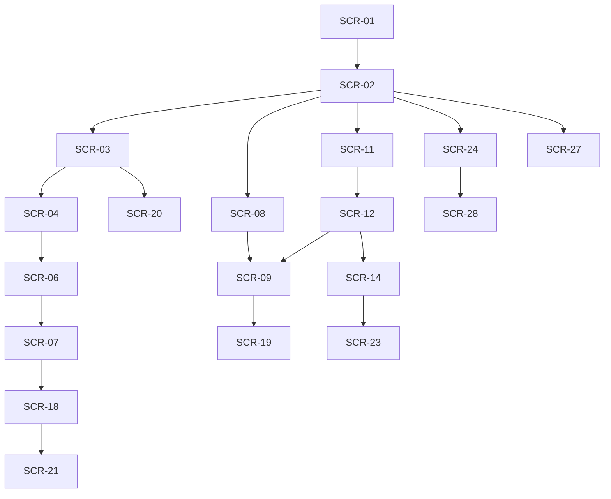

# 03 画面設計・遷移

版：v0.3 / 2026-10-13 / 未承認・未実装。画面/操作/表示状態の正本。SCR-01〜19を維持し20〜28を追加。全採用機能を一つのアプリに統合する。

## 1. 全画面共通

モバイルはホーム/地図/予定・活動/出動/管理の5入口を基本に、通知・文書・AI作業を同じホームと対象詳細へ接続。AIチャットのみを別製品として作らない。PC/タブレットでは一覧/詳細併置。権限の非表示だけに依存せず10のAPI認可を使用する。

loading/empty/validation_error/network_error/forbidden/conflict/successを区別。通信断時はlocal_draft/pending_sync、202は処理中であり完了ではない。未確認報告・位置確認済・人確認分類・AI推定を別ラベル/日時/確認者で表示する。文字拡大、フォーカス移動、キーボード、スクリーンリーダー、色以外の形/文字を使用。操作量を08で測る。

**PH0（T005）で確定した共通UI：** 見た目はprototype（"Beacon"暗色：背景#08101C・主色#FF5A2E・pillボタン・20px角丸カード・Material Symbols Rounded・Zen Kaku Gothic New）に合わせ、項目はこの章のとおり**ホーム/地図/予定・活動/出動/管理**とする（prototypeの「AI/メニュー」タブは採用しない＝AIは別製品にしない方針）。下部ナビに無い画面は、スマホはヘッダーの「メニュー」シート、PC(1024px以上)は左サイドバー(248px)から開く。サブ画面は親のタブを強調。保存結果は`saved`のときだけ「保存しました」とし、202=「処理中（完了ではありません）」、409=「再確認」、通信断/5xx/読めない応答=「結果を確認できません。同じ内容で再送しても二重登録にならない」（同じIdempotency-Keyを再利用）。誤りは最初の誤り欄へフォーカスし、未保存の離脱は確認ダイアログ（既定=編集に戻る）、閉じたら操作位置へフォーカスを戻す。ヘッダーに「DEMO」（架空データ）と通信状態を文字で表示。prototypeに無い**フォーカスリング**を追加（キーボード要件のため）。

## 2. 画面一覧と完了操作

| 画面ID / path | 主な表示・操作 | API-ID | 権限/完了 |
|---|---|---|---|
| SCR-01 /login | 招待受領、ログイン/再認証/MFA/回復、ログアウト | API-01,35,36 | 未登録の自由sign-upを出さない、D04 |
| SCR-02 /app | 次回予定/本人未回答、確認待ち異常、点検期限、通知/自分タスク | API-28,67 | 数値ごとに同scopeの一覧filterリンク |
| SCR-03 /app/map | 地図/一覧、種類/位置確認/点検結果/番号検索、現在地 | API-10 | 全page取得状況・凡例、Google帰属を覆わない |
| SCR-04 /app/facilities/:id | 台帳/写真/位置出典/確認対象版/点検/異常、編集/位置確認/外部経路 | API-12,13,27,44,45 | 元版/根拠確認、座標変更で旧確認失効 |
| SCR-05 /app/facilities/new | 種別/番号または識別名/緯度経度/目印/出典/写真 | API-11,26,83,84 | 登録権、保存前座標確認、Googleからの自動台帳抽出なし |
| SCR-06 /app/facilities/:id/inspections/new | 承認様式版/項目結果/実施日時/実施者/コメント/写真/異常起票 | API-14,26,83,84 | 原本保存と異常生成/明細の成功、AI jobは別状態 |
| SCR-07 /app/issues | 未確認/確認中/対応中/対応実施/終了、起点点検、担当/理由/履歴 | API-15,16,17 | 詳細sheetで確認/却下/再開、D07 |
| SCR-08 /app/activities | 予定/実績の一覧、日付/種別/参加者/状態検索 | API-05 | 予定と実績の時刻を別列で表示 |
| SCR-09 /app/activities/:id | 本人出欠/対象者、予定編集/中止、実績入力/訂正、使用資産/報告書 | API-07,08,09,39,40,41,42,43,57,62 | 代理は許可理由表示、実績の旧版も追跡 |
| SCR-10 /app/activities/new | 日時/場所/担当/対象者/回答期限 | API-06 | 参加対象snapshotと通知draft導線 |
| SCR-11 /app/incidents | 種別/日時/状態一覧・登録 | API-21 | 模擬/訓練/実出動記録を目立つ文字で区分 |
| SCR-12 /app/incidents/:id | 概要/参集/帰還/関連活動/車両/機材/履歴・同期状態 | API-23,57,69,70,71,80,81,82 | 本人/代理権、更新版、正式指令ではない表示 |
| SCR-13 /app/assets | 車両/資機材一覧、登録 | API-18,19,47,49 | 保管先/数量単位/状態、D15 |
| SCR-14 /app/assets/:type/:id | 台帳編集、点検/異常/使用履歴、期限 | API-48,50,51,56 | 物理削除で履歴消失させない |
| SCR-15 /app/members | 名簿/所属/役職・許可項目、登録/変更/停止 | API-02,03,04,37,38 | 自分/基本/機微項目を分離、D02/D03 |
| SCR-16 /app/announcements | 作成/公開先/公開日時/版/閲覧/本人既読 | API-24,25,66,72,101 | 既読は版に束縛、通知承認とは別 |
| SCR-17 /app/admin | 招待/取消、roles/scopes、監査、費用/評価、点検様式版/承認、運用設定 | API-33,34,37,38,88,89,93,94,95,96,97 | 管理者復旧は通常UIで自己昇格不可 |
| SCR-18 /app/ai/reviews | 原文/AI候補/質問版/モデル版、差分、承認/編集/却下/タスク | API-30,31,68,86,87 | 元版変化はstale、効果対象を承認前に表示 |
| SCR-19 /app/reports/:id/draft | 生成依頼/処理中、下書き/不足欄、編集/版/承認/出力 | API-32,58,59,60,61,62,86 | 人数/時刻は元実績と比較、承認前配布不可 |
| SCR-20 /app/facilities/import | CSVプレビュー、列/重複/座標エラー、確定/出力 | API-53,54,55,86 | previewHash、同時変更時再プレビュー |
| SCR-21 /app/tasks-notifications | 業務タスク、通知draft/本文/対象/承認/配送失敗/既読 | API-63,64,65,67,68,87,100 | 受付/配送/既読を別表示、再送/取消は対象を明示 |
| SCR-22 /app/incidents/new | 種別/発生日時/概要/関連活動/使用資産 | API-22 | 出動指令文として自動送信しない |
| SCR-23 /app/assets/:type/:id/inspection | 資産点検様式/明細/写真/コメント/訂正 | API-20,46 | 対象一致、原本を上書きしない |
| SCR-24 /app/documents | 許諾原本の登録/版/承認/撤回/ACL/閲覧 | API-27,73,74,75,90,91,92,99,101 | D01採用確認後RAG接続、ACLは常時適用 |
| SCR-25 /app/patrol-plans | 対象施設/日/順序/計画案/人の確定 | API-78,79 | D01採用確認待ち、経路自動指揮なし |
| SCR-26 /app/analytics | 月次/年度/団員別、元活動/出動/operation参照 | API-52 | 二重計上なし、条件/単位/未入力を明示 |
| SCR-27 /app/sync | 端末下書き/未同期/応答不明/拒否/競合、手動再送/削除 | API-81,82 | 他ユーザー下書きを復元せず、旧版を自動上書きしない |
| SCR-28 /app/assistant | 権限付き横断検索/RAG、引用原文、書込/通知提案の確認 | API-76,77,31 | D01採用確認待ち。読取でもACL、ツール実行は業務承認API |

## 3. 主な遷移

## 4. モバイル点検・GPS・誤操作

施設選択→詳細→点検開始の3操作でフォームへ（既存目標維持）。フォームは前回値を「前回参考」として表示できるが今回の結果へ自動入力しない。対象/実施者/様式版/現在時刻の候補を示し、利用者が確認する。写真失敗は点検本文を失わず、添付ready後に確定、保留の意味を表示。

GPSはユーザー操作による一回取得、accuracy/取得時刻/誤差円を表示、低精度/拒否/timeoutは手入力へ。常時追跡・自動施設上書きを行わない。位置送信/保存の説明、撤回/端末保存範囲はD09/D14。外部地図リンクは送る座標を明示しD08の用途に限る。

## 5. 定量評価案

360pxスマートフォン、タブレット768px、PC1280px、iOS Safari/Android Chrome/PC主要ブラウザで検証。キーボードのみ、200%文字拡大、タップ領域44 CSS px目標、エラー欄フォーカス、地図代替一覧を検査。月1〜2回利用相当の説明なし再訪テストで予定確認/出欠/点検を各5名程度の代表利用者が完了できることを計測し、目標完了率/時間はD18で承認する。数値を未測定の達成実績として書かない。
