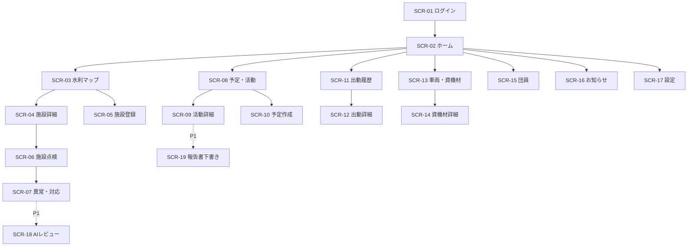

# 03 画面設計・遷移（ドラフト）

## 1. UI基本方針

- モバイルファースト。管理者の一括編集・集計はPC向けに補強する。
- ナビゲーションは「ホーム」「地図」「予定・活動」「出動」「管理」に大別する。
- **地図は参照用だけでなく業務起点** とする。施設を開くと「詳細」「点検する」「異常を報告」「写真を追加」の導線がある。
- 地図の色だけに意味を持たせない。文字ラベル・アイコン・一覧表示を併用する。
- 「報告（未確認）」「確認済み」「対応済み」を画面上で明確に区別する。
- 権限がない機能は非表示にするが、APIでの認可を必須とする。
- AIによる提案は必ず「提案」「下書き」を表示し、確認・承認しない限り正式データを変更しない。

## 2. 画面一覧

| ID | パス案 | 画面名 | 主な操作 | 優先 |
|---|---|---|---|---|
| SCR-01 | `/login` | ログイン | 招待制ログイン、再認証 | P0 |
| SCR-02 | `/app` | ホーム | 次回予定・自分の出欠・確認待ちを確認 | P0 |
| SCR-03 | `/app/map` | 消防水利マップ | 施設表示・検索・絞り込み・選択 | P0 |
| SCR-04 | `/app/facilities/:id` | 施設詳細 | 台帳・写真・点検・異常履歴を確認 | P0 |
| SCR-05 | `/app/facilities/new` | 施設登録 | 管理番号、種別、位置、根拠を入力 | P0 |
| SCR-06 | `/app/facilities/:id/inspections/new` | 施設点検 | 点検結果、写真、自由記述、異常報告 | P0 |
| SCR-07 | `/app/issues` | 異常・対応一覧 | 進捗検索、担当割当、確認処理 | P0 |
| SCR-08 | `/app/activities` | 予定・活動一覧 | 絞り込み・予定確認 | P0 |
| SCR-09 | `/app/activities/:id` | 活動詳細 | 出欠回答、参加者・実績閲覧 | P0 |
| SCR-10 | `/app/activities/new` | 活動予定作成 | 日時・場所・担当等登録 | P0 |
| SCR-11 | `/app/incidents` | 出動イベント一覧 | 訓練/模擬/実績区分で閲覧 | P0 |
| SCR-12 | `/app/incidents/:id` | 出動イベント詳細 | 参集状況、関連記録入力 | P0 |
| SCR-13 | `/app/assets` | 車両・資機材一覧 | 台帳参照、種別検索 | P0 |
| SCR-14 | `/app/assets/:type/:id` | 車両・資機材詳細 | 点検履歴、対応中の異常 | P0 |
| SCR-15 | `/app/members` | 団員・組織 | 検索、情報管理（権限制御） | P0 |
| SCR-16 | `/app/announcements` | お知らせ | 閲覧、担当者の投稿 | P0 |
| SCR-17 | `/app/admin` | 管理設定 | 招待、権限、監査閲覧、設定 | P0 |
| SCR-18 | `/app/ai/reviews` | AI確認待ち | 分類結果の確認、差戻し、承認 | P1 |
| SCR-19 | `/app/reports/:id/draft` | 報告書下書き | LLM生成、編集、確認・承認 | P1 |

パス・IDは仮。画面の分割・統合は実装段階で変更可能。

## 3. 画面遷移図

## 4. 主要画面の要素

### SCR-02 ホーム

- **自分向け**: 次回の訓練/点検、回答待ちの出欠、自分の作業。
- **担当者向け**: 確認待ちの異常、期限が近い点検、未回答の活動予定。
- **管理者向け**: 未処理件数、活動実績、最近の重要変更。
- 指標はすべて対応する一覧へのリンクを付け、データの根拠を追えるようにする。

### SCR-03 消防水利マップ

- Google Mapsの地図キャンバス、一覧、検索欄、種別/状態フィルター、現在地ボタン、凡例。
- 消火栓/防火水槽/格納箱に種類別のシンボルを設定する。
- ピン選択で施設のサマリーを表示し、施設詳細に移動可能とする。
- モバイルでは地図全画面＋下部シート、PCでは地図＋サイドパネルを基本形にする。
- Google Mapsが読み込めない場合は施設一覧での参照を継続できる構成とする。

### SCR-04 施設詳細

- 管理番号、種別、緯度経度、住所/目印、位置情報の出典、確認状態、最終点検日。
- 写真サムネイル、点検タイムライン、異常・対応チケット一覧。
- 権限に応じて「点検」「異常報告」「施設編集」を表示。
- 「施設が使える」といった断定表現をAIだけで更新しない。

### SCR-06 施設点検

- 点検日時、実施者、確認項目、結果（問題なし/要確認/判定不能）、自由記述、添付写真。
- 実施者、日時、対象施設の整合性チェックを行う。
- 異常報告を起票する場合は確認待ちとして保存する。
- P1でJev分類候補が付いた場合は「AIによる参考分類」と明示する。

### SCR-09 活動詳細

- 日時、場所、担当者、内容、出欠回答、実績入力、参加者リスト。
- 活動予定と活動実績は区別する。参加回答と実際の参加は別フィールドとする。
- P1の生成レポートは下書き編集・承認を経て確定する。

### SCR-12 出動イベント詳細

- 「模擬」「訓練」「実出動記録」の区分を目立たせ、誤認を防止する。
- 参加者・参集状況は履歴記録として扱い、正式指令の代用とはしない。

## 5. UI状態

各画面は `初期表示 / 読み込み中 / データなし / 入力エラー / 通信エラー / 権限なし / 正常表示` を設計対象とする。

登録・編集フォームは二重送信防止、編集中離脱確認、入力エラー位置へのフォーカス、成功・失敗結果の表示を備える。

## 6. 端末とアクセシビリティ

- 360px級のスマートフォンからデスクトップまで対応する。
- キーボード操作、十分なタップ領域、文字サイズ、色以外の状態表現に配慮する。
- 正確なGPS位置を提供しなくても、住所/管理番号/手動地図操作で施設を利用できる。
- 端末位置情報はユーザーの許可が得られた場合のみ取得し、常時追跡しない。
