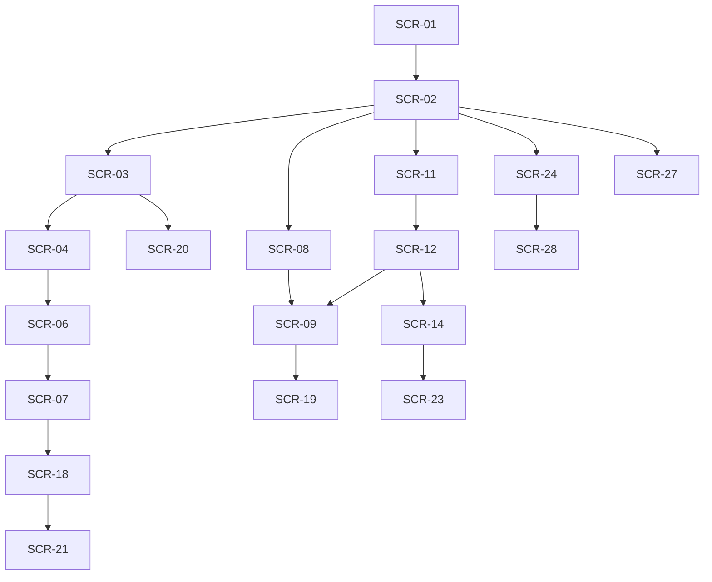

# 03 画面設計・遷移

版：v0.3 / 2026-10-13 / 未承認。シェルと共通UIはPH0で実装済み、各画面は未実装。画面/操作/表示状態の正本。SCR-01〜19を維持し20〜28を追加。全採用機能を一つのアプリに統合する。

## 1. 全画面共通

**画面構成・導線・見た目・文言の正は `prototype/`（FireOS Prototype / Desktop / Design System）。** docsはprototypeに合わせ、prototypeが示さない業務規則・権限・状態遷移・API・DBを補う。prototypeと食い違う記述はprototypeを優先してdocsを直す（2026-10-13改訂）。モバイルは**ホーム/マップ/予定・活動/AI/メニュー**の5タブ（AIは独立したタブ。ただし書込・送信は必ず人の確認を経る）。通知・文書・AI作業はホームと対象詳細へも接続する。PC/タブレットでは一覧/詳細併置。権限の非表示だけに依存せず10のAPI認可を使用する。

loading/empty/validation_error/network_error/forbidden/conflict/successを区別。通信断時はlocal_draft/pending_sync、202は処理中であり完了ではない。未確認報告・位置確認済・人確認分類・AI推定を別ラベル/日時/確認者で表示する。文字拡大、フォーカス移動、キーボード、スクリーンリーダー、色以外の形/文字を使用。操作量を08で測る。

### 1.1 prototype準拠のシェルと共通UI（正本: prototype/）

**デザイン原則（Design System）：** ①一点だけ光らせる＝1画面に主要アクション（暖色の塗り）は1つ。②色＋形＋文字で伝える＝施設種別・状態は色だけに頼らず形状とラベルを併記。③AIは紫、決めるのは人＝AI由来は常に紫で示し、確定・送信は必ず人の操作。④出動時は世界ごと変える＝出動モードは背景から切り替え、確定は長押し/2回タップ。

**トークン（暗色のみ）：** 背景#08101C・面#101A2B（パネル#0D1626、サイドバー#060C16）・文字#EDF1F7（補助#A9B3C4/#8792A5/#7D889B）・主色Ember#FF5A2E（淡#FF8A66）・OK#3AD08F・注意#FFC35C・異常#FF7A66・AI紫#B9A9FF・現在地青#4F9BFF・出動#FF3B2F（出動背景#0D0709）。フォントはZen Kaku Gothic New（和欧文）＋IBM Plex Mono（数値・管理番号・時刻・英字小見出し）、アイコンはMaterial Symbols Rounded（選択中はFILL 1）。本文の最小14px、補足の最小11px。角丸はpill=99px・カード20〜22px・入力16px・PCナビ12px。罫線はbox-shadowの1px inset（rgba(255,255,255,.07)）。主ボタン56px（pill、1画面1つ）、副ボタン52px、入力54px、下部ナビ84px、PCサイドバー248px・ヘッダー64px・本文余白28/32px・最大幅1440px。施設マーカー: 消火栓=赤#E8432A円、防火水槽=青#2F7FE0丸角四角、格納箱=橙#F08A24ひし形、詰所=緑#2FAE6A六角形。

**スマホ（FireOS Prototype）：** 下部ナビは**ホーム/マップ/予定・活動/AI/メニュー**（高さ84px、選択=アイコンpill橙18%、AIだけ紫18%）。常設ヘッダーは無く、ホームの最上段に「通信状態の札（左）・DEMO・通知（橙の点=未読）」、他の画面は等幅の小見出し（例: 2026 · OCT）＋26px太字の画面名。サブ画面は左上に44pxの丸い戻るボタン（点検登録は×）＋画面名＋右に状態ピル。サブ画面は親のタブを強調（施設→マップ、活動・活動記録→予定・活動）。点検登録は下部ナビなしの全画面フロー。ホームとログインのみ橙の放射状ぼかし。**メニュー**はプロフィールカード（頭文字・氏名・所属・役割ピル）＋2列タイル（団員名簿/車両・資機材/お知らせ/文書・規程/出動履歴/活動分析/設定・通知/使い方ガイド）＋ログアウト。prototypeに入口が無いdocs上の画面（点検管理/巡回計画/AIレビュー/同期の状況/管理）はメニューへ**追加**タイルとして置く（到達できない画面を作らないため）。

**PC（FireOS Desktop）：** 左サイドバー248px＝ロゴ（同心円マーク）＋FireOS＋DEMO／分団カード／**OVERVIEW**（ダッシュボード）・**OPERATIONS**（マップ・水利/予定・出欠/活動記録/点検管理/お知らせ）・**ORGANIZATION**（団員/車両・資機材/文書・規程/活動分析）／最下部に赤枠の**出動管理**と利用者ブロック（頭文字・氏名・班・役割ピル）。**ADMIN**グループ（タスク・通知/巡回計画/AIレビュー/同期の状況/管理）はprototypeに無いため追加。ヘッダー64px＝パンくず（分団/区分: 概要・運用・組織・分析・災害）＋画面名、検索欄（⌘K）、通信状態の札、通知、紫枠の「AIアシスタント」ボタン。本文だけがスクロール（100vh固定）。右側に重ねる要素: AIパネル360px・団員ドロワー440px・リマインドモーダル560px。切替幅はスマホ/PC=1024px（prototypeのPC最小幅1200pxより広くタブレットも扱う）。

**SCR番号の無いシェル画面：** `/app/menu`（メニュー、T005）、`/app/help`（使い方ガイド、内容はT086）。

**prototype画面 → SCR対応と主な仕様：**

| prototype | SCR | 主な仕様（prototypeの内容） |
|---|---|---|
| ログイン | 01 | 団員ID/パスワード/ログイン/生体認証でログイン、DEMO注記、「パスワードを忘れた場合は分団の管理者へ」 |
| ホーム/ダッシュボード | 02 | 次回予定ダイヤル（参加/未定/未回答の円）、出欠クイック回答、やること（横スクロールカード）、お知らせ（重要=赤札/連絡）、AIバー。PCはKPI4枚・要対応（AIが優先度順）・今後の予定・担当区域ミニマップ・月別活動件数 |
| マップ | 03 | 検索＋地図/一覧切替、種別チップ（件数）、現在地、選択シート（状態/最終点検/次回期限、点検する/詳細/経路）。PCは右420px施設一覧/詳細＋凡例 |
| 施設詳細 | 04 | 写真、種別/状態ピル、異常報告枠、管理番号/規格/最終点検/次回期限、点検履歴、固定CTA「この施設を点検する」 |
| 点検登録 | 06 | 3ステップ（チェック→写真・メモ→確認）、項目ごとに良好/異常あり、AI分類候補（JEV・緊急度・根拠・確度、最終判断は人）、「班長への確認タスクを作成」、オフライン時は端末保存→自動送信 |
| 予定・活動 | 08 | 週ストリップ7日＋月別グループ（日付/種別/時刻/題/出欠ピル）。PCは左300px＋詳細 |
| 活動詳細 | 09 | 種別/状態ピル、日時/場所/持ち物、あなたの出欠（参加/未定/不参加）、参加状況チップ、過去の活動は「AI報告書」（紫） |
| 活動記録 | 19 | 下書き→確認待ち→承認の3段階、不足欄のAI指摘、下書き保存/班長に確認を依頼。PCは左360px一覧＋承認 |
| AIアシスタント | 28 | 「団員権限で参照」、提案チップ、思考ステップ、準備状況ブリーフ、タスク下書き（確認して作成/破棄）、連絡文下書き（全体送信は班長以上、班長に送信を依頼） |
| 団員（PC） | 15 | 班/資格フィルタ付き一覧、団員ドロワー440px、未回答者へのリマインド（モーダル560px） |
| 出動モード | 11/12 | 赤テーマ。要請カード、状態ボード4、応答の長押し、進捗ステップ、「現場の指揮は団長・消防署の指示に従う」を常時表示、訓練想定=DEMO |
| 点検管理/車両・資機材/文書・規程/活動分析/お知らせ（PC） | 07/13/24/26/16 | prototypeでは予告ページ（実装は完成版で作成） |

**prototypeから意図して変えた点（理由つき）：**
1. 「同期済み 19:48」→「オンライン/オフライン」。同期はPH6で実装するまで実際に同期していないため、完了を示す表示は出さない。
2. 「PHASE 2/3」「P2/P3」のタグは表示しない。フェーズは作業順でリリース境界ではない（README）。
3. 分団名・氏名・班名は架空（架空市消防団 第一分団、架空 団員）。実在団体名を載せない。
4. 検索欄・分団切替・ログアウト・AIパネルは見た目を先に置き、機能が入るまで無効表示（押しても何も起きない状態を作らない）。サイドバーの件数バッジ（マップ=異常件数、活動記録=承認待ち）と通知の未読の点は、件数データの接続時（PH2〜4）に表示する。
5. アクセシビリティの追加：フォーカスリング（prototypeはoutline:none）、スキップリンク、h1、44px以上の押下領域。

**ログイン画面SCR-01（PH1 T010で実装、prototype LOGINに合わせた）：** 上余白120px・左右28px、ロゴ76px→FireOS 40px/900→キャッチ14px→52px下に入力（54px・等幅16px）→主ボタン「ログイン」56px→「生体認証でログイン」52px（passkey未実装のため無効表示）→最下部にDEMO注記と「パスワードを忘れた場合は分団の管理者へ」。ホームと同じ橙のぼかし。シェル（ナビ）の外。**prototypeから変えた点：** ①「団員ID」→「メールアドレス」（認証identityは招待先メール）、②二要素認証・招待受領（`/login#invite=<token>`）・再設定（`#reset` / `#recover`）・二要素の設定（`#mfa`）を同じ見た目で追加、③自由な新規登録は出さない。招待tokenはURLの # 以降から読み、アドレスから消す。ログイン後の戻り先（`?next=`）は /app 配下だけ許す。サイドバー下部の利用者ブロックとメニューのプロフィールはAPI-01の値（氏名・役職・役割・所属名）。PCにはメニュータブが無いので、利用者ブロックを押すとメニュー画面（プロフィール・二要素認証・ログアウト）へ進む。

**団員名簿SCR-15（PH1 T013、prototype Desktop MEMBERS）：** 検索欄320×42px＋班タブ（データの班から作る）＋件数＋「団員を追加」（管理者のみ有効、他はロック表示）、一覧は 団員（アバター32px・入団年）/班/役職/資格・講習/状態、行を押すと440pxの団員ドロワー（アバター64px、緊急連絡先は伏せて「表示」で開く、「個人情報の表示は監査ログに記録されます」）。**prototypeから変えた点：** ①「訓練参加率」「次回の出欠」の列とドロワーの実績3指標は、出欠・実績（PH3）が入るまで値を出さない（ドロワーは枠だけ「—」）。②連絡先は本人と、その団員を対象にした担当(scope)の保持者だけが読める（管理者の役割だけでは読めない。他人には「本人と、担当する者だけが表示できます」）。③スマホ（prototypeはPC版のみ）は同じ一覧をカード行にし、ドロワーを全幅で開く。④本人は自分の連絡先を編集でき、管理者は基本情報（氏名・役職・班・資格・入団日）を編集できる。

**管理SCR-17（PH1 T013/T014、prototypeに該当ページ無し。共通部品で構成）：** PCは左に「団員を選ぶ」（氏名・役職・役割と、招待中/利用中/未招待/休団/退団のチップ）、右に選択した団員の管理（アカウントと招待／役割と担当／利用停止・セッション）を併置、スマホは縦に積む。下に「二要素認証」と「監査ログ」。招待は発行した直後だけ招待リンクを表示（再表示不可）し、取消は理由つきの確認、再発行は旧招待を自動で取消。役割と担当は変更前後の差分を確認してから実行（自分自身の権限は上げられない）。利用停止は停止理由が必須で、確認に対象・理由・影響（アカウント停止・全端末のログイン解除・過去の活動記録を保持）を示す。最後の管理者の停止・降格は拒否。管理者以外がこの画面を開くと案内だけを出し、操作はサーバーが拒否する。確認ダイアログの既定フォーカスは「戻る」。入力途中のドロワー/モーダルを閉じる（Esc・幕・×）と「入力を破棄しますか」を最前面に出す。スマホでは主要な操作（班タブ・表示/隠す・検索・追加・文字リンク）の押下領域を44px以上にしている（PCはprototypeの寸法）。**prototypeからの追加：** ドロワーの「表示」は画面上の伏せ字を外すだけで、他人の連絡先を取得した事実は名簿の取得時に監査される（文言を実態に合わせ「他の団員の連絡先を読み込んだ記録は、監査ログに残ります」とした）。危険操作のボタンは白文字のコントラストのため `--color-danger`（#c93a22）を追加。

**共通UIの挙動（PH0 T005で実装）：** 保存結果は`saved`のときだけ「保存しました」を明るいトーストで2.6秒（スマホの下からの位置は prototype toastBottom どおり 予定・活動/メニュー100px、マップとその他110px、ホーム/AI 160px。PCは下28px中央。各画面は実装時に位置を渡す）。422は「この状態では実行できません」（入力欄の誤りとは別表示）。202=「処理中（完了ではありません）」、409=「再確認」、通信断/5xx/読めない応答=「結果を確認できません。同じ内容で再送しても二重登録にならない」（同じIdempotency-Keyを再利用）。誤りは最初の誤り欄へフォーカス、未保存の離脱は確認ダイアログ（既定=編集に戻る）、閉じたら操作位置へフォーカスを戻す。

## 2. 画面一覧と完了操作

| 画面ID / path | 主な表示・操作 | API-ID | 権限/完了 |
|---|---|---|---|
| SCR-01 /login | 招待受領、ログイン/再認証/MFA/回復、ログアウト | API-01,35,36 | 未登録の自由sign-upを出さない、D04 |
| SCR-02 /app | 次回予定/本人未回答、確認待ち異常、点検期限、通知/自分タスク | API-28,67 | 数値ごとに同scopeの一覧filterリンク |
| SCR-03 /app/map | 地図/一覧、種類/位置確認/点検結果/番号検索、現在地 | API-10 | 全page取得状況・凡例、Google帰属を覆わない |
| SCR-04 /app/facilities/:id | 台帳/写真/位置出典/確認対象版/点検/異常、編集/位置確認/外部経路 | API-12,13,27,44,45 | 元版/根拠確認、座標変更で旧確認失効 |
| SCR-05 /app/facilities/new | 種別/番号または識別名/緯度経度/目印/出典/写真 | API-11,26,83,84 | 登録権、保存前座標確認、Googleからの自動台帳抽出なし |
| SCR-06 /app/facilities/:id/inspections/new | 承認様式版/項目結果/実施日時/実施者/コメント/写真/異常起票 | API-14,26,83,84 | 原本保存と異常生成/明細の成功、AI jobは別状態 |
| SCR-07 /app/issues | 未確認/確認中/対応中/対応実施/終了、起点点検、担当/理由/履歴 | API-15,16,17 | 詳細sheetで確認/却下/再開、D07 |
| SCR-08 /app/activities | 予定/実績の一覧、日付/種別/参加者/状態検索 | API-05 | 予定と実績の時刻を別列で表示 |
| SCR-09 /app/activities/:id | 本人出欠/対象者、予定編集/中止、実績入力/訂正、使用資産/報告書 | API-07,08,09,39,40,41,42,43,57,62 | 代理は許可理由表示、実績の旧版も追跡 |
| SCR-10 /app/activities/new | 日時/場所/担当/対象者/回答期限 | API-06 | 参加対象snapshotと通知draft導線 |
| SCR-11 /app/incidents | 種別/日時/状態一覧・登録 | API-21 | 模擬/訓練/実出動記録を目立つ文字で区分 |
| SCR-12 /app/incidents/:id | 概要/参集/帰還/関連活動/車両/機材/履歴・同期状態 | API-23,57,69,70,71,80,81,82 | 本人/代理権、更新版、正式指令ではない表示 |
| SCR-13 /app/assets | 車両/資機材一覧、登録 | API-18,19,47,49 | 保管先/数量単位/状態、D15 |
| SCR-14 /app/assets/:type/:id | 台帳編集、点検/異常/使用履歴、期限 | API-48,50,51,56 | 物理削除で履歴消失させない |
| SCR-15 /app/members | 名簿/所属/役職・許可項目、登録/変更/停止 | API-02,03,04,37,38 | 自分/基本/機微項目を分離、D02/D03 |
| SCR-16 /app/announcements | 作成/公開先/公開日時/版/閲覧/本人既読 | API-24,25,66,72,101 | 既読は版に束縛、通知承認とは別 |
| SCR-17 /app/admin | 招待/取消、roles/scopes、監査、費用/評価、点検様式版/承認、運用設定 | API-33,34,37,38,88,89,93,94,95,96,97 | 管理者復旧は通常UIで自己昇格不可 |
| SCR-18 /app/ai/reviews | 原文/AI候補/質問版/モデル版、差分、承認/編集/却下/タスク | API-30,31,68,86,87 | 元版変化はstale、効果対象を承認前に表示 |
| SCR-19 /app/reports/:id/draft | 生成依頼/処理中、下書き/不足欄、編集/版/承認/出力（PCは別入口 /app/reports で一覧と詳細を併置） | API-32,58,59,60,61,62,86 | 人数/時刻は元実績と比較、承認前配布不可 |
| SCR-20 /app/facilities/import | CSVプレビュー、列/重複/座標エラー、確定/出力 | API-53,54,55,86 | previewHash、同時変更時再プレビュー |
| SCR-21 /app/tasks-notifications | 業務タスク、通知draft/本文/対象/承認/配送失敗/既読 | API-63,64,65,67,68,87,100 | 受付/配送/既読を別表示、再送/取消は対象を明示 |
| SCR-22 /app/incidents/new | 種別/発生日時/概要/関連活動/使用資産 | API-22 | 出動指令文として自動送信しない |
| SCR-23 /app/assets/:type/:id/inspection | 資産点検様式/明細/写真/コメント/訂正 | API-20,46 | 対象一致、原本を上書きしない |
| SCR-24 /app/documents | 許諾原本の登録/版/承認/撤回/ACL/閲覧 | API-27,73,74,75,90,91,92,99,101 | D01採用確認後RAG接続、ACLは常時適用 |
| SCR-25 /app/patrol-plans | 対象施設/日/順序/計画案/人の確定 | API-78,79 | D01採用確認待ち、経路自動指揮なし |
| SCR-26 /app/analytics | 月次/年度/団員別、元活動/出動/operation参照 | API-52 | 二重計上なし、条件/単位/未入力を明示 |
| SCR-27 /app/sync | 端末下書き/未同期/応答不明/拒否/競合、手動再送/削除 | API-81,82 | 他ユーザー下書きを復元せず、旧版を自動上書きしない |
| SCR-28 /app/assistant | 権限付き横断検索/RAG、引用原文、書込/通知提案の確認 | API-76,77,31 | D01採用確認待ち。読取でもACL、ツール実行は業務承認API |

## 3. 主な遷移

## 4. モバイル点検・GPS・誤操作

施設選択→詳細→点検開始の3操作でフォームへ（既存目標維持）。フォームは前回値を「前回参考」として表示できるが今回の結果へ自動入力しない。対象/実施者/様式版/現在時刻の候補を示し、利用者が確認する。写真失敗は点検本文を失わず、添付ready後に確定、保留の意味を表示。

GPSはユーザー操作による一回取得、accuracy/取得時刻/誤差円を表示、低精度/拒否/timeoutは手入力へ。常時追跡・自動施設上書きを行わない。位置送信/保存の説明、撤回/端末保存範囲はD09/D14。外部地図リンクは送る座標を明示しD08の用途に限る。

## 5. 定量評価案

360pxスマートフォン、タブレット768px、PC1280px、iOS Safari/Android Chrome/PC主要ブラウザで検証。キーボードのみ、200%文字拡大、タップ領域44 CSS px目標、エラー欄フォーカス、地図代替一覧を検査。月1〜2回利用相当の説明なし再訪テストで予定確認/出欠/点検を各5名程度の代表利用者が完了できることを計測し、目標完了率/時間はD18で承認する。数値を未測定の達成実績として書かない。
