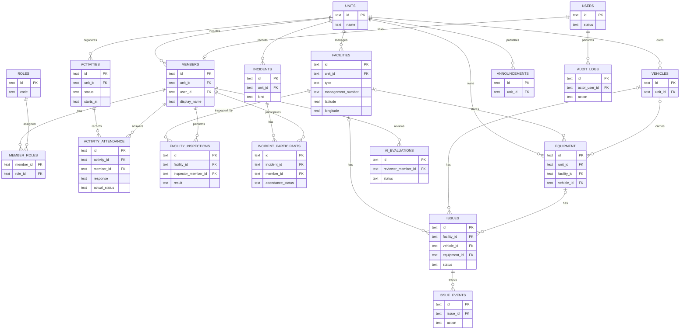

# 04 データ設計・ER図（ドラフト）

## 1. データベース方針

- Cloudflare D1（SQLite）+ Drizzle ORMを初期候補とする。
- 施設座標は WGS84（緯度 `latitude`、経度 `longitude`）で保存する。
- 人物データと公開可能なデータは論理的に区分し、全APIで認可を実施する。
- 履歴を失わないため、点検記録・出欠・異常対応・AI提案を別のテーブルで扱う。
- R2には実体ファイル、D1にはファイル所有者・参照先・R2キー・種類等のメタデータを保存する。
- 初期は1分団だが `units` を設ける。**分団IDを受け取っただけで参照許可とみなさない**。

## 2. 論理ER図（主要な関係のみ、簡略版）

`attachments`、`asset_inspections`、活動と施設・車両の中間テーブル、AI提案と元の報告のリンクは見やすさのため図から省略している。

## 3. 主なテーブル定義（論理設計）

| テーブル | 主なカラム | 制約・補足 |
|---|---|---|
| `units` | `id`, `name` | 初期は1件 |
| `users` | `id`, `status`, `created_at` | 認証ライブラリ固有テーブルとの統合は詳細設計で確定 |
| `members` | `id`, `unit_id`, `user_id?`, `display_name`, `rank?`, `joined_at?`, `status` | `user_id`は招待前の名簿登録でNULLを許容 |
| `roles` / `member_roles` | `role_code`, `member_id`, `role_id` | 役割の重複・競合時の優先順位を定義する |
| `activities` | `id`, `unit_id`, `title`, `kind`, `starts_at`, `ends_at`, `location_text`, `status`, `created_by` | 予定と実績のライフサイクルを状態で区分 |
| `activity_attendance` | `activity_id`, `member_id`, `response`, `actual_status`, `responded_at` | `(activity_id, member_id)` UNIQUE |
| `incidents` | `id`, `unit_id`, `kind`, `occurred_at`, `summary`, `status`, `recorded_by` | `kind` = simulation/training/actual_record |
| `incident_participants` | `incident_id`, `member_id`, `attendance_status`, `arrived_at?` | `(incident_id,member_id)` UNIQUE |
| `facilities` | `id`, `unit_id`, `type`, `management_number`, `latitude`, `longitude`, `source`, `verification_status`, `last_verified_at?` | type = hydrant/cistern/box。`(unit_id,type,management_number)` UNIQUE候補 |
| `facility_inspections` | `id`, `facility_id`, `inspector_member_id`, `inspected_at`, `result`, `note`, `created_at` | 原本は追記型、訂正時は監査情報を残す |
| `vehicles` | `id`, `unit_id`, `asset_code`, `name`, `status` | `(unit_id,asset_code)` UNIQUE |
| `equipment` | `id`, `unit_id`, `asset_code`, `name`, `quantity`, `facility_id?`, `vehicle_id?` | 収納場所の表現を要詳細設計 |
| `asset_inspections` | `id`, `vehicle_id?`, `equipment_id?`, `inspector_member_id`, `result`, `inspected_at` | 車両・資機材の片方だけを対象とするCHECK |
| `issues` | `id`, `facility_id?`, `vehicle_id?`, `equipment_id?`, `status`, `title`, `reported_by`, `assignee_member_id?` | 原則いずれか1つの対象IDを持つCHECK |
| `issue_events` | `id`, `issue_id`, `action`, `actor_member_id`, `note`, `created_at` | 状態遷移・担当割当・確認履歴 |
| `attachments` | `id`, `r2_key`, `content_type`, `byte_size`, `owner_unit_id`, `uploaded_by`, `created_at` | 保存はプライベート。関連付けは別テーブルで実施候補 |
| `attachment_links` | `attachment_id`, `entity_type`, `entity_id` | アプリサービス層で関連先の存在・権限を検証する |
| `announcements` | `id`, `unit_id`, `title`, `body`, `author_member_id`, `published_at?` | 既読はP1 |
| `ai_evaluations` | `id`, `source_type`, `source_id`, `model_id`, `model_version?`, `output_json`, `status`, `reviewer_member_id?` | 提案・確認・却下の区分 |
| `audit_logs` | `id`, `actor_user_id`, `action`, `entity_type`, `entity_id`, `occurred_at`, `metadata_json` | 必要最小限の記録・改変防止運用を検討 |

全テーブルの型・NULL制約・インデックス・外部キー・CASCADE方針は物理設計時に確定する。生成AIの出力値を正式な判定結果として保存することはしない。

## 4. データ整合性ルール

- 緯度 `[-90, 90]`、経度 `[-180, 180]` を検証し、経緯度の順序混同を防ぐ。
- 同一活動の出欠レコード、同一出動の参加者レコードには一意制約を設ける。
- 施設の削除は実績の参照関係を確認し、原則論理無効化/アーカイブにする。
- 異常チケットの状態 `reported → under_review → in_progress → resolved/closed` を定義し、状態遷移は権限を検証する。
- AI候補と担当者の最終判断は別値で保存する。
- すべての重要な編集に `updated_at` と更新競合防止値（`version`等）の付与を検討する。
- 日時はDBでUTCのISO 8601文字列またはUnix時刻に統一し、表示は日本時間へ変換する。

## 5. GIS検索

MVPは小規模データ（実数未確定）を想定し、施設タイプ・状態・管理番号で検索する。地図表示範囲（bounding box）による絞り込みは、緯度・経度の数値条件で実装できる。複雑な地理空間演算や道路距離分析はP2でPostGIS等を検討する。

## 6. データ保護・復元

- D1のバックアップ/復元方法とR2オブジェクトの保持・削除ルールを運用文書で定義する。
- DBにはR2の公開URLを永続保存せず、保護されたオブジェクトキーを管理する。
- 退団時の個人情報削除・履歴への影響、監査ログの保持期間は正式導入前の要決定事項とする。
- 公開デモDBは本番DBと完全に別にし、架空の地点・人物に置き換える。
