# 04 データ設計・ER図

版：v0.3 / 2026-10-15 / 論理・物理契約ドラフト（B案）。DBカラムと制約の正本。状態は11、API項目対応は05。実装済みの表は共通・認可・jobs（drizzle/0001〜0007）、添付・施設・取込・資産・様式・点検/異常（0008〜0014）、活動・実参加・出動・使用履歴・お知らせ（0015〜0019。PH3。§3.2/§3.4の該当行と実DDLの列名・制約・索引を突き合わせ済み＝docs/evidence/ph3.md）、点検期限と超過検出ログ（0020。T048。§3.3の該当行）、業務タスクと履歴（0021。T049。§3.4の該当行）、通知（0022。T050で作成・**T051でdelivery_keyの書式と配送statusのCHECK（cancelled追加）をリリース前に拡張**。§3.4の該当行）、AI評価と人の決定（0023。T053。§3.4の該当行。**T068でsource_type CHECKに'assistant'をin-place追加**）、報告書・文書版の元（0024。T056。§3.4のreports/report_versions/content_version_events。文書documents側は0027〔T062〕。**ebdcc3cでsupersede CHECKを「承認されたことがある版だけが承認列を持つ」へ拡張〔T063発見・T058の残経路の不具合修正〕**）、LLM下書きの生成証跡列（0025。T057。report_versionsへの列追加と内容不変トリガーの置き換え。§3.4の該当行）、AI評価の実行履歴（0026。T061。§3.4の該当行）、許諾文書の原本・版・ACL・chunk（0027。T062で作成・T063/T064/T066で書込。§3.4の該当行）、FTS索引の仮想表（0028。T066。§3.4の該当行）、RAG回答と引用（0029。T067。§3.4の該当行）、地域の点検巡回計画（0030。T071。§3.4の該当行）。残りはPH6以降で実装（実装済みmigrationと実DDLの突き合わせはdocs/evidence/ph5.md）。

## 1. 共通規約

D1/Drizzleを採用。記法T＝TEXT、I＝INTEGER、R＝REAL、J＝TEXT(JSON、json_valid CHECK)、D＝UTC ISO8601固定ミリ秒TEXT、B＝INTEGER 0/1 CHECK。`?`だけNULL可、その他NOT NULL。内部IDはサーバー生成UUIDのT PK、API例のdemo IDは説明用。外部表示番号とは別。金額を持つ場合は最小通貨単位I、数量Rは有限正数/非負をCHECKする。時刻はUTC保存・Asia/Tokyo表示、日付期限は業務日TEXT YYYY-MM-DDと明示し瞬間値と混同しない。

全業務表は`unit_id:T FK units(id)`を持つ。root可変表は`version:I DEFAULT 1 CHECK(version>=1), last_mutation_token:T?, created_at:D, updated_at:D, created_by:T? FK users(id), actor_kind:T`（human時created_by必須、system時NULL可）を共通追加。履歴/中間表はid/unit_id/created_at/actor_user_id（system時だけNULL＋actor_kind=system）を追加し追記型。表の下線名はDB、APIはcamelCase。共通欄を各行で省略しても任意項目ではない。

認証固有表の正確な名前/列はBetter Authの固定版スキーマをD04で生成・照合する。下表のauth_*は設計上の論理名。業務のuser_idを認証IDへ一意に対応させる。認証ライブラリのroleと業務roleを自動同期しない。

## 2. 統合ER（関係の正本は3のFK/制約も併読）

```mermaid
erDiagram
  UNITS ||--o{ MEMBERS : contains
  USERS ||--o| MEMBERS : account_link
  MEMBERS ||--o{ MEMBER_ROLES : assigned
  ROLES ||--o{ MEMBER_ROLES : role
  MEMBERS ||--o{ SCOPE_ASSIGNMENTS : scope
  MEMBERS ||--o{ INVITATIONS : invited
  OPERATIONS ||--o| ACTIVITIES : scheduled
  OPERATIONS ||--o| INCIDENTS : incident
  ACTIVITIES ||--o{ ACTIVITY_ATTENDANCE : responses
  ACTIVITIES ||--o| ACTIVITY_RESULTS : actual
  ACTIVITY_RESULTS ||--o{ ACTIVITY_RESULT_REVISIONS : revisions
  ACTIVITY_RESULT_REVISIONS ||--o{ ACTIVITY_ACTUAL_PARTICIPANTS : actual_members
  INCIDENTS ||--o{ INCIDENT_PARTICIPANTS : participants
  INCIDENT_PARTICIPANTS ||--o{ INCIDENT_PARTICIPANT_EVENTS : history
  OPERATIONS ||--o{ RESOURCE_USAGES : uses
  VEHICLES |o--o{ RESOURCE_USAGES : vehicle
  EQUIPMENT |o--o{ RESOURCE_USAGES : equipment
  FACILITIES |o--o{ EQUIPMENT : storage
  VEHICLES |o--o{ EQUIPMENT : storage
  FACILITIES ||--o{ FACILITY_LOCATION_REVISIONS : location_versions
  FACILITIES ||--o{ FACILITY_INSPECTIONS : inspected
  INSPECTION_TEMPLATES ||--o{ INSPECTION_TEMPLATE_VERSIONS : version
  INSPECTION_TEMPLATE_VERSIONS ||--o{ FACILITY_INSPECTIONS : form
  VEHICLES |o--o{ ASSET_INSPECTIONS : inspected
  EQUIPMENT |o--o{ ASSET_INSPECTIONS : inspected
  FACILITY_INSPECTIONS |o--o{ INSPECTION_ITEMS : items
  ASSET_INSPECTIONS |o--o{ INSPECTION_ITEMS : items
  FACILITY_INSPECTIONS |o--o{ ISSUES : origin
  ASSET_INSPECTIONS |o--o{ ISSUES : origin
  ISSUES ||--o{ ISSUE_EVENTS : history
  ATTACHMENTS ||--o{ ATTACHMENT_LINKS : business_links
  ACTIVITIES ||--o{ REPORTS : reports
  REPORTS ||--o{ REPORT_VERSIONS : revision
  JOBS ||--o{ AI_EVALUATIONS : output
  AI_EVALUATIONS ||--o| REVIEW_DECISIONS : human_decision
  REVIEW_DECISIONS |o--o{ TASKS : effect
  NOTIFICATIONS ||--o{ NOTIFICATION_RECIPIENTS : audience
  NOTIFICATION_RECIPIENTS ||--o{ NOTIFICATION_DELIVERIES : attempts
  DOCUMENTS ||--o{ DOCUMENT_VERSIONS : version
  DOCUMENT_VERSIONS ||--o{ DOCUMENT_CHUNKS : index
  RAG_ANSWERS ||--o{ RAG_CITATIONS : sources
  DOCUMENT_CHUNKS ||--o{ RAG_CITATIONS : cited
```

全親子で同unitを要求。DBにFKを置ける参照はFK、unit一致は親の`UNIQUE(unit_id,id)`と子の複合FKを原則とする。多態リンクはサービス層＋同一mutationガードで存在/所属/分類を検査し、参照先タイプを許可リスト化する。ER省略：各actorのusers/members参照、監査、outbox、ACL等は次表に定義。

**時刻列の検査（T003で確定）：** D1は`GLOB`/`LIKE`のパターン長に上限があるため、CHECKは`strftime('%Y-%m-%dT%H:%M:%fZ', 列) IS 列`（正規形に戻して一致）で行う。形式違反に加え存在しない日付も拒否する。**`=`でなく`IS`を使う**：不正な日付ではstrftimeがNULLを返し、CHECKはNULLを合格扱いにするため。

## 3. テーブル契約

### 3.1 組織・認証・認可

| テーブル | 共通列以外の列 | UNIQUE / FK / CHECK |
|---|---|---|
| units | name:T, status:T, dataset_revision:I DEFAULT 1, event_sequence:I DEFAULT 0 | 初期一件、status active/disabled |
| users（unitなし） | auth_id:T, status:T, authz_version:I(既定1,>=1), disabled_at:D? | auth_id UNIQUE、停止変更とauthz_version増分を同一操作、status=disabledとdisabled_at非NULLは常に対(CHECK)。unitを持たないため共通のversion/created_by列は持たず、更新の競合ガードはauthz_version（T003） |
| auth_users/auth_sessions/auth_accounts/auth_verifications/auth_two_factors/auth_rate_limits（unitなし、`drizzle/0004_auth.sql`、T007） | better-auth 1.7.7の公式スキーマ（`getAuthTables`）にsnake_caseの列名を当てたもの。auth_usersが認証identity（メール）、auth_two_factorsにTOTP秘密と回復コード（暗号化）、auth_verificationsの識別子（再設定token）はhash保存、auth_rate_limitsはIP単位の回数 | 業務users.auth_id＝auth_users.id（FKにしない：認証表はライブラリ管理で作り直せるように）。token生値を業務表に保存しない。時刻はライブラリ書式のISO文字列で、業務表のような厳密CHECKは付けない |
| members | user_id:T?, display_name:T, rank:T?, squad:T?(班), qualifications:J(資格・講習の配列、最大10件), joined_at:D?, status:T, status_reason:T?(状態変更の理由、0007) | user_id FK users、非NULL UNIQUE（初期一user一団員）、active/paused/retired。squad/qualificationsはprototype（班/資格フィルタ）に合わせた基本項目（T011、`drizzle/0006_members.sql`、D02の検証設定）。物理削除せず退団は論理状態、子（招待・役割・許可列）が残る限りDBがDELETEを拒否 |
| member_private_profiles | member_id:T, allowed_fields:J(値の連想配列) | member_id UNIQUE/複合FK。**許可リスト `phone` / `emergencyContact` 以外のキー、文字列以外、200文字超はトリガーがINSERT/UPDATEで拒否**（D02：未承認列は保存不可）。許可列を増やす時はトリガーとcontractsを一緒に変更。本人または当該団員を対象にした担当(scope)の保持者だけが読める（管理者の役割だけでは読めない） |
| roles（unitなし） | code:T | code UNIQUE(member/operator/officer/admin、業務役割への割当はD03) |
| member_roles | member_id:T, role_id:T, granted_by:T(FK users), revoked_at:D?, change_reason:T?(変更理由、0007) | 有効(revoked_at IS NULL)組合せUNIQUE部分索引、役職rankと分離、(unit_id,member_id)複合FK。root可変表として共通version列を持ち、権限変更の「割当版」assertionの対象（T003） |
| scope_assignments | member_id:T, entity_type:T, entity_id:T, permissions:J(JSON配列), expires_at:D?, revoked_at:D?, change_reason:T?(0007) | 有効(revoked_at IS NULL)対象組合せ一意（期限切れは一覧・認可から除く）、(unit_id,member_id)複合FK、対象所属/存在はサービス層とmutation内guardで検証、D03。root可変表（T003で revoked_at を追加） |
| invitations（`drizzle/0005_invitations.sql`、T009） | member_id:T, kind:T(invite/bootstrap), email_hash:T, token_hash:T, status:T(pending/consumed/cancelled), expires_at:D, consumed_at:D?, consumed_by_user_id:T?, cancelled_at:D?, cancel_reason:T?, intended_authz:J({"roleCodes":[...]}) | token_hash UNIQUE。statusと consumed_at/cancelled_at/consumed_by_user_id は常に対(CHECK)。団員ごとに有効(pending)は1件(部分UNIQUE)、bootstrapは分団ごとにpending/consumedで1件。期限切れはstatusでなくexpires_atで判定。使用時member未リンク/期限/取消/メール一致を同batchでガードし、同時消費不可。生token・メールは保存しない（SHA-256のみ） |

### 3.2 活動・出動・資産の連携

| テーブル | 共通列以外の列 | UNIQUE / FK / CHECK |
|---|---|---|
| operations | kind:T, status:T, countable:B | 共通出来事。無効時countable=0、集計正本ID |
| activities | operation_id:T, title:T, kind:T, planned_starts_at:D, planned_ends_at:D?, location_text:T, owner_member_id:T, status:T, response_due_at:D? | operation_id UNIQUE/FK、日時順序、担当同unit |
| activity_audience | activity_id:T, member_id:T | 両FK、組合せUNIQUE。未回答母数は現在の名簿全件ではなく対象snapshot |
| activity_events | activity_id:T, previous_status:T, next_status:T, reason:T? | activity FK、追記、取消も保持 |
| activity_attendance | activity_id:T, member_id:T, response:T, responded_at:D? | 組合せUNIQUE、対象者FK/同unit、回答版あり。actual_statusは実参加表へ分離 |
| attendance_events | attendance_id:T, response:T, proxy_for_member_id:T?, reason:T? | attendance FK、本人/代理操作者を記録 |
| activity_results | activity_id:T, current_revision_id:T? | activity_id UNIQUE/FK。revision pointerは同親の版のみ |
| activity_result_revisions | result_id:T, revision_no:I, actual_starts_at:D?, actual_ends_at:D?, content:T, supersedes_id:T?, correction_reason:T? | result/revision UNIQUE、両時刻存在時ends>=starts、未知はNULLで保留、訂正は理由必須 |
| activity_actual_participants | result_revision_id:T, member_id:T, actual_status:T, individual_starts_at:D?, individual_ends_at:D? | 組合せUNIQUE、版/member FK、個人時間はD05承認時のみ必須化。活動時間とは別 |
| incidents | operation_id:T, activity_id:T?, kind:T, occurred_at:D, summary:T, status:T | operation_id UNIQUE、activity_id UNIQUE/FK、kind simulation/training/actual_record、リンク時operation一致 |
| incident_events | incident_id:T, action:T, before_json:J, after_json:J, reason:T? | incident FK、種別訂正/操作元を保持 |
| incident_participants | incident_id:T, member_id:T, attendance_status:T, mobilized_at:D?, arrived_at:D?, returned_at:D? | 組合せUNIQUE、既知時刻の順序、記録版あり |
| incident_participant_events | participant_id:T, before_json:J, after_json:J, reason:T? | participant FK、代理入力者/訂正保持 |
| vehicles | asset_code:T(100), name:T, status:T(100), storage_facility_id:T?, archived_at:D? | unit/asset_code UNIQUE、facility FK/同unit。廃止は論理状態（archived_at）で物理削除しない |
| equipment | asset_code:T(100), name:T, quantity:R, quantity_unit:T(50), storage_facility_id:T?, storage_vehicle_id:T?, storage_note:T?, status:T(100), archived_at:D? | unit/asset_code UNIQUE、quantity>=0、storage_facility/storage_vehicle同時指定不可（サーバーが422。外部保管時双方NULL＋note）。個体/数量D15 |
| resource_usages | operation_id:T, vehicle_id:T?, equipment_id:T?, quantity:R, used_from:D?, used_to:D?, recorded_by_member_id:T, status:T | 対象ちょうど一つ、quantity>0、時間順序、同unit。active/cancelled、訂正/取消はresource_usage_eventsへ変更前後を追記、operation版も増分、物理削除しない。在庫を自動減算しない |
| resource_usage_events | usage_id:T, action:T, before_json:J, after_json:J, reason:T? | usage FK、追記履歴、operation更新と同commit |

operationを共有する活動と出動は一つの出来事として数える。活動別/出動別集計も提示可能だが合算はdistinct operation_id。団員の延べ参加はoperation/member単位で重複除去、時間はD05で正本を決定し未決時は二つの時間を合算しない。既存の別operationをリンクするAPI-71は両rootのversion・関連利用行をガードし、incidentと使用履歴を活動側operationへ付替、旧operationを非計数化し旧ID/理由をイベントへ残す。既存の別リンクがある場合は409とし上書きしない（多重度の業務承認はD08）。

### 3.3 GIS・点検・異常・添付

| テーブル | 共通列以外の列 | UNIQUE / FK / CHECK |
|---|---|---|
| facilities | type:T, management_number:T?, identifying_name:T?, latitude:R, longitude:R, location_note:T, location_source:T, location_version:I, verification_status:T, last_verified_at:D?, verified_by_member_id:T?, metadata:J, archived_at:D? | type hydrant/cistern/box、番号か識別名必須、lat[-90,90]/lng[-180,180]、有限値。番号UNIQUE(unit,type,number)はD19案 |
| facility_location_revisions | facility_id:T, location_version:I, event_no:I, latitude:R, longitude:R, location_source:T, verification_status:T, verified_by_member_id:T?, verified_at:D?, reason:T | facility/location_version/event_no UNIQUE、座標/出典変更で版増分、同版の確認履歴もevent_no増分で追記 |
| inspection_templates | name:T, target_type:T, current_version_id:T?, status:T | target facility/vehicle/equipment、承認様式D06 |
| inspection_template_versions | template_id:T, revision_no:I, item_schema:J, approved_by_member_id:T?, approved_at:D?, status:T | template/revision UNIQUE、承認済版は不変、項目コード/型/必須条件保持 |
| inspection_series | facility_id:T?, vehicle_id:T?, equipment_id:T?, current_facility_inspection_id:T?, current_asset_inspection_id:T? | 対象一つ、current点検は高々一つ/同対象、rootのversionで訂正競合をガード |
| facility_inspections | series_id:T, facility_id:T, template_version_id:T, inspector_member_id:T, inspected_at:D, result:T, note:T, supersedes_id:T?, correction_reason:T? | 全FK、点検時location_versionも保存、series FK、訂正先同series/対象、supersedes_id非NULL UNIQUE、原本追記 |
| asset_inspections | series_id:T, vehicle_id:T?, equipment_id:T?, template_version_id:T, inspector_member_id:T, inspected_at:D, result:T, note:T, supersedes_id:T?, correction_reason:T? | 車両/機材片方のみ、series FK、全FK/同unit、supersedes_id非NULL UNIQUE、原本追記 |
| inspection_items | facility_inspection_id:T?, asset_inspection_id:T?, item_code:T, result:T, value_json:J?, note:T? | 点検先片方のみFK、点検/コードUNIQUE、様式版の型/必須検査 |
| issues | facility_id:T?, vehicle_id:T?, equipment_id:T?, source_facility_inspection_id:T?, source_asset_inspection_id:T?, title:T, description:T, reported_by:T, assignee_member_id:T?, status:T, confirmed_category:T? | 対象ちょうど一つ。起点点検は高々一つ・対象一致。手動起票は両起点NULL |
| issue_events | issue_id:T, action:T, before_json:J, after_json:J, note:T? | issue FK、確認/割当/進捗/再開/訂正は追記 |
| inspection_schedules | facility_id:T?, vehicle_id:T?, equipment_id:T?, next_due_date:T, interval_days:I?, timezone:T | 対象一つ、周期正、期限はAsia/Tokyo日付、D06の期限規則。**T048実装（0020）**: 対象ごとの部分一意索引（0014のseriesと同じ方式。並行の初回作成は409）、timezoneはAsia/Tokyo固定のCHECK、API-56のPUT（全置換・版比較更新）で書く。facilityはAPI-56の対象外だが表はdocs/04どおり持つ |
| inspection_due_detections | target_type:T, target_id:T, schedule_id:T, schedule_version:I, due_date:T, detected_at:D | 検出ログ（追記型。REPLACE拒否トリガー）。UNIQUE(unit,対象,予定版,期限日)で重複検出を防ぎ、INSERT ... ON CONFLICT DO NOTHINGで冪等記録する（T048。Cron毎分のdetectDueInspectionsが書き、T050が通知draftの源にする）。schedule_idはFKで整合。target_idは多形参照のためFKなし（audit_logs.entity_idと同じ） |
| attachment_drafts | intended_entity_type:T, parent_type:T?, parent_id:T?, owner_user_id:T, status:T, expires_at:D, consumed_entity_id:T? | 作成前の予約。親/作成権を検査、prepared→consumed一回。期限後upload/確定不可 |
| upload_attempts | attachment_id:T, staging_key:T, byte_size:I, sha256:T, status:T, expires_at:D | attachment FK、キーUNIQUE、試行ごと不変、選択/検査状態を保持。途中転送は未完了、回収対象 |
| attachments | selected_upload_attempt_id:T?, owner_user_id:T, owner_member_id:T, intent_target_type:T, intent_target_id:T, draft_id:T?, content_type:T, byte_size:I, status:T, expires_at:D, classification:T, staging_key:T?, ready_key:T?, sha256:T?, upload_token_hash:T | R2キーUNIQUE、size>0、ready時sha256/ready_key必須。生tokenは保存せずhash照合。公開URLなし。直対象intent（facility/vehicle/equipment）は検査通過時にjobが初回リンクを作る（draft対象は業務mutationが消費） |
| attachment_links | attachment_id:T, entity_type:T, entity_id:T, linked_by:T | 組合せUNIQUE、元先存在/同unit/分類検査。ready添付のみリンク。unlinked_at:D?、unlink_reason:T?を保持、有効組合せ部分UNIQUE |
| attachment_events | attachment_id:T, action:T, details:J | FK、検査/リンク/削除履歴 |

点検の訂正はinspection_seriesのversion＋current pointerをガードし、新原本＋新明細＋pointer切替を同一mutationにする。原本/明細は追記型、seriesだけを更新可能にし、Inspection DTOはseriesId/seriesVersionを返す。同一旧原本から二つの訂正枝を作らない。異常起票は一意なorigin＋起票操作IDで重複防止。訂正原本から既存異常を黙って削除/閉鎖しない。

### 3.4 連絡・文書・AI・検索

| テーブル | 共通列以外の列 | UNIQUE / FK / CHECK |
|---|---|---|
| announcements | title:T, body:T, revision_no:I, status:T, published_at:D? | 公開対象は下表、日時/状態整合 |
| announcement_revisions | announcement_id:T, revision_no:I, title:T, body:T, audience_snapshot:J | 親/版UNIQUE、変更原本保持 |
| announcement_audience | announcement_id:T, member_id:T | 組合せUNIQUE、対象を明示snapshot |
| announcement_reads | announcement_id:T, revision_no:I, member_id:T, read_at:D | 三つ組UNIQUE、本人のみ、既読と配送を分離 |
| tasks | source_evaluation_id:T?, source_issue_id:T?, title:T, assignee_member_id:T?, status:T, due_date:T?, source_decision_id:T?, effect_operation_id:T? | 元/decision FK、effect_operation_id非NULL UNIQUE、AIはpending提案へ直接確定できない。**T049実装（0021）**: statusはtaskStates列挙のCHECK、業務日はstrftime CHECK、effect_operation_idは部分一意索引（uq_task_effect_operation。手動作成はNULLのため対象外）、decision/effectは対で必須のCHECK（AI起点は承認effectから＝docs/11）。**source_evaluation_id/source_decision_idはFKを置けない**（参照先ai_evaluations/review_decisionsはT053で作成。SQLiteは親表が存在しないFKの列にNULLを入れるDMLも失敗させるため。docs/16 T049に記録）。存在検査はサービス層（API-68の承認検査。T054が承認effect経由でのみ非NULL化）。**T053で0023が両表を作成済みだが、tasks側へのFK後追い追加は行っていない**（既存表の作り直しが要るため。存在検査はサービス層のまま。docs/16 T053に記録）。索引(unit_id,status,assignee_member_id,id)＋source_issue/source_decision |
| task_events | task_id:T, action:T, before_json:J, after_json:J, reason:T? | task FK、追記履歴、状態変更と同commit。**T049実装（0021）**: issue_eventsと同じ追記型（理由≤2000） |
| notifications | source_type:T, source_id:T, body_revision:J, audience_hash:T, status:T, approved_by:T?, approved_at:D?, expires_at:D? | 承認した本文と対象を固定、変更時新draft。**T050実装（0022）**: statusはdocs/11通知承認のCHECK（draft/approved/cancelled/dispatching/finished/failed。approved→cancelledは配送単位の取消のため無い。docs/16 T050裁定）、source_typeはactivity/announcement/inspection_dueのCHECK（source_idは多形のためFKなし。実在はdraft作成時にサービス層で検査、読めない源は400）、body_revisionは{"body": テキスト}のJSON、audience_hashは対象memberId整列配列の正規化JSONのSHA-256（64桁CHECK。API-64の承認固定に使用）、approved_by/approved_atは対で必須のCHECK、approved_byはusers FK。索引(source_type,source_id)/(unit_id,status,id) |
| notification_recipients | notification_id:T, member_id:T, channel:T, address_ref:T, read_at:D? | 親/member/channel UNIQUE、既読は本人recipient、連絡先生値をジョブへ複製しない。**T050実装（0022）**: channelは'inapp'のCHECK（docs/14 D13の検証設定。実チャネル拡張はD13了承後。states.ts notificationChannels）、address_refは参照のみ（inapp=`member:<memberId>#inbox`。氏名・電話の生値は保存しない）、read_atはUTC瞬間CHECK、中間表共通列（actor_user_idはhuman時必須）。索引(member_id,notification_id)/(notification_id) |
| notification_deliveries | recipient_id:T, delivery_key:T, attempt_count:I, status:T, provider_id:T?, last_error_code:T?, next_attempt_at:D? | delivery_key UNIQUE（再試行で固定）、current行のattempt_count増分、各試行はnotification_eventsへ追記、provider受付と既読は別状態。**T050実装（0022。行の生成・更新はT051の配送handler）→T051で実装**: statusはdocs/11配送のCHECK＋**T051でcancelledを追加**（未送分取消。pending→cancelledのみ＝送信済みを未送へ戻さない。T050で作成したCHECKをリリース前に拡張）、attempt_count>=1（行は最初の送信試行で作る。handlerがattempt_count=1でINSERT ON CONFLICT(delivery_key) DO NOTHINGし、再送時に+1）、**delivery_key=`${通知ID}\|${recipientId}\|${channel}`の固定キー**（T051裁定。再試行でも同じキー＝非冪等providerへの2回目のsendが起きない。unknownは無条件再送しない）、last_error_codeは1〜100の短コード（providerの拒否コードを正規化。providerIdは試行の識別子を記録）、索引(status,next_attempt_at)＝docs/04 §4。handlerの確定規則: 受付>=1で通知=finished／受付0件で拒否・未送の残は通知=failed／全件unknown・全件取消・0件送信（期限切れ・全員退団）は通知=finished（個別delivery状態が正本）。取消（cancelUnsentDeliveries）は全宛先の行を先に確保（取消用の行もattempt_count=1で作る）してからpendingだけcancelledへ。宛先除外（members.status!=active）の行は作らない（delivery.skippedイベントで記録） |
| notification_events | notification_id:T, action:T, details:J | FK、承認/取消/期限/配送全体履歴。**T050実装（0022）**: 追記型（REPLACE拒否トリガー。0003/0020と同じ方式）。T050が書くのはdraft.created/approval.approved/draft.cancelled。配送の試行履歴はT051 |
| jobs（内部処理表。共通のversion/created_by/actor_kindは持たず、競合ガードはlease_token、依頼者はrequested_by） | kind:T, source_type:T, source_id:T, source_version:I, config_version:T, dedupe_key:T, status:T(queued/running/succeeded/retry_wait/manual_review/cancelled/stale), attempts:I, max_attempts:I(既定3), next_attempt_at:D, lease_token:T?, lease_until:D?, error_code:T?(短いコードのみ), result_ref:T?, requested_by:T?(FK users。システム起動はNULL) | dedupe_key UNIQUE、attempts<=max_attempts、running⇔lease_token/lease_untilが共に非NULL(CHECK)、running時attempts>=1、元の送信可能性再検査。T006で max_attempts/result_ref/requested_by と stale を追加（API-86の依頼者照会・結果参照のため） |
| ai_evaluations | job_id:T, source_type:T, source_id:T, source_version:I, input_hash:T, input_snapshot_ref:T?, question_version:T, model_id:T, actual_model_version:T?, output_json:J, status:T, usage_json:J? | job/出力種別 UNIQUE、許可カテゴリ/型検査、最終分類は別列/表へ。**T053実装（0023）**: 追記型（docs/04 §1の中間表共通列付き）。source_typeはfacility_inspection/asset_inspection/issue/**assistant（T068でCHECK語彙にin-place追加）**のCHECK（source_idは多形のためFKなし。assistant源は`query:<質問本文のsha256>`、source_versionは提案自体の前提版=1固定）、input_hashはSHA-256（64桁CHECK）、usage_jsonはusage不明のときNULL（usage既知/未知件数の元。docs/evidence/ai-evaluation.md。DDL・応答DTOもNULL可）、statusはdocs/11 AI提案の語彙CHECK（作成時は常にpending。**T054実装**: 遷移はAPI-31が同batchで行う（pending→approved/approved_with_edit/rejected。生出力JSON・候補本体は書換ない。staleへの遷移はAPI-31では行わない＝docs/16 T054裁定））。「job/出力種別 UNIQUE」は**UNIQUE(unit_id, job_id)で実装**（意図して変えた点: 出力種別はT053時点でclassificationのみのため種別列を設けず、種別が増えるときは列追加と一緒に拡張。docs/16 T053に記録）。jobsへの複合FKのために`uq_jobs_unit_id`（jobsのUNIQUE(unit_id,id)）を0023で追加。索引(unit_id,status,id)/(source_type,source_id)。**T068実装（assistant源の書込）**: API-77（proposeAssistantAction）が「jobs（kind='ai.assistant'。**同期応答のため同batch内でstatus='succeeded'で直接INSERT**。handlerは無くrunnerに拾われない。dedupe_key=`unit|ai.assistant|<proposalId>`＝提案ごとに1job。jobのdedupeはAPI冪等キーに委任）」＋本表の提案行を1つのexecuteMutationで確定する。output_jsonはAssistantCandidateOutput（answer＋references〔根拠に使った記録の版集合〕＋readResults〔読み取り結果の要約。本文は最小化〕＋proposedEffects〔書込候補。許可enumだけ〕＋questionVersion/sourceVersion/model/usage）。生成応答の構造検証を通った出力だけを保存する（検証不可の保留は行を作らない＝unvalidatedJsonSaved=false） |
| review_decisions | evaluation_id:T?, report_version_id:T?, document_version_id:T?, decision:T, confirmed_payload:J, reviewer_member_id:T, reviewed_at:D, reason:T, effect_operation_id:T? | 対象ちょうど一つ、各対象非NULL UNIQUE、effect操作ID UNIQUE。approved_with_editの変更内容を保存。**T053実装（0023）**: root可変表（docs/04 §1の共通列付き。API-31の版ガード用。書込はT054）。対象ちょうど一つはCHECK、各対象は部分UNIQUE（一版一決定＝二重決定409）、effect_operation_idは部分UNIQUE（却下は効果を伴わないためNULL可。T054が承認effectで設定）。**decision語彙はdocs/11前提のapproved/approved_with_edit/rejected**（T049のfindApprovedDecisionと一致。docs/05 API-31 ReviewInputのapprove等とは入出力で語彙が違い、対応はT054が行う。docs/16 T053裁定）。evaluation_idはai_evaluationsへ複合FK、report/document_version_idは参照先未作成のためFKなし（実在はサービス層検査。T054以降）。**T054実装**: 書込はAPI-31のみ（決定1行＋status遷移＋確定分類/タスク/通知draftの効果を同batch。stale検査はconditionsで元版/候補版/質問版/権限を再検査＝docs/05 API-31行）。effect_operation_idは承認effectで設定しT049のtasks.effect_operation_idと共有（同effectの2回目は409）。**T068実装**: assistant源（source_type='assistant'）の承認も同じAPI-31のmutationで行う（stale検査はreferencesの全版が現行と一致するconditions＋質問版。confirmedCategoryの指定は400＝反映先が無いため効果はconfirmedPayload.task/.notificationだけ。effect_operation_id/tasks.effect_operation_idの共有は分類源と同じ）。**T058実装**: report_version_id側の書込はAPI-60のapproveのみ（decisionは'approved'。差戻し〔changes_requested〕はこの語彙に無いため決定行を作らずcontent_version_eventsへ記録＝docs/11。docs/16 T058に記録）。confirmed_payloadに承認時に確定した出力欄のサーバー計算値（{templateVersion,revisionNo,computed〔activityTitle/participantCount/actualPeriod〕,creatorMemberId,approverMemberId}）を保存し、API-61の出力原本に使う（元実績の後続変更で承認済み出力は書変わらない）。承認はeffect操作を伴わないためeffect_operation_idはNULL |
| reports | activity_id:T, kind:T, current_draft_version_id:T?, current_approved_version_id:T? | activity FK、文書とは配布用途を区別。**T056実装（0024）**: kindは'manual'のCHECK（AI下書きはT057以降で種別追加と一緒にCHECK拡張）、1活動に複数帳票可（ERどおりUNIQUE無し）、root可変表。current_draft/approvedはreport_versionsへの複合FK（循環のためDMLの順序は「root(NULL付きINSERT)→版→pointer切替」。docs/11「承認版とdraftの別pointer」「承認済pointerは次版承認まで保持」）。索引(unit_id,activity_id,id)。**T058実装**: current_approved_version_idの切替はAPI-60のapproveだけが行う（同batchで旧承認版をsupersededへ遷め、決定行とeventsを確定。draft pointerはapproveで触らない） |
| report_versions | report_id:T, template_version:T, revision_no:I, text:T, missing_fields:J, source_versions:J, model_id:T?, status:T, approved_by:T?, approved_at:D? | report/版UNIQUE、編集/承認版不変。**T056実装（0024）**: 「report/版UNIQUE」はUNIQUE(unit_id,report_id,revision_no)、textは1〜20,000、missing_fields/source_versionsはJSON配列/objectのCHECK、statusはdocs/11のcontentVersionStatesどおりのCHECK、承認されたことがある版（approved。superseded/withdrawnへ遷んだ後も保持）だけが承認者/時刻を持つCHECK、root可変表（T058の決定操作がstatus遷移を版ガード付き比較更新で行うため）。**内容列（text等）は常に不変、承認済み以降は承認列も不変、DELETEは全拒否のトリガー**（docs/11「旧版不変」。0012の承認済み点検様式と同じ流儀）。template_versionはallowlist設定artifactの版（config/report-templates/manifest.jsonでhash固定。§3.5末尾）、source_versionsはサーバーが実績から計算した{activityVersion,resultVersion,resultRevisionNo}（docs/16 T056「数値は実績からサーバー計算」。元実績の更新は保存版との不一致で検出できる）。**T057実装（0025）**: LLM下書きの生成証跡列を3つ追加（ALTER TABLE ADD COLUMN。既存行はNULL＝手動下書きはNULL）——prompt_version（LLMのプロンプト構造の版。1〜100）、input_hash（LLMへ渡した最小化inputのSHA-256。64桁）、usage_json（token使用量のobject）。内容不変トリガーは0025で新3列も守る形へ置き換え（生成証跡も版の内容。docs/06 §3「生出力は書換ない」の趣旨）。missing_fieldsは様式のrequired欄の未記入に加え、**サーバー値が元実績に無い項目のキー**（actualStartsAt/actualEndsAt/participantCount。未記載のまま補完しない＝docs/06 §4）を含む語彙に拡張。model_idはdocs/04:147どおり要求カタログ名（T053のai_evaluations.model_idと同じ方針。実モデル版はV04のモデル版固定後に一致させる）。生成の証跡をai_evaluationsではなく版側へ保存する方式変更（docs/06 §3からの変更。理由＝source_type語彙のCHECK拡張に表の作り直しが要る一方、承認対象は版でありreview_decisions.report_version_id＝T053が用意済みの対象に証跡が付く方が一貫する）はdocs/06・docs/16 T057に記録。**T059実装（DTO反映・DDL変更は無し）**: API-58のReportVersion DTOにpromptVersion/usageJsonを追加（0025の列の反映。SCR-19「様式/モデル/質問/版を表示」に必要。docs/05 API-58行とopenapiを再生成。手動下書きはNULL） |
| content_version_events | report_version_id:T?, document_version_id:T?, action:T, reason:T? | 対象一つ、申請/差戻し/承認/撤回履歴、request_reviewで決定行は作らない。**T056実装（0024）**: 追記型（REPLACE拒否トリガー。0003/0020と同じ方式）、対象ちょうど一つのCHECK、actionは'request_review/changes_requested/approved/superseded/withdrawn'のCHECK（docs/04:148の語彙＋docs/11 approved→superseded。T058以降が書込。T056では作成のみ）、reason≤2000、索引(report_version_id)/(document_version_id)＋created_at。**T058実装**: API-60が書込（request_review＝申請〔決定行は作らない〕／changes_requested＝差戻し〔同様に決定行は作らない〕／approved＝承認／superseded＝旧承認版の切替。reasonは入力のreason）。API-61の出力はこの履歴とreview_decisionsを根拠にする |
| documents | title:T, classification:T, current_version_id:T?, current_draft_version_id:T?, status:T, policy_version:I | RAG対象は許諾と承認を要する。**T062実装（0027）**: statusはdraft/approved/withdrawnのCHECK（docs/11「文書全体のstatusは各機能タスクで列挙」。D03未承認の検証設定）、**policy_versionはACL・分類の改訂版**（API-75/99の応答契約がpolicyVersionを返すためのT062追加列。API-99のACL変更で増分。docs/16 T062に記録）、current_draftは版作成で切替・current_version（承認済pointer）は承認だけが切替（docs/11「承認版とdraftの別pointer」「承認済pointerは次版承認まで保持」。循環FKのためDMLの順序は「root(NULL付きINSERT)→版→pointer切替」）、索引(unit_id,status,id)。**T063実装**: 辺は承認（API-75のapprove。draft→approved。初回承認でRAG対象になる）と撤回（API-92。draft/approved→withdrawn。終端で二重撤回は422。書込前の条件検査＋rootのallowedStates）。ACL変更（API-99）はstatusを動かさずpolicy_versionだけ増分。撤回後は一覧・詳細・原文・版の全GETが404（存在も明かさない。docs/06 §5「D1側で即除外」） |
| document_versions | document_id:T, revision_no:I, attachment_id:T, status:T, approved_by:T?, approved_at:D?, license_ref:T, content_hash:T | 文書/版UNIQUE、ready添付、承認原本不変。current_versionは有効承認版、draftは別pointer。**T062実装（0027）**: 「文書/版UNIQUE」はUNIQUE(unit_id,document_id,revision_no)（revision_noは文書ごとに1から採番）、statusはcontentVersionStatesどおりのCHECK、root可変表（決定操作がstatus遷移を版ガード付き比較更新で行うため）。**内容列（attachment_id/license_ref/content_hash等）は常に不変、承認済み以降は承認列も不変、DELETEは全拒否のトリガー**（docs/04:150「承認原本不変」。0024の帳票版と同じ流儀）。attachment_idは**同unit・ready添付への直接参照**（docs/04:150どおり。取得API-27のACL再検査の経路として同じ(document,attachment)のattachment_links行を版作成時に1本作る＝**直参照とlink併用**。linkはAPI-101のunlinkに使う。撤回・ACL失効の遮断はlinkを外さずD1の可視性判定で行う＝T063。docs/16 T062/T063に記録）。content_hashは版作成時に添付のsha256へ固定（後続の版作成でも書変わらない＝原本不変の証跡）。license_refは必須（無い版は作れない。API-74の契約必須400）。索引(document_id,revision_no)。**T063実装（0027のin-place拡張）**: 承認列のCHECKは「承認されたことがある版（approved。superseded/withdrawnへ遷んだ後も保持）だけがapproved_by/approved_atを持つ」に拡張（T062作成時の「approvedだけ」の語のままだと旧承認版のapproved→superseded遷移〔docs/11。承認列は不変のままstatusだけ遷める〕がCHECKで失敗し、docs/11の状態機械と両立しないため。0022/T051の前例どおり未リリース連番のin-place編集。docs/16 T063に記録）。辺はAPI-75の決定（request_review＝draft→in_review／changes_requested＝in_review→changes_requested〔終端〕／approve＝in_review→approved＋旧承認版superseded）だけが書く。approved版の撤回（API-92）は版statusを動かさず文書rootのstatusで表現する（版のwithdrawn語は将来の版単位撤回用） |
| document_acl | document_id:T, member_id:T?, role_id:T?, permission:T, effect:T | member/role片方、同unit、effect allow/deny、D03/D20、deny優先。**T062実装（0027）**: member/role片方のCHECK、memberは同unit団員の複合FK（roleはunitに属さない全unit共通の語）、effectはallow/denyのCHECK。現在のACLは行の全置換で管理する（API-99）。**T062の可視性判定（一覧/詳細の両方に前置。docs/10 §3「SQLで対象行を絞ってからページング」）はdeny一致→非公開、allow一致→可視、ACL行ありで一致無し→非公開、ACL行が無い→可視（同unitのPER-01保持者に見える既定）の4値。permission値は判定に使わず記録のみ**（docs/16 T062に記録）。索引(document_id)。**T063実装**: API-99の全置換（DELETE＋同一batch INSERT。撤回済み文書には変更不可）、ACL対象の実在検査（同unit団員/役割。未知は404）、可視性SQL（documentVisibilitySql）と承認済み版の共通認可（authorizedDocumentVersions）をsrc/server/documents/authorized.tsへ集約（一覧・詳細・原文取得・検索/引用の全経路が同じ判定を使う。docs/16 T063の裁定）、緩和/引上げの向きは監査metadataに記録。permission値の細分化語彙は将来のACL管理で確定 |
| document_chunks | version_id:T, chunk_no:I, page_no:I?, section:T?, text:T, source_offsets:J, index_status:T, index_key:T? | 版/chunk UNIQUE、無効版を検索対象から除外、抽出原文への位置保持。**T062実装（0027）**: 表のみ作成（T064にmigrationが無いため「新ドメインのDDLはその最初の保存タスクで作る」裁定）。UNIQUE(unit_id,version_id,chunk_no)、textは1〜20,000、source_offsetsはJSONのCHECK。索引(version_id,index_status)（docs/04 §4どおり）。**T064実装（0027のin-place語彙追加＋書込）**: 抽出job（document.extract）のhandlerが書込する。**source_offsets語彙は`{contentHash,extractorVersion,pageNo,start,end}`**（contentHash=原本のsha256でdocument_versions.content_hashと一致、start/end=頁の抽出テキスト内の文字offset〔UTF-16コード単位、endは含まない〕。**chunk.text＝頁テキスト.slice(start,end)が常に成立**＝引用spanの原文逆引きは`頁テキスト.slice(start+spanStart, start+spanEnd)`で行える〔docs/06 §5「ページ/節/文字offsetを保持」の実装。src/server/documents/chunk.tsのresolveCitationSpan〕）。**index_status語彙は`pending/indexed/removed`**（0027のCHECKへ未リリース連番のin-place追加。pending=抽出済みで索引化待ち〔抽出直後の値。**検索可能を意味しない**。検索対象はT066が承認済み＋authorizedDocumentVersionsで別途絞る〕、indexed/removed=T066が設定。docs/16 T064に記録）。**T066実装（書込）**: document.index/deindex/reindex job（T063がenqueue・handlerはsrc/server/jobs/handlers/document-index.ts）が書く。**index_keyの語彙は`d1_fts:v1/<chunkId>`**（FTS仮想表document_chunks_ftsの行との対応＝FTS行のchunk_idは自分のid。`index_key IS NOT NULL ⇔ index_status='indexed'`。回収時にNULLへ戻す）。index/reindexは実行時に現状態（承認済み＋非withdrawn）と突き合わせ、**FTS行の全削除＋再投入＋本表のindex_status/index_key更新を1つのD1 batchで確定**（重複実行・lease失効後の再実行で効果0。抽出jobの再実行でchunk行が作り直された場合は次のindex jobで索引が収束する）。deindexと失権中（superseded/withdrawn）のreindexは本表の全行を**'removed'＋index_key=NULL**へ（pendingを含む。版が無効になったため）。失権中のindex jobは索引化せずstale（document_version_not_indexable）。**本表のindex_statusが現在状態の正本**で、検索（src/server/search/adapter.ts）は'indexed'かつ現ACL可視のみを返す |
| document_chunks_fts（FTS5仮想表） | chunk_id:T, unit_id:T, version_id:T, document_id:T, page_no:I?, chunk_no:I, text:T（**textだけ索引化。他はUNINDEXED**） | **T066実装（0028）**: T065が選定したd1_ftsの全文検索仮想表（`USING fts5(... tokenize='trigram')`。docs/14 D16、docs/evidence/V04-retrieval.mdのT065実測〔trigram recall@5=0.581・unicode61は日本語で0〕と同一条件。列構成は選定評価と同じ）。**仮想表にB-tree索引・UNIQUE制約は持てない**ため、本表との対応はFTS行のchunk_id＝document_chunks.id＋document_chunks.index_key（`d1_fts:v1/<chunkId>`）。投入/回収はdocument.index/deindex/reindex jobが「本表の全削除＋再投入」をdocument_chunksと同じD1 batchで行い、重複を作らない。**本表に存在するだけでは検索可能を意味しない**: 検索はSQL前置（unit一致・v.status='approved'・d.status<>'withdrawn'・c.index_status='indexed'・行対応）＋hit後のauthorizedDocumentVersions再検査（docs/10 §4。索引の更新が遅れてもD1の現状態で落とす＝docs/06 §5.5）。tokenizerを変える再評価（D16のVectorize比較等）では、新しい仮想表のDDLと全文書の再索引（reindex）を同じ改訂で行う |
| rag_answers | requester_member_id:T, query_hash:T, answer:T, status:T, model_id:T, source_versions:J | 回答の再取得でもACL再検査。全文ログ保持D10/D12。**T067実装（0029）**: 追記型（docs/04 §1の中間表共通列付き。UPDATE/DELETEしない。API-76は読み取り専用POST〔Idempotency-Key不要＝docs/05 §2〕だが、応答の記録として都度新行を作る＝過去回答の再表示契約は無く、再取得は原文GET経由の現ACL検査に任せる）。**query_hashは質問本文のSHA-256（64桁CHECK）で、生の質問本文は保存しない**（氏名等を含み得るため。docs/04:154に質問本文の列は無く、無い列は作らない。docs/16 T067裁定）。answerは引用付き回答または固定文言の保留応答（1〜20,000）、**status語彙は`answered`（引用span検証＋出力前ACL再検査を通った回答）/`abstained`（根拠不足・検索0件・引用span検証不可）/`withheld`（出力前再検査で引用元が失権し回答を出せない。生成中の撤回を含む）**のCHECK（docs/16 T067裁定1）、model_idは要求カタログ名（T053/T057と同じ方針。usage列は無く保存しない＝無い列は作らない。V04の評価機構追加時に改めて）、source_versionsは引用元版の重複除去配列（根拠版）、確認日時は共通列created_at。索引(unit_id,created_at,id)/(unit_id,requester_member_id,id) |
| rag_citations | answer_id:T, chunk_id:T, quoted_span:T, page_no:I?, section:T? | 両FK、版/ページ/原文を辿る引用。**T067実装（0029）**: 追記型（中間表共通列付き）、quoted_spanは**引用された文字列そのもの**（chunk.textの部分列。サーバーが**正規化なしの完全一致**を検証済み＝docs/06 §5.4「生成した引用を原文位置と突合し」。応答DTOのquotedSpan {start,end}はchunk.text内の位置でslice(start,end)が本列と常に一致）、page_no/sectionは引用時点の所在（chunk行の複製スナップショット）。chunk行は不変のため参照は常に辿れる。索引(unit_id,answer_id)/(unit_id,chunk_id) |
| ai_evaluation_runs/ai_evaluation_cases | dataset_version:T, question_version:T, model_id:T, labels:J, outputs:J, metrics:J? | 代表性/分割/人手ラベル/承認者/実行日時、個人本文最小化。**T061実装（0026）**: ai_evaluation_runsは追記型で1 job=1 run（UNIQUE(unit_id, job_id)＋jobsへの複合FK。API-89が登録するevaluation.run jobが1元版1jobのため）。kindは'classification/report'のCHECK（RAGは後続タスクで語彙拡張。**T067裁定: 実モデル出力が存在するようになってから〔V04〕で語彙拡張する。T067時点のRAG品質評価〔50問の引用一致100%/漏えい0/捏造0〕は固定dataset＋決定的検証の指定試験〔tests/rag.test.ts〕とtests/live/rag-quality.test.tsの手順で満たし、ai_evaluation_runs機構には追加しない。docs/16 T067に記録**）。labels_json/outputs_jsonは**統計のみ**（期待/予測ラベル分布・usage既知/未知件数など）で**個人本文は複製しない**。metrics_jsonとgate_passed（0/1、NULL=未判定）はstatus='succeeded'の実行だけが持ち、「（succeeded ⇔ metricsとgate_passedが非NULL）」「（failed ⇔ error_codeが非NULL）」のCHECKで**失敗・未判定を合格と表示できない**構造にする。dataset_ref（fixtureのパス@版）とdataset_sha256で再現性を保存（生成スクリプト: scripts/generate-ai-holdout.ts。正本の.jsonlと同一内容の生成TSモジュールをsrc/server/ai/dataset/にコミット）。ai_evaluation_casesは**失敗例のみ**の行（成功例は行を作らず統計はruns側。case_refはdataset行idで本文は複製しない。UNIQUE(unit_id, run_id, case_ref)、100行/runの上限、全件数はmetrics.failedCasesで分かる）。承認者・実行日時はrun_by_user_id（PER-08の実行者）とexecuted_at。閾値・指標の定義はsrc/server/ai/evaluation.ts（docs/06 §6のB案を事前固定、thresholdVersion付き） |
| patrol_plans/patrol_plan_stops | plan側status（revision列なし・確定/取消は終端）、stop側plan_id/facility_id/position | D01採用時のみ稼働。順序一意、計画確定は人。**T071実装（0030）**: patrol_plansはroot可変表（unit_id/plan_date〔業務日YYYY-MM-DD〕/objective〔1..200〕/status〔draft/confirmed/cancelledのCHECK〕＋docs/04 §1の共通列。決定列decided_at/decided_byは「決定済みのときだけ非NULL」のCHECK。索引(unit_id,plan_date)）。**改版の解釈（docs/16 T071の裁定）**: confirmed/cancelledは**終端**でplanにrevision列は持たない（docs/11「confirmedの変更は新revision」＝確認済み計画の行は書換えず、変更はAPI-78の新しい案として作り直す）。patrol_plan_stopsは中間表（unit_id/plan_id/facility_id/position〔>=1〕＋中間表共通列）。**positionはplan内一意＝UNIQUE(unit_id,plan_id,position)**、同じ施設の二重登録禁止＝UNIQUE(unit_id,plan_id,facility_id)、planとfacilityは同unitの複合FK（ON DELETE RESTRICT）、索引(facility_id)/(plan_id,position)。書込はAPI-78（案作成時にサーバーが施設座標から**最近傍順〔nearest-neighbor。開始点は最も南。同点は経度→id。決定的ルール。Google Routes等の外部最適化は使わない＝docs/14 D01〕**を提案して保存）とAPI-79（decision=confirmで人が送った順序に**同じbatch内のDELETE+INSERT**で作り直す。SQLiteの一意制約は即時のため位置の入替えを直接UPDATEできない。cancelはstopsを触らない。docs/16 T071に記録）。**確定・取消でも出動/タスク/通知/点検の自動作成は0件**（計画確定を実災害の指令/設備安全判断にしない。画面に常時注記＝docs/03 SCR-25） |

### 3.5 横断整合性

| テーブル | 必須項目/制約 |
|---|---|
| idempotency_records | unit_id、actor_user_id/operation_code/idempotency_key UNIQUE、canonical_request_hash:T(64桁)、state:T(reserved/completed/expired)、response_status:I?、response_json:J?、created_at/expires_at:D。batch先頭でreserved予約→末尾でcompleted確定（reservedは応答を持たず、completedは応答必須: CHECK）。7日後は応答本文だけ消してexpiredにし、鍵とhashは残して期限後の暗黙再実行を拒否（T003/T004で確定） |
| mutation_assertions | attempt_token:T、seq:I(>=1)、ok:I CHECK(ok=1)、PK(attempt_token,seq)。単一batchの比較更新0件を例外化する内部表。1 batchで複数の検査(権限版/root/子)を行うため seq で区別する（02、T003） |
| audit_logs | unit_id、actor_kind/actor_user_id、action:T、entity_type/entity_id、mutation_id:T、occurred_at:D、metadata_json:J（値はID・コード形式のみ）。追記専用（UPDATE/DELETEに加え、既存行と衝突するINSERT(OR REPLACE)もトリガーで拒否。0003）。**operation_idを改称**：業務の「出来事(operations)」のIDと紛らわしいため（T003、D21） |
| domain_events（outbox兼用。追記専用、REPLACE含む上書きはトリガーで拒否） | mutation_id:T(旧operation_id、D21)、entity_type/entity_id、entity_version:I、event_type:T、payload_minimal:J、sequence:I ； unit/sequence UNIQUE、units.event_sequenceを同batchで1増分して採番、一mutation一event（変更対象配列）。PII本文を配信しない。再同期は正本API |
| sync_operations | user_id/device_id/client_operation_id UNIQUE、operation_code:T、target_id:T、base_version:I?、request_hash:T、status:T、result_json:J、expires_at:D ； 下書き本文ではなく同期結果/冪等台帳。元対象の認可を必須。**T076実装（0031）**: 計画列に無かったoperation_code/target_idを実DDLに合わせ追記（全列NOT NULL＋長さCHECK: device_id≤200・client_operation_id≤128・operation_code≤100〔監査のaction語彙と同じ上限〕・request_hash=64桁）。operation_codeはT076のallowlist語彙（点検保存/訂正・本人出欠・参集）、target_idは元対象（facility/activity/incident/点検原本。操作ごとに型が違うため多形参照＝FKを置かない。audit_logs.entity_idと同じ扱い）、base_versionは0以上で新規作成は0（docs/05 SyncCommand「VersionOrZero」どおりNULLも許す）。**status語彙は`applied/conflict/rejected`のCHECK**（docs/11の同期操作状態のうちサーバーが確定させる終端だけ。local_draft/pending/sendingは端末側の状態）で**現行の書込みはappliedのみ**（失敗は台帳に行を作らず業務効果ゼロのまま再送で同じ失敗を再導出。conflict/rejectedは語彙予約＝docs/evidence/ph6.md T076）。result_jsonは`{id,status}`のJSONだけで業務本文を複製しない。expires_atは冪等と同じ7日。書込みは元業務mutationと同一batchのみ、行は一度書いたら更新・削除しない |
| import_batches/import_rows | batch status(pending/parsing/ready/failed/committing/committed)/input_hash/preview_hash/base_dataset_revision/owner_user_id、row_no/error/normalized_json/committed_facility_id ； batch/row UNIQUE、プレビューで業務台帳を変更しない。確定はbatch版で一回（chunk分割はcommitted_facility_idで固定し再開可。別更新検出で残り停止） |

報告書templateVersionは点検様式と別の版付き不変設定artifactを指す。承認されたID/版/hash/項目schema/原様式/承認者を配置manifestに記録し、APIはallowlistにある版のみ受理。report_versions.template_versionとsource_versionsに使用版/hashを保存。具体artifactはD20承認後PH4で作成、存在しない版は422。新しい業務管理CRUDがあるとは主張しない。**T056実装**: artifactとmanifestを`config/report-templates/`に配置済み（`test-activity-v1.json`＝**架空の検証設定。実団体の正式様式・承認を示さない**＝docs/14 D06の点検様式と同じ扱い。manifestのnoteに記載）。hashはartifactの正規化JSON（JSON.parse→JSON.stringify、UTF-8）のSHA-256で、manifestに固定し取得時に再照合する（不一致・allowlist外は422 UNAPPROVED_POLICY）。manifestはサーバーが起動時に読むだけ（`src/server/reports/templates.ts`。静的importでbundleに埋め込み、API経由のCRUDは無い）。正式様式への差し替えはD20承認後（artifact＋manifest＋templates.tsの登録点を一緒に更新）。

## 4. 削除・保持・索引

参照される業務rootはarchive/statusで無効化しFK ON DELETE RESTRICT。履歴/承認/原本をCASCADEで消さない。個人情報は退団時にアクセス停止し、D10の保持期間後に私的列を削除/仮名化、人物IDと必要実績を保持する案。法的/組織的保持年限は未承認。物理削除はバックアップ保持との整合・監査・参照照合を含む専用運用で実施。認証表のcascadeは業務履歴へ伝播させない。

索引契約：全FK子列（監査用の`created_by`列は除く。検索は監査ログで行う）、members(unit_id,status)、activities(unit_id,planned_starts_at,id)、参加(activity_id,member_id UNIQUE)と(member_id,activity_id)、facilities(unit_id,type,management_number)、facilities(unit_id,latitude)、点検(target_id,inspected_at,id)、issues(unit_id,status,assignee_member_id,id)、jobs(status,next_attempt_at)、audit(unit_id,occurred_at,id)、document_chunks(version_id,index_status)、配送(status,next_attempt_at)。**T066実装**: document_chunks_ftsはFTS5仮想表（trigram。B-tree索引・UNIQUEを持てず、document_chunksとの対応はchunk_id＝index_key。docs/04 §3.4の同表行どおり検索時のSQL前置と再検査で毎回現状態に突き合わせる）。longitude/状態索引の追加はEXPLAIN QUERY PLANとrows_readで判断。B-treeが2次元範囲を理想的に絞ると仮定しない。

全JSONはサイズ上限を05で設定。D1一行2 MB/100 bound parameters/DB容量制限に合わせ大量取込をチャンク処理する。DDLの生成物・全FK/NULL/CHECK・migration互換をPH0/該当PHで検証し、DDL未検証を正式リリースで免除しない。[D1 Limits](https://developers.cloudflare.com/d1/platform/limits/)、[Foreign Keys](https://developers.cloudflare.com/d1/sql-api/foreign-keys/)

## 5. GIS検索・復元

bboxはwest,south,east,north。範囲境界を包含し、日付変更線を跨ぐ場合はlongitude条件を二分。型/位置確認/最新有効点検結果/番号で条件を別々に扱う。cursorとsnapshotRevisionで全件取得し描画完了まで「一部取得」を表示（05）。D1比較検索で成立する範囲で運用し、空間JOIN/道路経路が必要ならD16でPostGIS/別経路基盤を評価する。機能を都合で削除しない。

D1とR2は別復元。R2キーは不変、削除を遅延しmanifestを保存。DB復元点に必要なready_keyがあること、逆に未参照オブジェクトを即削除しないことを07の照合試験で確認する。
