# 04 データ設計・ER図

版：v0.3 / 2026-10-13 / 論理・物理契約ドラフト（B案）。DBカラムと制約の正本。状態は11、API項目対応は05。共通・認可表/冪等/監査/outbox/jobsはPH0（drizzle/0001〜0003）、認証/招待/名簿の許可列/失効の列はPH1（0004〜0007）で実装済み。他の業務表は未実装。

## 1. 共通規約

D1/Drizzleを採用。記法T＝TEXT、I＝INTEGER、R＝REAL、J＝TEXT(JSON、json_valid CHECK)、D＝UTC ISO8601固定ミリ秒TEXT、B＝INTEGER 0/1 CHECK。`?`だけNULL可、その他NOT NULL。内部IDはサーバー生成UUIDのT PK、API例のdemo IDは説明用。外部表示番号とは別。金額を持つ場合は最小通貨単位I、数量Rは有限正数/非負をCHECKする。時刻はUTC保存・Asia/Tokyo表示、日付期限は業務日TEXT YYYY-MM-DDと明示し瞬間値と混同しない。

全業務表は`unit_id:T FK units(id)`を持つ。root可変表は`version:I DEFAULT 1 CHECK(version>=1), last_mutation_token:T?, created_at:D, updated_at:D, created_by:T? FK users(id), actor_kind:T`（human時created_by必須、system時NULL可）を共通追加。履歴/中間表はid/unit_id/created_at/actor_user_id（system時だけNULL＋actor_kind=system）を追加し追記型。表の下線名はDB、APIはcamelCase。共通欄を各行で省略しても任意項目ではない。

認証固有表の正確な名前/列はBetter Authの固定版スキーマをD04で生成・照合する。下表のauth_*は設計上の論理名。業務のuser_idを認証IDへ一意に対応させる。認証ライブラリのroleと業務roleを自動同期しない。

## 2. 統合ER（関係の正本は3のFK/制約も併読）

```mermaid
erDiagram
  UNITS ||--o{ MEMBERS : contains
  USERS ||--o| MEMBERS : account_link
  MEMBERS ||--o{ MEMBER_ROLES : assigned
  ROLES ||--o{ MEMBER_ROLES : role
  MEMBERS ||--o{ SCOPE_ASSIGNMENTS : scope
  MEMBERS ||--o{ INVITATIONS : invited
  OPERATIONS ||--o| ACTIVITIES : scheduled
  OPERATIONS ||--o| INCIDENTS : incident
  ACTIVITIES ||--o{ ACTIVITY_ATTENDANCE : responses
  ACTIVITIES ||--o| ACTIVITY_RESULTS : actual
  ACTIVITY_RESULTS ||--o{ ACTIVITY_RESULT_REVISIONS : revisions
  ACTIVITY_RESULT_REVISIONS ||--o{ ACTIVITY_ACTUAL_PARTICIPANTS : actual_members
  INCIDENTS ||--o{ INCIDENT_PARTICIPANTS : participants
  INCIDENT_PARTICIPANTS ||--o{ INCIDENT_PARTICIPANT_EVENTS : history
  OPERATIONS ||--o{ RESOURCE_USAGES : uses
  VEHICLES |o--o{ RESOURCE_USAGES : vehicle
  EQUIPMENT |o--o{ RESOURCE_USAGES : equipment
  FACILITIES |o--o{ EQUIPMENT : storage
  VEHICLES |o--o{ EQUIPMENT : storage
  FACILITIES ||--o{ FACILITY_LOCATION_REVISIONS : location_versions
  FACILITIES ||--o{ FACILITY_INSPECTIONS : inspected
  INSPECTION_TEMPLATES ||--o{ INSPECTION_TEMPLATE_VERSIONS : version
  INSPECTION_TEMPLATE_VERSIONS ||--o{ FACILITY_INSPECTIONS : form
  VEHICLES |o--o{ ASSET_INSPECTIONS : inspected
  EQUIPMENT |o--o{ ASSET_INSPECTIONS : inspected
  FACILITY_INSPECTIONS |o--o{ INSPECTION_ITEMS : items
  ASSET_INSPECTIONS |o--o{ INSPECTION_ITEMS : items
  FACILITY_INSPECTIONS |o--o{ ISSUES : origin
  ASSET_INSPECTIONS |o--o{ ISSUES : origin
  ISSUES ||--o{ ISSUE_EVENTS : history
  ATTACHMENTS ||--o{ ATTACHMENT_LINKS : business_links
  ACTIVITIES ||--o{ REPORTS : reports
  REPORTS ||--o{ REPORT_VERSIONS : revision
  JOBS ||--o{ AI_EVALUATIONS : output
  AI_EVALUATIONS ||--o| REVIEW_DECISIONS : human_decision
  REVIEW_DECISIONS |o--o{ TASKS : effect
  NOTIFICATIONS ||--o{ NOTIFICATION_RECIPIENTS : audience
  NOTIFICATION_RECIPIENTS ||--o{ NOTIFICATION_DELIVERIES : attempts
  DOCUMENTS ||--o{ DOCUMENT_VERSIONS : version
  DOCUMENT_VERSIONS ||--o{ DOCUMENT_CHUNKS : index
  RAG_ANSWERS ||--o{ RAG_CITATIONS : sources
  DOCUMENT_CHUNKS ||--o{ RAG_CITATIONS : cited
```

全親子で同unitを要求。DBにFKを置ける参照はFK、unit一致は親の`UNIQUE(unit_id,id)`と子の複合FKを原則とする。多態リンクはサービス層＋同一mutationガードで存在/所属/分類を検査し、参照先タイプを許可リスト化する。ER省略：各actorのusers/members参照、監査、outbox、ACL等は次表に定義。

**時刻列の検査（T003で確定）：** D1は`GLOB`/`LIKE`のパターン長に上限があるため、CHECKは`strftime('%Y-%m-%dT%H:%M:%fZ', 列) IS 列`（正規形に戻して一致）で行う。形式違反に加え存在しない日付も拒否する。**`=`でなく`IS`を使う**：不正な日付ではstrftimeがNULLを返し、CHECKはNULLを合格扱いにするため。

## 3. テーブル契約

### 3.1 組織・認証・認可

| テーブル | 共通列以外の列 | UNIQUE / FK / CHECK |
|---|---|---|
| units | name:T, status:T, dataset_revision:I DEFAULT 1, event_sequence:I DEFAULT 0 | 初期一件、status active/disabled |
| users（unitなし） | auth_id:T, status:T, authz_version:I(既定1,>=1), disabled_at:D? | auth_id UNIQUE、停止変更とauthz_version増分を同一操作、status=disabledとdisabled_at非NULLは常に対(CHECK)。unitを持たないため共通のversion/created_by列は持たず、更新の競合ガードはauthz_version（T003） |
| auth_users/auth_sessions/auth_accounts/auth_verifications/auth_two_factors/auth_rate_limits（unitなし、`drizzle/0004_auth.sql`、T007） | better-auth 1.7.7の公式スキーマ（`getAuthTables`）にsnake_caseの列名を当てたもの。auth_usersが認証identity（メール）、auth_two_factorsにTOTP秘密と回復コード（暗号化）、auth_verificationsの識別子（再設定token）はhash保存、auth_rate_limitsはIP単位の回数 | 業務users.auth_id＝auth_users.id（FKにしない：認証表はライブラリ管理で作り直せるように）。token生値を業務表に保存しない。時刻はライブラリ書式のISO文字列で、業務表のような厳密CHECKは付けない |
| members | user_id:T?, display_name:T, rank:T?, squad:T?(班), qualifications:J(資格・講習の配列、最大10件), joined_at:D?, status:T, status_reason:T?(状態変更の理由、0007) | user_id FK users、非NULL UNIQUE（初期一user一団員）、active/paused/retired。squad/qualificationsはprototype（班/資格フィルタ）に合わせた基本項目（T011、`drizzle/0006_members.sql`、D02の検証設定）。物理削除せず退団は論理状態、子（招待・役割・許可列）が残る限りDBがDELETEを拒否 |
| member_private_profiles | member_id:T, allowed_fields:J(値の連想配列) | member_id UNIQUE/複合FK。**許可リスト `phone` / `emergencyContact` 以外のキー、文字列以外、200文字超はトリガーがINSERT/UPDATEで拒否**（D02：未承認列は保存不可）。許可列を増やす時はトリガーとcontractsを一緒に変更。本人または当該団員を対象にした担当(scope)の保持者だけが読める（管理者の役割だけでは読めない） |
| roles（unitなし） | code:T | code UNIQUE(member/operator/officer/admin、業務役割への割当はD03) |
| member_roles | member_id:T, role_id:T, granted_by:T(FK users), revoked_at:D?, change_reason:T?(変更理由、0007) | 有効(revoked_at IS NULL)組合せUNIQUE部分索引、役職rankと分離、(unit_id,member_id)複合FK。root可変表として共通version列を持ち、権限変更の「割当版」assertionの対象（T003） |
| scope_assignments | member_id:T, entity_type:T, entity_id:T, permissions:J(JSON配列), expires_at:D?, revoked_at:D?, change_reason:T?(0007) | 有効(revoked_at IS NULL)対象組合せ一意（期限切れは一覧・認可から除く）、(unit_id,member_id)複合FK、対象所属/存在はサービス層とmutation内guardで検証、D03。root可変表（T003で revoked_at を追加） |
| invitations（`drizzle/0005_invitations.sql`、T009） | member_id:T, kind:T(invite/bootstrap), email_hash:T, token_hash:T, status:T(pending/consumed/cancelled), expires_at:D, consumed_at:D?, consumed_by_user_id:T?, cancelled_at:D?, cancel_reason:T?, intended_authz:J({"roleCodes":[...]}) | token_hash UNIQUE。statusと consumed_at/cancelled_at/consumed_by_user_id は常に対(CHECK)。団員ごとに有効(pending)は1件(部分UNIQUE)、bootstrapは分団ごとにpending/consumedで1件。期限切れはstatusでなくexpires_atで判定。使用時member未リンク/期限/取消/メール一致を同batchでガードし、同時消費不可。生token・メールは保存しない（SHA-256のみ） |

### 3.2 活動・出動・資産の連携

| テーブル | 共通列以外の列 | UNIQUE / FK / CHECK |
|---|---|---|
| operations | kind:T, status:T, countable:B | 共通出来事。無効時countable=0、集計正本ID |
| activities | operation_id:T, title:T, kind:T, planned_starts_at:D, planned_ends_at:D?, location_text:T, owner_member_id:T, status:T, response_due_at:D? | operation_id UNIQUE/FK、日時順序、担当同unit |
| activity_audience | activity_id:T, member_id:T | 両FK、組合せUNIQUE。未回答母数は現在の名簿全件ではなく対象snapshot |
| activity_events | activity_id:T, previous_status:T, next_status:T, reason:T? | activity FK、追記、取消も保持 |
| activity_attendance | activity_id:T, member_id:T, response:T, responded_at:D? | 組合せUNIQUE、対象者FK/同unit、回答版あり。actual_statusは実参加表へ分離 |
| attendance_events | attendance_id:T, response:T, proxy_for_member_id:T?, reason:T? | attendance FK、本人/代理操作者を記録 |
| activity_results | activity_id:T, current_revision_id:T? | activity_id UNIQUE/FK。revision pointerは同親の版のみ |
| activity_result_revisions | result_id:T, revision_no:I, actual_starts_at:D?, actual_ends_at:D?, content:T, supersedes_id:T?, correction_reason:T? | result/revision UNIQUE、両時刻存在時ends>=starts、未知はNULLで保留、訂正は理由必須 |
| activity_actual_participants | result_revision_id:T, member_id:T, actual_status:T, individual_starts_at:D?, individual_ends_at:D? | 組合せUNIQUE、版/member FK、個人時間はD05承認時のみ必須化。活動時間とは別 |
| incidents | operation_id:T, activity_id:T?, kind:T, occurred_at:D, summary:T, status:T | operation_id UNIQUE、activity_id UNIQUE/FK、kind simulation/training/actual_record、リンク時operation一致 |
| incident_events | incident_id:T, action:T, before_json:J, after_json:J, reason:T | incident FK、種別訂正/操作元を保持 |
| incident_participants | incident_id:T, member_id:T, attendance_status:T, mobilized_at:D?, arrived_at:D?, returned_at:D? | 組合せUNIQUE、既知時刻の順序、記録版あり |
| incident_participant_events | participant_id:T, before_json:J, after_json:J, reason:T? | participant FK、代理入力者/訂正保持 |
| vehicles | asset_code:T, name:T, status:T, storage_facility_id:T? | unit/asset_code UNIQUE、facility FK/同unit |
| equipment | asset_code:T, name:T, quantity:R, quantity_unit:T, facility_id:T?, vehicle_id:T?, storage_note:T?, status:T | unit/asset_code UNIQUE、quantity>=0、facility/vehicle同時指定不可（外部保管時双方NULL＋note）。個体/数量D15 |
| resource_usages | operation_id:T, vehicle_id:T?, equipment_id:T?, quantity:R, used_from:D?, used_to:D?, recorded_by_member_id:T, status:T | 対象ちょうど一つ、quantity>0、時間順序、同unit。active/cancelled、訂正/取消はresource_usage_eventsへ変更前後を追記、operation版も増分、物理削除しない。在庫を自動減算しない |
| resource_usage_events | usage_id:T, action:T, before_json:J, after_json:J, reason:T | usage FK、追記履歴、operation更新と同commit |

operationを共有する活動と出動は一つの出来事として数える。活動別/出動別集計も提示可能だが合算はdistinct operation_id。団員の延べ参加はoperation/member単位で重複除去、時間はD05で正本を決定し未決時は二つの時間を合算しない。既存の別operationをリンクするAPI-71は両rootのversion・関連利用行をガードし、incidentと使用履歴を活動側operationへ付替、旧operationを非計数化し旧ID/理由をイベントへ残す。既存の別リンクがある場合は409とし上書きしない（多重度の業務承認はD08）。

### 3.3 GIS・点検・異常・添付

| テーブル | 共通列以外の列 | UNIQUE / FK / CHECK |
|---|---|---|
| facilities | type:T, management_number:T?, identifying_name:T?, latitude:R, longitude:R, location_note:T, location_source:T, location_version:I, verification_status:T, last_verified_at:D?, verified_by_member_id:T?, metadata:J, archived_at:D? | type hydrant/cistern/box、番号か識別名必須、lat[-90,90]/lng[-180,180]、有限値。番号UNIQUE(unit,type,number)はD19案 |
| facility_location_revisions | facility_id:T, location_version:I, event_no:I, latitude:R, longitude:R, location_source:T, verification_status:T, verified_by_member_id:T?, verified_at:D?, reason:T | facility/location_version/event_no UNIQUE、座標/出典変更で版増分、同版の確認履歴もevent_no増分で追記 |
| inspection_templates | name:T, target_type:T, current_version_id:T?, status:T | target facility/vehicle/equipment、承認様式D06 |
| inspection_template_versions | template_id:T, revision_no:I, item_schema:J, approved_by_member_id:T?, approved_at:D?, status:T | template/revision UNIQUE、承認済版は不変、項目コード/型/必須条件保持 |
| inspection_series | facility_id:T?, vehicle_id:T?, equipment_id:T?, current_facility_inspection_id:T?, current_asset_inspection_id:T? | 対象一つ、current点検は高々一つ/同対象、rootのversionで訂正競合をガード |
| facility_inspections | series_id:T, facility_id:T, template_version_id:T, inspector_member_id:T, inspected_at:D, result:T, note:T, supersedes_id:T?, correction_reason:T? | 全FK、点検時location_versionも保存、series FK、訂正先同series/対象、supersedes_id非NULL UNIQUE、原本追記 |
| asset_inspections | series_id:T, vehicle_id:T?, equipment_id:T?, template_version_id:T, inspector_member_id:T, inspected_at:D, result:T, note:T, supersedes_id:T?, correction_reason:T? | 車両/機材片方のみ、series FK、全FK/同unit、supersedes_id非NULL UNIQUE、原本追記 |
| inspection_items | facility_inspection_id:T?, asset_inspection_id:T?, item_code:T, result:T, value_json:J?, note:T? | 点検先片方のみFK、点検/コードUNIQUE、様式版の型/必須検査 |
| issues | facility_id:T?, vehicle_id:T?, equipment_id:T?, source_facility_inspection_id:T?, source_asset_inspection_id:T?, title:T, description:T, reported_by:T, assignee_member_id:T?, status:T, confirmed_category:T? | 対象ちょうど一つ。起点点検は高々一つ・対象一致。手動起票は両起点NULL |
| issue_events | issue_id:T, action:T, before_json:J, after_json:J, note:T? | issue FK、確認/割当/進捗/再開/訂正は追記 |
| inspection_schedules | facility_id:T?, vehicle_id:T?, equipment_id:T?, next_due_date:T, interval_days:I?, timezone:T | 対象一つ、周期正、期限はAsia/Tokyo日付、D06の期限規則 |
| attachment_drafts | intended_entity_type:T, parent_type:T?, parent_id:T?, owner_user_id:T, status:T, expires_at:D, consumed_entity_id:T? | 作成前の予約。親/作成権を検査、prepared→consumed一回。期限後upload/確定不可 |
| upload_attempts | attachment_id:T, staging_key:T, byte_size:I, sha256:T, status:T, expires_at:D | attachment FK、キーUNIQUE、試行ごと不変、選択/検査状態を保持。途中転送は未完了、回収対象 |
| attachments | selected_upload_attempt_id:T?, owner_unit_id:T, uploaded_by:T, intent_target_type:T, intent_target_id:T, staging_key:T?, ready_key:T?, content_type:T, byte_size:I, sha256:T?, status:T, expires_at:D, classification:T | owner_unit_id=unit_id、R2キーUNIQUE、size>0、ready時sha256/ready_key必須。公開URLなし |
| attachment_links | attachment_id:T, entity_type:T, entity_id:T, linked_by:T | 組合せUNIQUE、元先存在/同unit/分類検査。ready添付のみリンク。unlinked_at:D?、unlink_reason:T?を保持、有効組合せ部分UNIQUE |
| attachment_events | attachment_id:T, action:T, details:J | FK、検査/リンク/削除履歴 |

点検の訂正はinspection_seriesのversion＋current pointerをガードし、新原本＋新明細＋pointer切替を同一mutationにする。原本/明細は追記型、seriesだけを更新可能にし、Inspection DTOはseriesId/seriesVersionを返す。同一旧原本から二つの訂正枝を作らない。異常起票は一意なorigin＋起票操作IDで重複防止。訂正原本から既存異常を黙って削除/閉鎖しない。

### 3.4 連絡・文書・AI・検索

| テーブル | 共通列以外の列 | UNIQUE / FK / CHECK |
|---|---|---|
| announcements | title:T, body:T, revision_no:I, status:T, published_at:D? | 公開対象は下表、日時/状態整合 |
| announcement_revisions | announcement_id:T, revision_no:I, title:T, body:T, audience_snapshot:J | 親/版UNIQUE、変更原本保持 |
| announcement_audience | announcement_id:T, member_id:T | 組合せUNIQUE、対象を明示snapshot |
| announcement_reads | announcement_id:T, revision_no:I, member_id:T, read_at:D | 三つ組UNIQUE、本人のみ、既読と配送を分離 |
| tasks | source_evaluation_id:T?, source_issue_id:T?, title:T, assignee_member_id:T?, status:T, due_date:T?, source_decision_id:T?, effect_operation_id:T? | 元/decision FK、effect_operation_id非NULL UNIQUE、AIはpending提案へ直接確定できない |
| task_events | task_id:T, action:T, before_json:J, after_json:J, reason:T? | task FK、追記履歴、状態変更と同commit |
| notifications | source_type:T, source_id:T, body_revision:J, audience_hash:T, status:T, approved_by:T?, approved_at:D?, expires_at:D? | 承認した本文と対象を固定、変更時新draft |
| notification_recipients | notification_id:T, member_id:T, channel:T, address_ref:T, read_at:D? | 親/member/channel UNIQUE、既読は本人recipient、連絡先生値をジョブへ複製しない |
| notification_deliveries | recipient_id:T, delivery_key:T, attempt_count:I, status:T, provider_id:T?, last_error_code:T?, next_attempt_at:D? | delivery_key UNIQUE（再試行で固定）、current行のattempt_count増分、各試行はnotification_eventsへ追記、provider受付と既読は別状態 |
| notification_events | notification_id:T, action:T, details:J | FK、承認/取消/期限/配送全体履歴 |
| jobs（内部処理表。共通のversion/created_by/actor_kindは持たず、競合ガードはlease_token、依頼者はrequested_by） | kind:T, source_type:T, source_id:T, source_version:I, config_version:T, dedupe_key:T, status:T(queued/running/succeeded/retry_wait/manual_review/cancelled/stale), attempts:I, max_attempts:I(既定3), next_attempt_at:D, lease_token:T?, lease_until:D?, error_code:T?(短いコードのみ), result_ref:T?, requested_by:T?(FK users。システム起動はNULL) | dedupe_key UNIQUE、attempts<=max_attempts、running⇔lease_token/lease_untilが共に非NULL(CHECK)、running時attempts>=1、元の送信可能性再検査。T006で max_attempts/result_ref/requested_by と stale を追加（API-86の依頼者照会・結果参照のため） |
| ai_evaluations | job_id:T, source_type:T, source_id:T, source_version:I, input_hash:T, input_snapshot_ref:T?, question_version:T, model_id:T, actual_model_version:T?, output_json:J, status:T, usage_json:J | job/出力種別 UNIQUE、許可カテゴリ/型検査、最終分類は別列/表へ |
| review_decisions | evaluation_id:T?, report_version_id:T?, document_version_id:T?, decision:T, confirmed_payload:J, reviewer_member_id:T, reviewed_at:D, reason:T, effect_operation_id:T | 対象ちょうど一つ、各対象非NULL UNIQUE、effect操作ID UNIQUE。approved_with_editの変更内容を保存 |
| reports | activity_id:T, kind:T, current_draft_version_id:T?, current_approved_version_id:T? | activity FK、文書とは配布用途を区別 |
| report_versions | report_id:T, template_version:T, revision_no:I, text:T, missing_fields:J, source_versions:J, model_id:T?, status:T, approved_by:T?, approved_at:D? | report/版UNIQUE、編集/承認版不変 |
| content_version_events | report_version_id:T?, document_version_id:T?, action:T, reason:T? | 対象一つ、申請/差戻し/承認/撤回履歴、request_reviewで決定行は作らない |
| documents | title:T, classification:T, current_version_id:T?, current_draft_version_id:T?, status:T | RAG対象は許諾と承認を要する |
| document_versions | document_id:T, revision_no:I, attachment_id:T, status:T, approved_by:T?, approved_at:D?, license_ref:T, content_hash:T | 文書/版UNIQUE、ready添付、承認原本不変。current_versionは有効承認版、draftは別pointer |
| document_acl | document_id:T, member_id:T?, role_id:T?, permission:T, effect:T | member/role片方、同unit、effect allow/deny、D03/D20、deny優先 |
| document_chunks | version_id:T, chunk_no:I, page_no:I?, section:T?, text:T, source_offsets:J, index_status:T, index_key:T? | 版/chunk UNIQUE、無効版を検索対象から除外、抽出原文への位置保持 |
| rag_answers | requester_member_id:T, query_hash:T, answer:T, status:T, model_id:T, source_versions:J | 回答の再取得でもACL再検査。全文ログ保持D10/D12 |
| rag_citations | answer_id:T, chunk_id:T, quoted_span:T, page_no:I?, section:T? | 両FK、版/ページ/原文を辿れる引用 |
| ai_evaluation_runs/ai_evaluation_cases | dataset_version:T, question_version:T, model_id:T, labels:J, outputs:J, metrics:J | 代表性/分割/人手ラベル/承認者/実行日時、個人本文最小化 |
| patrol_plans/patrol_plan_stops | plan側status/revision、stop側plan_id/facility_id/position | D01採用時のみ稼働。順序一意、計画確定は人 |

### 3.5 横断整合性

| テーブル | 必須項目/制約 |
|---|---|
| idempotency_records | unit_id、actor_user_id/operation_code/idempotency_key UNIQUE、canonical_request_hash:T(64桁)、state:T(reserved/completed/expired)、response_status:I?、response_json:J?、created_at/expires_at:D。batch先頭でreserved予約→末尾でcompleted確定（reservedは応答を持たず、completedは応答必須: CHECK）。7日後は応答本文だけ消してexpiredにし、鍵とhashは残して期限後の暗黙再実行を拒否（T003/T004で確定） |
| mutation_assertions | attempt_token:T、seq:I(>=1)、ok:I CHECK(ok=1)、PK(attempt_token,seq)。単一batchの比較更新0件を例外化する内部表。1 batchで複数の検査(権限版/root/子)を行うため seq で区別する（02、T003） |
| audit_logs | unit_id、actor_kind/actor_user_id、action:T、entity_type/entity_id、mutation_id:T、occurred_at:D、metadata_json:J（値はID・コード形式のみ）。追記専用（UPDATE/DELETEに加え、既存行と衝突するINSERT(OR REPLACE)もトリガーで拒否。0003）。**operation_idを改称**：業務の「出来事(operations)」のIDと紛らわしいため（T003、D21） |
| domain_events（outbox兼用。追記専用、REPLACE含む上書きはトリガーで拒否） | mutation_id:T(旧operation_id、D21)、entity_type/entity_id、entity_version:I、event_type:T、payload_minimal:J、sequence:I ； unit/sequence UNIQUE、units.event_sequenceを同batchで1増分して採番、一mutation一event（変更対象配列）。PII本文を配信しない。再同期は正本API |
| sync_operations | user_id/device_id/client_operation_id UNIQUE、base_version:I?、request_hash:T、status:T、result_json:J、expires_at:D ； 下書き本文ではなく同期結果/冪等台帳。元対象の認可を必須 |
| import_batches/import_rows | batch status(pending/parsing/ready/failed/committing/committed)/input_hash/preview_hash/base_dataset_revision/owner、row_no/error/normalized_json/committed_facility_id ； batch/row UNIQUE、プレビューで業務台帳を変更しない。確定はbatch版で一回（chunk分割はcommitted_facility_idで固定し再開可。別更新検出で残り停止） |

報告書templateVersionは点検様式と別の版付き不変設定artifactを指す。承認されたID/版/hash/項目schema/原様式/承認者を配置manifestに記録し、APIはallowlistにある版のみ受理。report_versions.template_versionとsource_versionsに使用版/hashを保存。具体artifactはD20承認後PH4で作成、存在しない版は422。新しい業務管理CRUDがあるとは主張しない。

## 4. 削除・保持・索引

参照される業務rootはarchive/statusで無効化しFK ON DELETE RESTRICT。履歴/承認/原本をCASCADEで消さない。個人情報は退団時にアクセス停止し、D10の保持期間後に私的列を削除/仮名化、人物IDと必要実績を保持する案。法的/組織的保持年限は未承認。物理削除はバックアップ保持との整合・監査・参照照合を含む専用運用で実施。認証表のcascadeは業務履歴へ伝播させない。

索引契約：全FK子列（監査用の`created_by`列は除く。検索は監査ログで行う）、members(unit_id,status)、activities(unit_id,planned_starts_at,id)、参加(activity_id,member_id UNIQUE)と(member_id,activity_id)、facilities(unit_id,type,management_number)、facilities(unit_id,latitude)、点検(target_id,inspected_at,id)、issues(unit_id,status,assignee_member_id,id)、jobs(status,next_attempt_at)、audit(unit_id,occurred_at,id)、document_chunks(version_id,index_status)、配送(status,next_attempt_at)。longitude/状態索引の追加はEXPLAIN QUERY PLANとrows_readで判断。B-treeが2次元範囲を理想的に絞ると仮定しない。

全JSONはサイズ上限を05で設定。D1一行2 MB/100 bound parameters/DB容量制限に合わせ大量取込をチャンク処理する。DDLの生成物・全FK/NULL/CHECK・migration互換をPH0/該当PHで検証し、DDL未検証を正式リリースで免除しない。[D1 Limits](https://developers.cloudflare.com/d1/platform/limits/)、[Foreign Keys](https://developers.cloudflare.com/d1/sql-api/foreign-keys/)

## 5. GIS検索・復元

bboxはwest,south,east,north。範囲境界を包含し、日付変更線を跨ぐ場合はlongitude条件を二分。型/位置確認/最新有効点検結果/番号で条件を別々に扱う。cursorとsnapshotRevisionで全件取得し描画完了まで「一部取得」を表示（05）。D1比較検索で成立する範囲で運用し、空間JOIN/道路経路が必要ならD16でPostGIS/別経路基盤を評価する。機能を都合で削除しない。

D1とR2は別復元。R2キーは不変、削除を遅延しmanifestを保存。DB復元点に必要なready_keyがあること、逆に未参照オブジェクトを即削除しないことを07の照合試験で確認する。
