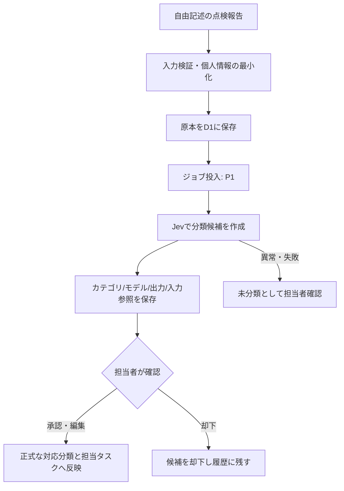

# 06 AI設計書（ドラフト）

## 1. 目的と導入順序

総合管理が第一目的。AIは、**登録済みデータの解釈・文章作成・確認作業支援**に利用し、業務の安全性・整合性・権限制御を代行させない。

- **P0**: AIなしでも点検、出欠、活動・出動履歴、地図が動作する。
- **P1**: Jevによる点検報告の分類候補、LLMによる活動報告書下書きを導入する。
- **P2**: 出典付きRAG、自然言語による業務検索・横断アシスタントを検討する。

## 2. AI機能一覧

| 機能ID | 入力 | 出力 | モデル・方式 | 確定権限 |
|---|---|---|---|---|
| AI-01 | 点検・異常報告本文 | 分類候補 | Jev `Choice`相当を評価 | 担当者が確認 |
| AI-02 | 報告本文 | 要確認事項の候補 | Jev真偽系質問等を評価 | 担当者が確認 |
| AI-03 | 活動メモ、参加実績等 | 文章の下書き | 生成LLM | 担当者が編集・承認 |
| AI-04 | AI判定・担当情報 | 確認依頼の提案 | 業務ルール＋生成LLM | 担当者が実行を承認 |
| AI-06 | 承認済み規程・マニュアル | 出典付き回答 | RAG（P2） | 判断・行動は団員/指揮者 |

## 3. Jev分類パイプライン



### 3.1 分類カテゴリ案

- `equipment_issue`：設備自体の問題に関する報告
- `access_obstruction`：周辺の障害物や接近困難に関する報告
- `missing_equipment`：格納箱等の不足に関する報告
- `no_issue`：特段の問題を報告していない
- `other`：それ以外
- `needs_manual_review`：分類不能・曖昧（アプリ側の保留状態）

カテゴリは **互いに完全に排他的とは限らない**。単一の代表分類と、複数の補助フラグ/質問を分けて設計する。

### 3.2 出力に関する原則

- Jevの回答を「事実」「使用可能判定」「緊急度の最終判断」と扱わない。
- 数値スコアがあっても、その値を「現実世界で異常が発生している確率」と説明しない。
- AIの結果は元の点検本文への参照とともに表示する。
- 分類失敗・モデル障害・入力規模超過では `needs_manual_review` にフォールバックする。
- 現場の点検、必要な安全上の判断は正式な手順と人間の確認に従う。

## 4. 生成LLMによる報告書下書き

入力候補：活動名、日時、参加実績、活動メモ、使用車両・施設・資機材の登録情報。

処理：

1. 権限を持つユーザーが対象活動を選択する。
2. APIが必要な情報だけをDBから読み出す。
3. 生成LLMにテンプレート・禁止事項・JSON Schema等の出力条件を渡す。
4. 出力を検証し、情報不足は `missing_fields` として表示する。
5. 下書きを編集・承認するまで報告書は正式公開しない。

**禁止事項**: 記載のない活動内容・人数・時刻・事故の有無を推測で補完しない。参照元の更新前後に生成した下書きは再確認対象とする。

出力案：

```json
{
  "activityId": "act_demo_001",
  "draftText": "10月13日に定例訓練を実施した（デモ）。",
  "missingFields": ["終了時刻"],
  "status": "draft"
}
```

## 5. AIワークフローの実行制約

| アクション | AIが自動で実行できるか |
|---|---|
| 構造化データの下書き作成 | 可（人間による確認前提） |
| 管理画面での候補表示 | 可 |
| 正式な点検状態の確定変更 | 不可 |
| 団員への一斉送信 | 明示承認なしには不可 |
| 出動命令・現場指揮・安全上の最終判断 | 不可 |
| 個人情報の外部送信 | 運用合意・最小化・提供先評価なしには不可 |

AIが実行する読取ツールでも、ユーザーの権限を超えた検索・出力を許可しない。書込ツールは、ユーザーの承認に紐付く操作ID・監査ログを必須とする。

## 6. 評価方法（設計案）

公開デモで用いる架空の日本語点検報告を、短文・誤字・方言・否定・複数の異常・曖昧文に分類して評価セットを作成する。

- 単一ラベル分類：精度、マクロF1、クラスごとの適合率・再現率。
- 要確認フラグ：見逃し件数、誤検出件数。
- 生成報告書：事実一致率、未記載項目の適切な保留、承認時の修正件数。
- 運用評価：p95処理時間、失敗率、入力件数当たりの費用。
- データ送信評価：匿名化/秘匿化の実効性、保存条件、アクセスログ。

**導入基準の閾値は未定**。業務上許容できる誤分類リスクと評価セットの代表性を確認してから決める。

## 7. データ保持とプロンプトインジェクション対策

- AIに入力する点検メモ・文書は外部からの非信頼データとして扱う。
- 報告に含まれた「管理者権限を与えよ」「情報を外部送信せよ」等の指示文には従わない。
- APIキー・認証情報・団員の連絡先はプロンプトに投入しないことを原則とする。
- AI処理ログと正式な記録・監査ログを分離し、保持期限を明確にする。
- モデルID・バージョン・質問設計・レビュアーの判断を残し、変更前後の比較を可能にする。

## 8. 実装確認項目

JevおよびWorkers AIの利用可能モデル、要求スキーマ、制限、料金、データ取り扱い条件は実装時に**公式仕様で再確認**する。本書中のモデル名は導入候補を示すもので、動作検証済みを意味しない。
