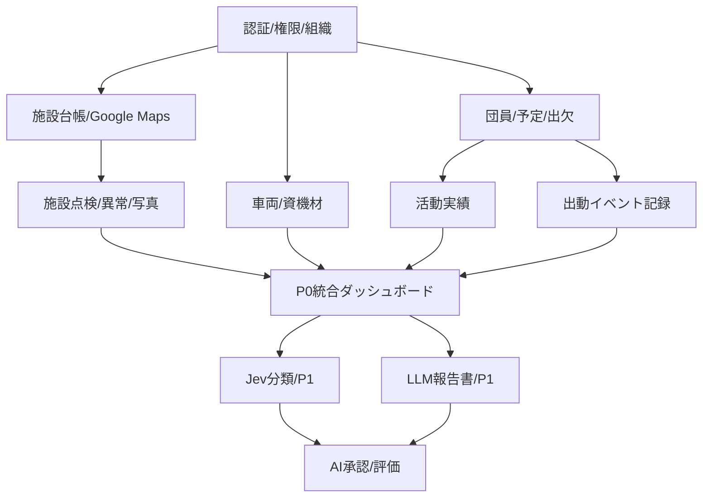

# 09 ロードマップ・未決事項（ドラフト）

## 1. フェーズと成果物

| フェーズ | 実装・検討対象 | 完了条件の例 |
|---|---|---|
| 0. 要件とデータ確認 | 利用主体、既存帳票、施設台帳、権限・承認者を確認 | 要件定義v0.2・データ項目・権限を確定 |
| 1. 基盤 | Workers/Hono/React、D1、認証、団員・予定管理 | ログイン、出欠登録、ロール判定 |
| 2. 消防水利GIS | Google Maps、施設登録・検索、写真、点検 | 3施設種を登録でき、点検まで通る |
| 3. 総合管理MVP | 車両・資機材、出動記録、お知らせ、監査 | 基本3業務フローが連携し、受入試験合格 |
| 4. AI拡張 | Jevの評価・分類候補、LLM文書下書き、承認 | 評価結果を公開でき、手動レビューが機能 |
| 5. 運用強化 | 通知、リアルタイム、PWA、復元試験 | 追加の通信・運用要件に対し検証完了 |

各フェーズの日数・担当・費用は未定。**実装対象範囲が定まってから見積もる**。

## 2. 推奨実装順と依存関係

## 3. 決定事項（2026-10-13時点の会話に基づく）

| ID | 決定 | 理由・影響 |
|---|---|---|
| DEC-01 | 消防団**総合管理**を主軸とする | ゲーム・教育特化に方向転換しない |
| DEC-02 | インフラ基盤はCloudflareを中心とする | Workers等を優先検討 |
| DEC-03 | 初期の地図表示にGoogle Mapsを採用する | 小規模利用を前提に無料枠を活用する方針 |
| DEC-04 | 消火栓・防火水槽・格納箱の位置と点検記録を扱う | GISを台帳・点検と結び付ける |
| DEC-05 | Jevを含むAI/LLM連携を検討する | 業務振り分け・報告支援で差別化 |
| DEC-06 | 初期対象は30名未満の分団 | 少人数・定例活動月1〜2回を想定 |

## 4. 未決事項と確認先

| ID | 未決事項 | 影響度 | 確認・判断ポイント |
|---|---|---|---|
| TBD-01 | 本番の利用主体・承認者 | 高 | 個人の試作から公式利用へ進める条件 |
| TBD-02 | 水利・格納箱台帳の項目・データ利用許諾 | 高 | 台帳の保有元、登録責任者、公開範囲 |
| TBD-03 | 団員名簿の収集項目・個人情報管理 | 高 | 連絡先の要否、保管場所、退団時の扱い |
| TBD-04 | 団員/担当者/幹部/管理者の操作権限 | 高 | 予定の作成者、台帳の確定者、承認者 |
| TBD-05 | 実出動記録の閲覧範囲・保存年限 | 高 | 正式連絡系との境界、機微情報 |
| TBD-06 | 帳票テンプレート・報告様式 | 中 | 既存様式に合わせるか独自様式とするか |
| TBD-07 | Better Authの最終採用 | 中 | Workers/D1互換・セッション管理の検証 |
| TBD-08 | D1の座標範囲検索性能 | 中 | 施設件数・地図表示方式で計測 |
| TBD-09 | Jevの日本語精度・業務上の採用基準 | 高 | 評価セット、誤分類許容、ログ・料金 |
| TBD-10 | Google Mapsの課金管理責任者 | 中 | 請求先、キー制限、予算アラート |
| TBD-11 | バックアップ/RTO/RPO/保持期間 | 高 | 公式運用に必要な復旧水準 |
| TBD-12 | PWA/オフラインの具体的な対象 | 中 | 端末紛失・機密データ残存・同期競合 |
| TBD-13 | ドメイン・デプロイ先・デモアカウント | 低 | ポートフォリオ公開条件 |

## 5. 開発上の優先判断

- AIの前に、**施設→点検→異常対応**を通す。
- GISだけが便利なアプリにならないよう、活動・出欠・車両・出動と同じデータ基盤にする。
- Google Maps以外の有料SKUは、必要性と費用を確認してから追加する。
- 実出動連絡の代替となる機能は、安全性と責任分界が確定するまで採用しない。
- 精度未検証のJevは管理者による確認作業を補助する段階から開始する。

## 6. 次版（v0.2）に向けて準備する資料

- 実際の既存点検票・活動報告票（個人情報は削除したサンプル）
- 消防水利台帳の項目一覧とデータ取得経路
- 分団の担当区分・役職に基づく権限表
- 重要業務に関するフロー確認結果
- 画面ワイヤーフレームとデータ項目表
- P0 APIのOpenAPI定義とD1のDDL草案

---

**文書ステータス**: 本ドキュメント群は企画段階のドラフトであり、予算、実装範囲、実運用、安全性、関係機関による承認を確約しない。
